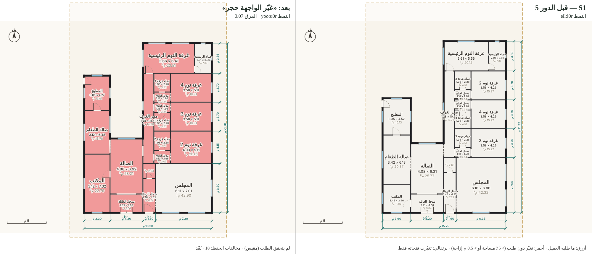
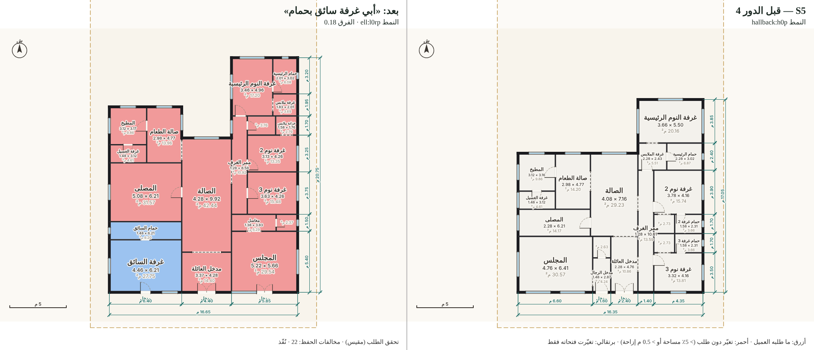
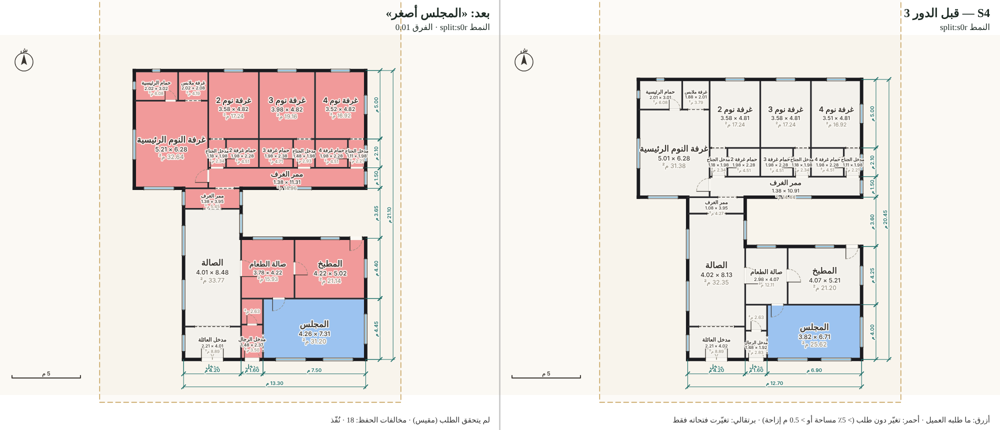
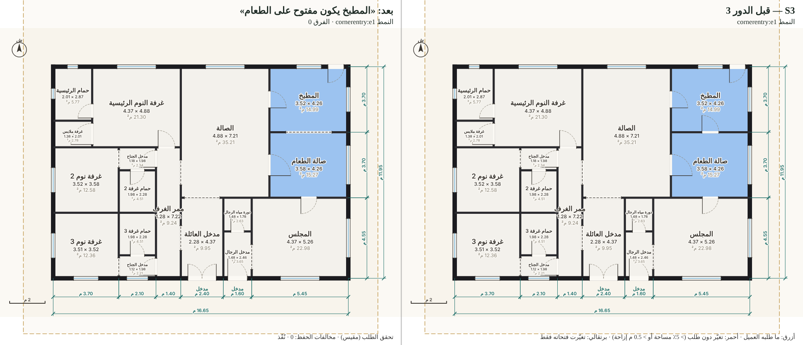

# إثبات الحوار — المرحلة r4: فهم الطلبات العربية الطويلة والتعديلات المتتابعة والحفاظ على ما لم يُطلب

> شرط المالك (نصًّا): «لا تكتفِ باختبارات الكود؛ اختبر فهم الطلبات العربية الطويلة والتعديلات المتتابعة، مع إثبات عدم تغيير أجزاء لم يطلب العميل تعديلها.»

التاريخ: 2026-10-20 · الفرع: `dev/dialog-proof` (من `dev/architect-v2` عند `de87f42`) · المولّد: ما يستعمله `dist/` افتراضيًا (المولّد الثاني `villa-layout-v2`) · لم يُعدَّل المولّد ولا `rules.mjs`.

## الخلاصة والحكم

| البند | النتيجة (r4، الشيفرة كما هي) | بعد إصلاح المحلل (r4b) |
|---|---|---|
| فهم 12 طلبًا طويلًا (150–204 كلمة) — متوسط F1 | **0.76** (دقة 0.81، استدعاء 0.73) | **0.81** (دقة 0.87، استدعاء 0.77) |
| بنود فاتت / أضيفت خطأً (من 12 طلبًا) | 67 / 39 | 58 / 26 |
| درجات القواعد (لازم/يفضل/ممنوع) فيما طابق | 100٪ | 100٪ |
| أدوار تعديل نُفّذ طلبها مقيسًا من المخطط | 17 من 30، **منها 6 كانت متحققة قبل التعديل أصلًا** | 17 من 30 |
| أدوار فيها تغيير لم يطلبه العميل (> 5٪ مساحة أو > 0.5 م) | **11 من 30، بمجموع 205 مخالفة** (كل دور منها 13–22 غرفة) | 11 من 30، 211 مخالفة |
| أدوار غيّرت المخطط وحقّقت الطلب **دون أي مخالفة** | **1 فقط** (S3 د3: فتح المطبخ على الطعام) | 1 |
| رد «لم أفهم» | 6 من 30 (منها رد واحد صحيح: «غرفة البنت») | 6، وسؤال واحد |

**الحكم الصادق:** الفهم المحلي للطلب الطويل **متوسط** (يفهم القواعد المكانية ودرجاتها جيدًا، ويخطئ في الأعداد والتصحيحات والصيغ الفصيحة والإنجليزية). **أما التعديل المتتابع فلا يحقق شرط المالك:** كل تعديل يغيّر شكل المخطط يعيد توزيع البيت كله تقريبًا — ومنها طلب «الواجهة حجر» الذي لا يمس المخطط، وحُذفت فيه غرف ومداخل لم يطلب العميل حذفها (غرفة الملابس، غرفة الغسيل التي طلبها العميل نفسه، **مدخل الرجال المستقل**). التعديلات التي «حفظت» كل شيء هي في الغالب تعديلات لم تغيّر شيئًا (لأنها لم تُفهم، أو كانت متحققة أصلًا، أو فُهمت ولم تُنفَّذ بصمت). لا تُعدّ هذه المرحلة نجاحًا للحوار.

## المنهج

- **المدوّنة** `scripts/dialog-cases.mjs`:
  - 12 طلبًا طويلًا بلهجات نجدية وحجازية وقصيمية وشرقية وفصحى رسمية وخليط إنجليزي، فيها: تصحيح في منتصف الكلام («لا لا خلها أربع»)، تراجع («لا ترى غيرت رأيي، خليه مقفل»)، نفي، أرقام هندية وفاصلة عشرية عربية، كلام متعارض لم يُحسم، وصف للبيت القديم بصيغة الماضي، وأشياء يرفضها العميل.
  - لكل طلب «فهم متوقع» مكتوب يدويًا (أعداد، تفضيلات، إضافات، نفي، مقاسات، قواعد بدرجاتها، أدوار، واجهة، غير مدعوم، تعارضات يجب أن تُسأل، عبارات يجب أن يُقال للعميل إنها لم تُفهم)، مع بنود «اختيارية» حين يكون للكلام تفسيران مقبولان، و«فخاخ» موصوفة. **تنبيه:** الفهم المتوقع كتبه Claude لا معماري بشري؛ يحتاج مراجعة بشرية كما يطلب المالك.
  - 6 جلسات تعديل (4–6 أدوار، 30 دورًا) منها مثال المالك حرفيًا. لكل دور: «النطاق» (الغرف التي يحق لها أن تتغير) و«الفحوص» المقيسة.
- **الأداة** `scripts/dialog-run.mjs <stage>`:
  - الطلب الطويل يمر كما في الموقع: `interpretFree` (أعداد النموذج) ثم `extractRequirements` ثم `detectConflicts` و`coverage`. يُقارن كل بند ذرّي بالمتوقع ← دقة/استدعاء لكل حقل، والفائت والمضاف خطأً، والعبارات «المُسقطة» (dropped).
  - كل دور تعديل يمر عبر `createSession`/`redesign`. **إثبات الحفظ** لكل غرفة خارج النطاق: نفس الاسم (والمعرّف)، فرق المساحة ٪، إزاحة المركز م، تغيّر عدد الأبواب والنوافذ؛ والنمط قبل/بعد، و`difference()` العام، والغلاف. المخالفة: مساحة > 5٪ أو إزاحة > 0.5 م أو غرفة حُذفت/أضيفت.
  - **تحقق الطلب يُقاس من المستند** (جهة، تجاور، بُعد، مقاس، تكبير/تصغير، رجوع لموضع سابق، وجود/غياب، عدد، فتحة مفتوحة/باب، مدخل خارجي، حقل الواجهة في المستند)، ويُحفظ سجل النظام (ledger) بجانبه للمقارنة. ويُفحص كل شرط على المخطط **قبل** التعديل أيضًا: النجاح الذي كان قائمًا قبل التعديل يُعلَّم «تافهًا».
  - صورة قبل/بعد لكل دور (`turn-N.png`؛ «قبل» يمينًا و«بعد» يسارًا، المقياس نفسه): **أزرق** ما طلبه العميل، **أحمر** تغيّر دون طلب، **برتقالي** تغيّرت فتحاته فقط.
- التشغيل: `node scripts/dialog-run.mjs r4` (≈ 3 دقائق). الأدلة: `evidence/dialog/r4/` (والمرحلة بعد الإصلاح `evidence/dialog/r4b/`).

## أولًا: فهم الطلبات الطويلة (r4)

الأرقام في الخلايا: المطابق/المتوقع، و(+ن) بنود أضيفت خطأً.

| الحالة | كلمات | F1 | الدقة | الاستدعاء | الأعداد | التفضيلات | الإضافات | النفي | المقاسات | القواعد | الواجهة | غير المدعوم | التعارضات | «لم أفهم» |
|---|---|---|---|---|---|---|---|---|---|---|---|---|---|---|
| L1 الرياض، تصحيح العدد | 160 | 0.81 | 0.86 | 0.76 | 2/4 (+2) | 3/5 (+1) | 4/4 | 2/2 | 0/1 | 5/6 | — | 1/1 | — | 1/1 |
| L2 جدة، دوران، تراجع | 160 | 0.62 | 0.67 | 0.58 | 2/4 (+2) | 3/4 (+2) | 2/2 (+1) | 0/1 | — | 3/8 | 1/2 | 2/2 (+1) | (+1) | — |
| L3 فصحى، زاوية | 175 | 0.65 | 0.74 | 0.58 | 2/4 (+2) | 2/6 (+1) | 4/4 | 1/1 | 1/2 | 1/3 | 1/2 | (+1) | (+1) | 1/1 |
| L4 محتار ومتعارض | 166 | **0.97** | 0.95 | 1.00 | 3/3 | 4/4 (+1) | — | — | — | 7/7 | — | — | **2/2** | 2/2 |
| L5 ضيقة اقتصادية | 158 | 0.71 | 0.67 | 0.75 | 3/4 (+1) | 3/3 | 1/1 (+2) | 0/2 (+1) | 0/1 | 2/2 | 1/1 | — | (+2) | 2/2 |
| L6 عائلة ممتدة | 164 | 0.91 | 0.95 | 0.88 | 3/4 (+1) | 5/5 | 5/5 | — | — | 6/7 | — | 1/1 | — | 0/1 |
| L7 خليط إنجليزي | 162 | **0.47** | 0.70 | 0.35 | 1/4 (+2) | 1/4 | 0/3 | 1/1 | — | 3/3 | 0/3 | 0/1 | (+1) | 1/1 |
| L8 طلبات مستحيلة | 157 | 0.76 | 0.85 | 0.69 | 1/4 (+1) | 1/1 | — | — | 2/3 | 4/4 (+1) | — | — | 2/3 | — |
| L9 قصة طويلة وماضٍ | 204 | 0.73 | 0.86 | 0.63 | 2/4 (+1) | 2/3 | 3/3 | — | — | 4/7 (+1) | 0/1 | 1/1 | — | — |
| L10 نفي كثيف | 154 | 0.79 | 0.77 | 0.81 | 2/4 (+1) | 3/4 (+1) | 3/3 | 4/4 (+1) | — | 4/4 | 0/1 (+1) | — | (+1) | — |
| L11 درجات الإلزام | 151 | 0.92 | 0.92 | 0.92 | 3/4 (+1) | — | 1/1 | — | — | **7/7** | — | — | — | — |
| L12 مقاسات بصيغ مختلفة | 156 | 0.77 | 0.80 | 0.75 | 3/4 (+1) | 0/1 (+1) | 2/2 | — | 4/6 (+1) | 2/2 | — | — | — | — |
| **المتوسط** | | **0.76** | 0.81 | 0.73 | | | | | | | | | | |

درجة كل قاعدة طابقت (لازم/يفضل/ممنوع/لو أمكن/ياليت) صحيحة في كل الحالات، ومنها L11 بقواعدها السبع.

### كل ما فات وكل ما أضيف خطأً، بسببه

**الأعداد (أضعف حقل: 24 من 48):**
- L1: العميل كتب «خمس غرف… لا لا خلها أربع». `interpretFree` (local-nlp) **جمع العددين = 9 غرف نوم**، والمحلل رأى عددين فاعتمد عدد النموذج (9). عبارتا العدد تظهران في التغطية «مُسقطتين». **التصحيح في منتصف الكلام غير مفهوم.**
- `interpretFree` يعدّ كل ذكر للمجلس مجلسًا (L3، L6، L7: 3 مجالس)، ويعدّ «مطبخين» من ذكر المطبخ مرتين (L2، L7)، فينشأ سؤال «count-mismatch» زائف في L2 وL3 وL5 وL7.
- «غرفة نوم رئيسية… وثلاث غرف نوم أخرى» = 3 لا 4 (L3)، «ثلاث غرف نوم غير الماستر» = 3 (L8)، «ثلاث غرف… وغرفة رابعة للوالدة» = 3 (L9)، «غرف النوم الثانية عددها ثلاث» = 1 (L12)، «خمس غرف فوق + غرفة لأمي تحت» = 5 لا 6 (L2).
- **`interpretFree` يرمي خطأً ويوقف الطلب كله في الموقع** في L8 («راجع مساحة مجلس؛ المساحة المقبولة بين 4 و120 م²» لمجلس 12×16) وفي L10 («راجع مساحة حمام» — قرأ «حمام مشترك… الأرض ١٨×٢٨» مساحةَ حمام). العميل في الموقع يرى هذا الخطأ فقط ولا يُكمل. (الأداة سجّلته في `interpretError` وأكملت القياس بلا أعداد النموذج.)

**التصحيح والتراجع:** L2 «open kitchen… لا ترى غيرت رأيي، خليه مقفل» ← فُهم **مطبخ مفتوح** (العكس).

**الرفض يُقرأ طلبًا (فخاخ وقع فيها المحلل):**
- L2 «ما نبغى خدامة ساكنة» ← أُضيفت غرفة خادمة. «ما أبغى مسبح» ← «المسبح غير مدعوم» (كأنه طُلب).
- L5 «ما فيه داعي لغرفة خادمة ولا سواق» ← أُضيفت غرفة خادمة وغرفة سائق. «ما نحتاج مجلس نساء» ← **«بدون مجلس» = صفر مجالس** (ألغى مجلس الرجال المطلوب) مع سؤال تعارض زائف.
- L10 «ما أبي مجلس نساء» ← صفر مجالس أيضًا. «ما أبي الواجهة زجاج… أبيها حجر» ← واجهة **زجاج**.
- L1 وL10 وL12: «مو لازم كل غرفة بحمام» / «ما أبي كل غرفة بحمام» / «ما يحتاج حمام لكل غرفة» ← **حمام لكل غرفة** (العكس).

**الماضي والحشو يُقرآن طلبًا:** L9 «المطبخ كان صغير وفي نص البيت» (وصف البيت القديم) ← قاعدة «المطبخ في الوسط». L4 «أمي تطبخ للعزايم» ← غرفة لكبار السن. L3 «مخزن ملحق به» ← «الملحق الخارجي غير مدعوم». L8 «ما أبي درج ولا دور ثاني» ← قاعدة «الدرج في الدور العلوي».

**صيغ لم تُفهم:**
- الفصحى بالتنوين: «المطبخ مفتوحًا على الصالة» ← مطبخ مفتوح على الطعام بدل الصالة؛ «مجلسًا للرجال على الشارع الجنوبي» ← لم تُستخرج القاعدة؛ «غرفة نوم رئيسية مقاسها ٥ × ٦» (بلا «ال») ← لم يُستخرج المقاس (L3).
- «الدور الأرضي يكون فيه المجلس والمقلط والمطبخ» (الفاعل بعد عبارة الدور) ← لم تُستخرج قواعد الأدوار الخمس (L2).
- المدخل المستقل بعيدًا عن كلمة المجلس: «مجلس رجال كبير مقاسه تقريبًا ٥×٧، يكون على الشارع وله مدخل مستقل» ← فاتت القاعدة والمقاس والمدخل (L1)، ومثله L3 وL7 وL9.
- مقاس مجلس 12×16 (192 م²) **يُسقط بصمت** لأنه فوق سقف 150 م²، فلا يُحسب تعارض «المساحات أكبر من الأرض» (L8) — كان يجب أن يُسأل لا أن يُسقط.
- «٥٫٥» بالفاصلة العشرية العربية ← 5 (L12). «كل وحدة ٤×٤» لغرف النوم ← لم يُفهم.
- L7 (نصفه إنجليزي): لم يُفهم home office، Laundry room، walk-in closet، Garage، separate entrance، living room big، ولا مادتا الواجهة glass and wood. (كلها ظهرت للعميل في «لم أفهم» — صادق، لكن الاستدعاء 0.35.)
- الواجهة تأخذ مادة واحدة فقط (L7 «glass and wood»).
- L9: «المطبخ… يكون في الخلف بعيد عن المجلس» و«البنات يبون غرفهم جنب بعض» لم تُستخرجا؛ «واجهتنا نفسه حجر» لم تُفهم.

**«لم أفهم» كثيرة ومزعجة:** كل طلب أعاد للعميل 7–27 عبارة «لم أفهمها»، منها أبعاد الأرض والتحية وعدد أفراد الأسرة («الشارع جنوبي»، «Thanks a lot»). الصدق محفوظ (لا شيء يسقط بصمت إلا ما في «مُسقطة»)، لكن القائمة طويلة على العميل.

**ما نجح:** التعارضات الحقيقية سُئلت (L4: المطبخ أمام وخلف، المجلس جنب المطبخ وبعيد عنه؛ L8: دور واحد مع ماستر فوق، ملاصق وبعيد معًا). القواعد المكانية ودرجاتها ممتازة حين يكون الفاعل قبل العبارة. غير المدعوم (كراج، مصعد، شرفة، فناء) يُعلَن بصدق.

## ثانيًا: التعديلات المتتابعة وإثبات الحفظ (r4)

«تحقق» = مقيس من المستند. «تافه» = كان متحققًا قبل التعديل. المخالفات = غرف خارج النطاق تغيّرت (بين قوسين: غرف رئيسية — نوم/مجلس/صالة/طعام/مطبخ/مكتب/خدمة).

| الدور | نص العميل | رد النظام | تحقق؟ | مخالفات | أبرز ما تغيّر دون طلب | الصورة |
|---|---|---|---|---|---|---|
| S1 د1 | انقل المطبخ ورا جنب الطعام | نُفّذ، النمط تغيّر | نعم | 19 (7) | البيت كله أُعيد توزيعه: الماستر انتقلت 10.2 م، المكتب +34٪، غرف النوم 9–10 م | `S1/turn-1.png` |
| S1 د2 | كبّر المجلس ٦×٧ | نُفّذ | نعم (6.16×6.86) | 20 (8) | الطعام +73٪، الصالة −26٪، المكتب −19٪، **حُذفت غرفة الملابس** | `S1/turn-2.png` |
| S1 د3 | رجّع المطبخ مثل أول | لم أفهم | لا | 0 | — (لا تراجع ولا «مثل أول») | `S1/turn-3.png` |
| S1 د4 | احذف المكتب | «فهمت: مكتب» | **لا — المكتب باقٍ** | 0 | الحذف قُرئ إضافة | `S1/turn-4.png` |
| S1 د5 | غيّر الواجهة حجر | نُفّذ، النمط تغيّر | لا (الواجهة ليست في المستند) | **18 (8)** | طلب واجهة فقط أعاد رسم البيت: المكتب +93٪، غرفة نوم 2 +35٪ و7.9 م | `S1/turn-5.png` |
| S1 د6 | خل كل شي مثل ما هو بس كبّر غرفة البنت | لم أفهم | نعم (لا تغيير، طُلب التوضيح) | 0 | — | `S1/turn-6.png` |
| S2 د1 | أبي غرفة الخادمة جنب المطبخ | نُفّذ | نعم — **تافه** | 0 | — | `S2/turn-1.png` |
| S2 د2 | خل الماستر بعيدة عن المجلس | نُفّذ | نعم — **تافه** | 0 | — | `S2/turn-2.png` |
| S2 د3 | زيد غرفة نوم وحدة | لم أفهم | لا | 0 | — | `S2/turn-3.png` |
| S2 د4 | لا خلاص رجعها أربع غرف | نُفّذ | نعم — **تافه** (لم تُزد أصلًا) | 0 | — | `S2/turn-4.png` |
| S2 د5 | الصالة أكبر شوي | «فهمت: الصالة أكبر» | **لا — لم يتغير شيء، ولا إخفاق في الرد** | 0 | فُهم ولم يُنفَّذ بصمت | `S2/turn-5.png` |
| S3 د1 | احتفظ بهذا التوزيع وغيّر الواجهة إلى حجر | نُفّذ (المخطط نفسه حرفيًا) | جزئي: المخطط محفوظ، والواجهة ليست في المستند («لاحقًا») | 0 | — | `S3/turn-1.png` |
| S3 د2 | خل الواجهة نجدي | نُفّذ | جزئي (كما سبق) | 0 | — | `S3/turn-2.png` |
| S3 د3 | المطبخ يكون مفتوح على الطعام | نُفّذ | **نعم، دون أي مخالفة** (باب ← فتحة مفتوحة فقط) | 0 | — | `S3/turn-3.png` |
| S3 د4 | لا لا رجّعه مقفل | لم أفهم | لا | 0 | — | `S3/turn-4.png` |
| S4 د1 | غرفة النوم الرئيسية ٥×٦ | نُفّذ | نعم (4.92×6.28) | 18 (7) | **المطبخ +87٪**، الطعام +47٪، المجلس +34٪، غرف النوم +16٪ | `S4/turn-1.png` |
| S4 د2 | المطبخ ٤×٥ | نُفّذ، النمط تغيّر | نعم | 13 (5) | الطعام −44٪ و7.8 م، المجلس −22٪، **حُذفت غرفة الغسيل** التي طلبها العميل في طلبه الأول | `S4/turn-2.png` |
| S4 د3 | المجلس أصغر | نُفّذ | **لا — المجلس كبُر 22٪** | 18 (6) | الطعام +32٪، غرفة نوم 3 +11٪ | `S4/turn-3.png` |
| S4 د4 | خل كل شي زي ما هو بس الصالة أوسع | نُفّذ | لا (الصالة +3٪ فقط) | **20 (7)** | «خل كل شي» ثم: الطعام −27٪، المجلس −21٪، غرفة نوم 3 −12٪ | `S4/turn-4.png` |
| S4 د5 | ودي غرفة نوم ٢ تكون ٤×٥ والباقي لا تلمسها | لم أفهم | لا | 0 | استهداف غرفة بعينها غير مدعوم | `S4/turn-5.png` |
| S5 د1 | أبي غرفة غسيل | نُفّذ، النمط تغيّر | نعم | 19 (7) | المجلس +53٪ و10.5 م، الصالة −38٪، الماستر −24٪ و8.3 م | `S5/turn-1.png` |
| S5 د2 | أضف مصلى قريب من المجلس | نُفّذ | نعم | 16 (6) | الصالة +34٪، الماستر +24٪ | `S5/turn-2.png` |
| S5 د3 | شيل المصلى | «فهمت: مصلى» | **لا — المصلى باقٍ** | 0 | الحذف قُرئ إضافة | `S5/turn-3.png` |
| S5 د4 | أبي غرفة سائق بحمام | نُفّذ، النمط تغيّر | نعم | **22 (7)** | **حُذف مدخل الرجال**، وحُذف حماما غرفتي 2 و3 (حمام مشترك بدلهما)، المصلى 14←31.6 م²، الصالة +45٪ | `S5/turn-4.png` |
| S5 د5 | خل المجلس على يمين الداخل | نُفّذ | نعم — **تافه** | 0 | — | `S5/turn-5.png` |
| S6 د1 | المطبخ في الخلف | نُفّذ | نعم — **تافه** | 0 | — | `S6/turn-1.png` |
| S6 د2 | الماستر في جهة الشمال | نُفّذ | نعم — **تافه** | 0 | — | `S6/turn-2.png` |
| S6 د3 | رجّع الماستر مكانها الأول | نُفّذ | نعم (لأنها لم تتحرك أصلًا) | 0 | — | `S6/turn-3.png` |
| S6 د4 | كبّر غرفة نوم ٢ لتصير ٤×٥ | لم أفهم | لا | 0 | — | `S6/turn-4.png` |
| S6 د5 | مجلس النساء أبيه بمدخل مستقل من برا | نُفّذ، النمط تغيّر | نعم | **22 (9)** | **حُذف مدخل الرجال** وغرفة الغسيل، الخادمة +55٪ و10.3 م، المطبخ +34٪، الغلاف 15.4×21 ← 18.9×16.6 م | `S6/turn-5.png` |

(المسارات نسبةً إلى `evidence/dialog/r4/sessions/`. تفاصيل كل غرفة — المعرّف قبل/بعد، المساحة، الإزاحة، الأبواب والنوافذ — في `turn-N.json`، والمستندات في `doc-N.json`.)









نظرتُ في صور الأدوار المخالفة كلها: الأحمر في الصور يطابق الأرقام — ليست إزاحات قياس صغيرة على حدود الجدران، بل غرف تتبدّل مواضعها ومقاساتها بالأمتار، والغلاف الخارجي نفسه يتغير (مثلًا S4 د1: 15.3×17.05 ← 16.2×20.35 م).

### أسباب الإخفاق في التعديلات

1. **كل تعديل يغيّر الهندسة = إعادة حل للبيت كله** (`villa-layout-v2.mjs`، مسار `prefer.local`/`localEdit` ثم التوليد الشامل): الأبعاد تُعاد حسابها لكل الغرف ولا قيد «ثبّت ما لم يُطلب». حتى حين يبقى النمط نفسه (S1 د2، S4 د1، S4 د3، S4 د4) تتغير 13–20 غرفة. لا يوجد في الشيفرة مفهوم «نطاق التعديل».
2. **الواجهة وحدها تعيد التوليد** إن لم يكتب العميل «احتفظ بالتوزيع» (`design-session.mjs`: `reuse` يتطلب `keepLayout`). S1 د5 مقابل S3 د1 يثبتان ذلك. والواجهة نفسها لا تُكتب في المستند (حالتها في السجل «pending-render»).
3. **«الطلب متحقق أصلًا فلم يُغيَّر شيء»** (`villa-layout-v2.mjs` نحو السطر 1739–1748): إذا نجحت كل بنود سجل `verifyRequest` على المخطط المعروض يُعاد كما هو. لكن السجل لا يحوي «بدون مكتب» ولا معاملات «أكبر/أصغر» — فـ«الصالة أكبر شوي» (S2 د5) و«احذف المكتب» (حتى بعد إصلاح المحلل، r4b) تمر بلا تغيير **وبلا إخفاق معلَن في الرد**. هذا ادعاء صمت لا ادعاء كذب: الرد لا يقول «نُفّذ» لكنه لا يقول «لم يُنفَّذ» أيضًا.
4. **«أصغر» يُعطي أكبر** (S4 د3): معامل 0.8 على المجلس، والناتج +22٪ لأن إعادة الحل كبّرت الغلاف. لا تحقق لاحق من أن الاتجاه المطلوب تحقق.
5. **حذف غرف غير مطلوب** عند تغيير النمط: غرفة الملابس (S1 د2)، غرفة الغسيل المطلوبة صراحة (S4 د2، S6 د5)، **مدخل الرجال المستقل** (S5 د4، S6 د5 — أهم قاعدة عند المالك)، وحمامات الغرف (S5 د4).
6. **المحلل لا يعرف أفعال التعديل**: «رجّع… مثل أول/مكانها الأول» (لا ذاكرة لموضع سابق)، «زيد غرفة»، «لا لا رجّعه مقفل» (ضمير بلا فاعل)، «غرفة نوم ٢» (لا استهداف لغرفة بعينها)، «انقل… للخلف». الرد «لم أفهم» صادق ولا يغيّر شيئًا، لكنه يترك العميل بلا طريق لتعديل غرفة محددة.
7. **السجل مقابل المستند:** لم يدّعِ السجل «نُفّذ» لبند فشل قياسه على المستند في أي دور من r4 (0 ادعاء غير صحيح). ملاحظة: «المطبخ في الخلف» في S1 د1 مقبول بتعريف السجل نفسه (للمطبخ جدار خارجي نحو الشمال في مبنى على شكل L، ومركزه على 55٪ من العمق)، وقبلته الأداة بالتعريف نفسه مع تسجيل الأرقام.

## ثالثًا: إصلاحات المحلل (أخطاء واضحة فقط) — قبل/بعد

عُدّل `dist/requirements.mjs` وحده (لا المولّد ولا `rules.mjs` ولا `design-session.mjs`):

| الخطأ | مثال | قبل | بعد |
|---|---|---|---|
| الحذف/الرفض يُقرأ إضافة | «احذف المكتب»، «شيل المصلى»، «ما نبغى خدامة»، «ما فيه داعي لغرفة خادمة ولا سواق» | مكتب/مصلى/خادمة/سائق **مضاف** | «بدون …» ويُحذف من الإضافات |
| رفض مجلس النساء يلغي كل المجالس | «ما نحتاج مجلس نساء»، «ما أبي مجلس نساء» | مجالس = 0 + سؤال تعارض زائف | مجلس واحد |
| نفي «حمام لكل غرفة» يُقرأ إثباتًا | «مو لازم كل غرفة بحمام»، «ما يحتاج حمام لكل غرفة» | حمام لكل غرفة | حمامات مشتركة |
| الفاصلة العشرية العربية | «بعرض ٤ وطول ٥٫٥» | 4×5 | 4×5.5 |

| الحالة | F1 قبل ← بعد | الدقة | الاستدعاء | مضاف خطأً | فائت |
|---|---|---|---|---|---|
| L1 | 0.81 ← 0.85 | 0.86 ← 0.91 | 0.76 ← 0.80 | 3 ← 2 | 6 ← 5 |
| L2 | 0.62 ← 0.67 | 0.67 ← 0.71 | 0.58 ← 0.63 | 7 ← 6 | 10 ← 9 |
| L5 | 0.71 ← **0.94** | 0.67 ← 0.94 | 0.75 ← 0.94 | 6 ← 1 | 4 ← 1 |
| L10 | 0.79 ← **0.93** | 0.77 ← 0.95 | 0.81 ← 0.91 | 5 ← 1 | 4 ← 2 |
| L12 | 0.77 ← 0.90 | 0.80 ← 0.93 | 0.75 ← 0.88 | 3 ← 1 | 4 ← 2 |
| بقية الحالات | بلا تغيير | | | | |
| **المتوسط** | **0.760 ← 0.808** | 0.812 ← 0.868 | 0.725 ← 0.766 | 39 ← 26 | 67 ← 58 |

أثرها على الجلسات: S1 د4 «احذف المكتب» صار يُفهم «بدون مكتب» لكن **المكتب ما زال في المخطط** (السبب 3 أعلاه — في المولّد والسجل، خارج نطاق هذا الفرع). S5 د3 «شيل المصلى» صار سؤالًا: «قلت بدون «المصلى»، وبعدين حددت مكانه — تبيه ولا لا؟» لأن قاعدة «مصلى قريب من المجلس» من الدور السابق ما زالت في الطلب؛ الحذف اللاحق يجب أن يُلغي القاعدة السابقة لا أن يُعدّ تعارضًا. «التغطية المُسقطة» زادت من 4 إلى 5 لأن فحص التغطية يقرأ عبارة «ولا سواق» وحدها طلبًا — الطلب الكامل صحيح والإنذار زائف.

اختبارات الإصلاحات في `tests/dialog-proof.test.mjs`. واختبارات المتطلبات والقواعد والجلسة (`requirement*`، `ai-requirements`، `design-session`، `local-nlp-understanding`): 160 ناجحة.

## رابعًا: التكرار والاختبارات الكاملة

- **المولّد غير حتمي تحت الحمل:** في التوليد الشامل حدّ زمني (`villa-layout-v2.mjs` السطر 1771: يتوقف بعد 8 ث أو 14 ث). نفس الطلب في S5 أعطى مخططًا أوليًا بنمط `cornerentry:e1` في تشغيل و`cornerentry:e0` في آخر (`evidence/dialog/r4/sessions/S5/doc-0.json` مقابل `r4b`)، وأعطى S1 د5 18 مخالفة في تشغيل و5 في تشغيل تحت حمل (`evidence/dialog/nondeterminism/r4b-under-load-summary.json`). الجلسات S1–S4 وS6 تطابقت حرفيًا بين r4 وr4b. لذا الأرقام لكل دور قابلة للتغير بين الأجهزة، والنمط العام (إعادة توزيع شاملة عند كل تعديل) ثابت في كل التشغيلات.
- **الاختبارات الكاملة:** 1256 اختبارًا، 1252 ناجحة و4 راسبة: `stage2-r3` (بوابات الجودة)، `stage2-r4` (C1 وC6)، `villa-layout-v2` (C1 بالزمن 17 ث، خمسة بدائل). **هذه الأربعة ترسب أيضًا على `de87f42` بلا أي تعديل مني** (شُغّلت منفردة ومتتابعة: 5 راسبة بما فيها اختبار الأرض المضلعة). السبب المرجّح الحدّ الزمني أعلاه مع حمل الجهاز (متوسط الحمل 5.6 على نواتين أثناء التشغيل، بسبب وكيل آخر يعمل على المولّد بالتوازي). لم أستطع إثبات نجاح الحزمة كاملة على هذا الجهاز؛ اختبار الحوار الجديد ناجح (≈ 19 ث منفردًا).

## خامسًا: ما يلزم لتحقيق شرط المالك (توصيات، لم تُنفَّذ هنا)

1. **تعديل موضعي حقيقي:** أي تعديل يحمل «نطاقًا» (الغرف المذكورة)، ويُحل المخطط بقيد تثبيت أبعاد ومواضع ما خارج النطاق، ويُرفض الحل الذي يحرك غرفة خارج النطاق فوق الحدين (5٪، 0.5 م) أو يحذف غرفة أو مدخلًا — أو يُسأل العميل قبل ذلك بتسمية ما سيتغير.
2. الواجهة لا تمر بالمولّد أبدًا (تُكتب في المستند وحده).
3. بنود في السجل لـ«بدون X» و«أكبر/أصغر» حتى لا يُعتبر الطلب «متحققًا أصلًا»، وتحقق من اتجاه التغيير.
4. أفعال التعديل في المحلل: رجّع/مثل أول (من سجل الجلسة)، زيد/نقّص، «غرفة نوم 2» بالاسم، وإلغاء قاعدة سابقة عند الحذف اللاحق.
5. في `local-nlp`: التصحيح «لا لا خلها…» يستبدل العدد لا يُجمع، وعدّ المجالس من «مجلس رجال/نساء» لا من كل ذكر، ولا رمي يوقف الطلب كله بسبب مساحة غير منطقية (يُسأل العميل).
6. مراجعة بشرية للفهم المتوقع في المدوّنة، وتوسيعها بطلبات حقيقية من العملاء.

## إعادة التشغيل

```
node scripts/dialog-run.mjs r5            # كل الحالات والصور (≈ 3 دقائق)
node scripts/dialog-run.mjs r5 --only S1  # جلسة واحدة
node scripts/dialog-run.mjs r5 --no-png   # بلا صور
node --test tests/dialog-proof.test.mjs   # الاختبار السريع
```
