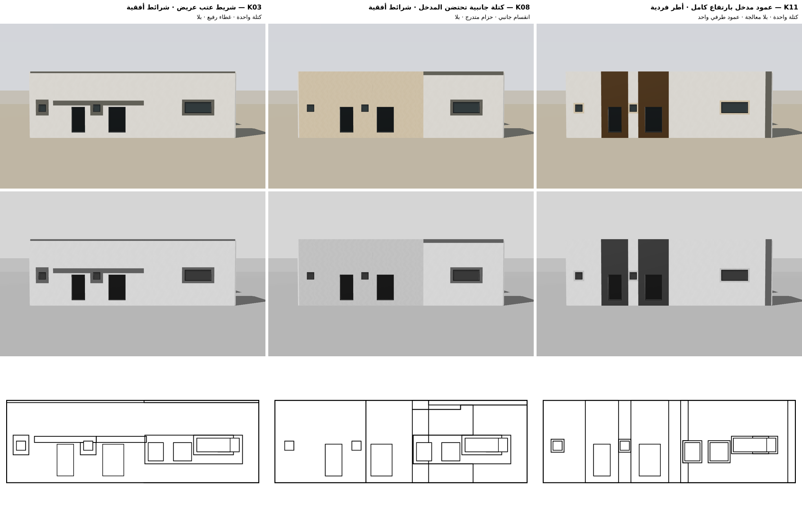
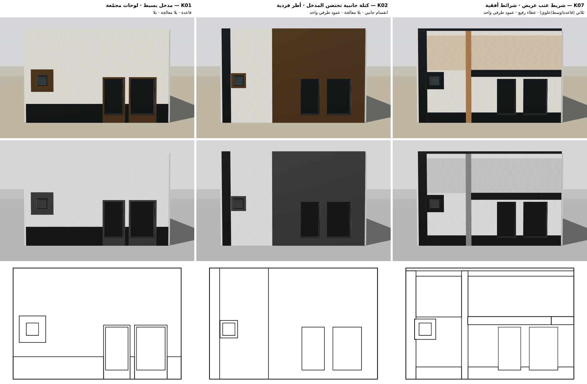
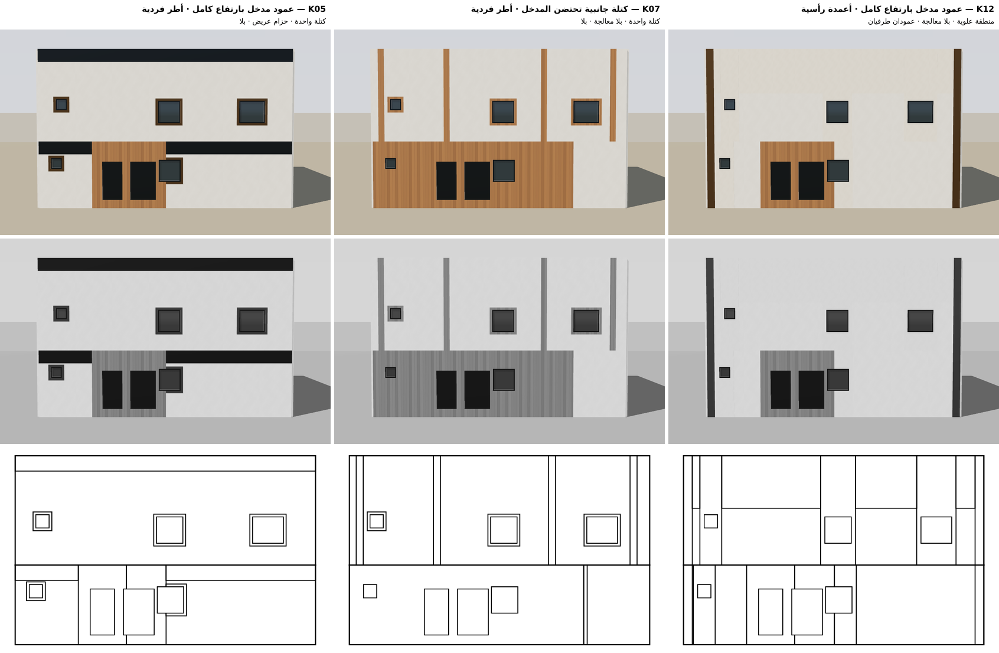
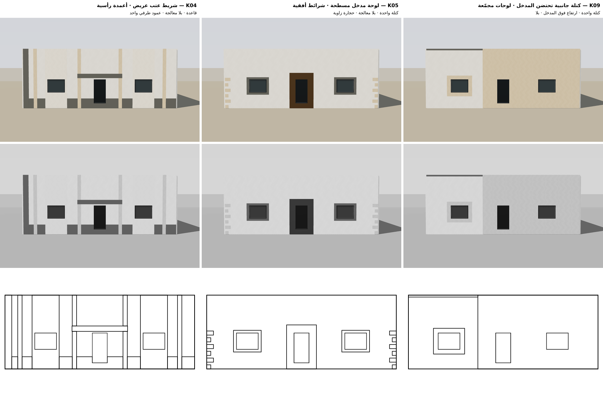
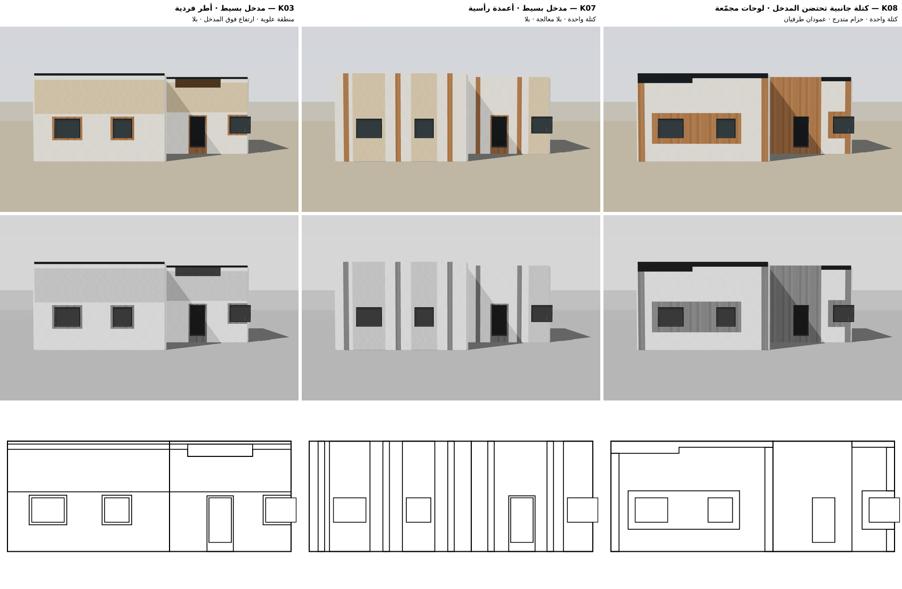
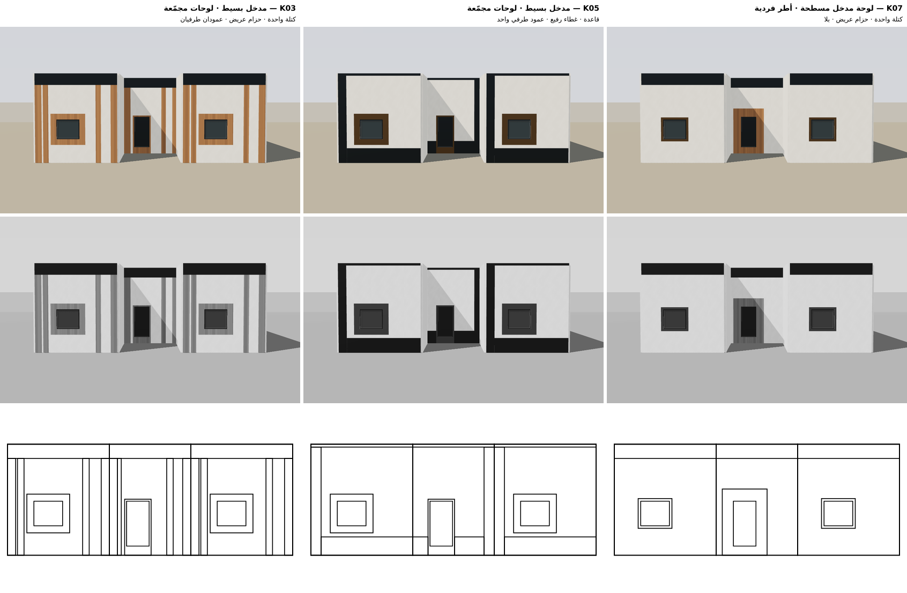
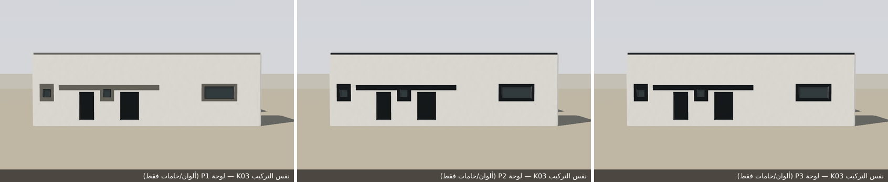
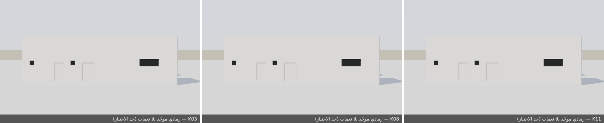
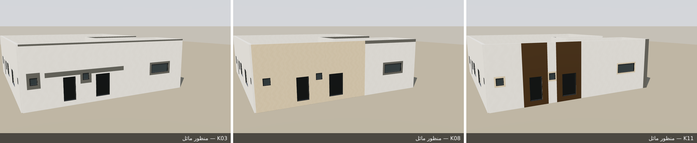

# المرحلة الأولى — نموذج توليد المفاهيم المعزول: النتائج والأدلة

> نطاق معزول (dist/facade-kit/concepts). لا نشر، لا دمج إنتاجي، لا Design Memory دائمة، لا بروزات (كل المناطق مسطحة: وجهها = وجه الجدار).

قاعدة قبول الزوج في بوابة التفرد: التباعد العام ≥ 0.35 و≥ 4 أبعاد «مختلفة» من 7 وتباعد الحواف ≥ 0.35. المعايرة أولية وتحتاج مراجعتك.

## C1 — 2 قطعة واجهة، 6 نوافذ، 2 مداخل، نسبة الفتحات 8.9%

- المجموعة الداخلية: 12 مفهومًا اجتاز بوابتي الأمانة والمعقولية (بعد 39 محاولة؛ رُفض 27). متقاربة داخل الدفعة وفق بوابة التفرد: 7.
- أسباب الرفض: restraint×23، no-sliver×9، coverage×8
- المختار: K03، K08، K11 — درجة الاختيار 0.782 (أدنى تباعد 0.719، متوسط الواقعية المعمارية 0.93).

| المفهوم | التركيب | الواقعية المعمارية |
|---|---|---|
| K03 | شريط عتب عريض · شرائط أفقية · كتلة واحدة · غطاء رفيع · بلا | 0.975 |
| K08 | كتلة جانبية تحتضن المدخل · شرائط أفقية · انقسام جانبي · حزام متدرج · بلا | 0.856 |
| K11 | عمود مدخل بارتفاع كامل · أطر فردية · كتلة واحدة · بلا معالجة · عمود طرفي واحد | 0.96 |

**K03 مقابل K08** — التباعد 0.719، أبعاد مختلفة 7/7، تباعد الحواف 0.74: جيد

| البُعد | المسافة | الحكم |
|---|---|---|
| استراتيجية المدخل | 1 | مختلف |
| إيقاع الفتحات وتجميعها | 0.464 | مختلف |
| الاتجاه الأفقي/الرأسي | 0.478 | مختلف |
| توزيع المناطق (المواد كمناطق) | 0.849 | مختلف |
| تقسيم الواجهة إلى كتل | 0.686 | مختلف |
| معالجة السقف | 1 | مختلف |
| معالجة الزوايا | 0.553 | مختلف |

**K03 مقابل K11** — التباعد 0.787، أبعاد مختلفة 6/7، تباعد الحواف 0.782: جيد

| البُعد | المسافة | الحكم |
|---|---|---|
| استراتيجية المدخل | 0.994 | مختلف |
| إيقاع الفتحات وتجميعها | 0.636 | مختلف |
| الاتجاه الأفقي/الرأسي | 1 | مختلف |
| توزيع المناطق (المواد كمناطق) | 0.246 | اختلاف متوسط |
| تقسيم الواجهة إلى كتل | 1 | مختلف |
| معالجة السقف | 1 | مختلف |
| معالجة الزوايا | 0.636 | مختلف |

**K08 مقابل K11** — التباعد 0.799، أبعاد مختلفة 7/7، تباعد الحواف 0.923: جيد

| البُعد | المسافة | الحكم |
|---|---|---|
| استراتيجية المدخل | 0.983 | مختلف |
| إيقاع الفتحات وتجميعها | 0.628 | مختلف |
| الاتجاه الأفقي/الرأسي | 0.694 | مختلف |
| توزيع المناطق (المواد كمناطق) | 0.612 | مختلف |
| تقسيم الواجهة إلى كتل | 0.675 | مختلف |
| معالجة السقف | 1 | مختلف |
| معالجة الزوايا | 1 | مختلف |

## C4 — 1 قطعة واجهة، 1 نوافذ، 2 مداخل، نسبة الفتحات 12.5%

- المجموعة الداخلية: 12 مفهومًا اجتاز بوابتي الأمانة والمعقولية (بعد 40 محاولة؛ رُفض 28). متقاربة داخل الدفعة وفق بوابة التفرد: 9.
- أسباب الرفض: restraint×4، no-sliver×16، coverage×17، entry-legible×1
- المختار: K01، K02، K07 — درجة الاختيار 0.684 (أدنى تباعد 0.563، متوسط الواقعية المعمارية 0.883).

| المفهوم | التركيب | الواقعية المعمارية |
|---|---|---|
| K01 | مدخل بسيط · لوحات مجمّعة · قاعدة · بلا معالجة · بلا | 1 |
| K02 | كتلة جانبية تحتضن المدخل · أطر فردية · انقسام جانبي · بلا معالجة · عمود طرفي واحد | 0.796 |
| K07 | شريط عتب عريض · شرائط أفقية · ثلاثي (قاعدة/وسط/علوي) · غطاء رفيع · عمود طرفي واحد | 0.853 |

**K01 مقابل K02** — التباعد 0.716، أبعاد مختلفة 6/7، تباعد الحواف 0.919: جيد

| البُعد | المسافة | الحكم |
|---|---|---|
| استراتيجية المدخل | 0.948 | مختلف |
| إيقاع الفتحات وتجميعها | 0 | متشابه |
| الاتجاه الأفقي/الرأسي | 0.466 | مختلف |
| توزيع المناطق (المواد كمناطق) | 0.63 | مختلف |
| تقسيم الواجهة إلى كتل | 1 | مختلف |
| معالجة السقف | 1 | مختلف |
| معالجة الزوايا | 0.971 | مختلف |

**K01 مقابل K07** — التباعد 0.582، أبعاد مختلفة 4/7، تباعد الحواف 0.851: جيد

| البُعد | المسافة | الحكم |
|---|---|---|
| استراتيجية المدخل | 0.328 | اختلاف متوسط |
| إيقاع الفتحات وتجميعها | 0 | متشابه |
| الاتجاه الأفقي/الرأسي | 0.227 | اختلاف متوسط |
| توزيع المناطق (المواد كمناطق) | 0.662 | مختلف |
| تقسيم الواجهة إلى كتل | 0.95 | مختلف |
| معالجة السقف | 1 | مختلف |
| معالجة الزوايا | 0.908 | مختلف |

**K02 مقابل K07** — التباعد 0.563، أبعاد مختلفة 4/7، تباعد الحواف 0.781: جيد

| البُعد | المسافة | الحكم |
|---|---|---|
| استراتيجية المدخل | 0.697 | مختلف |
| إيقاع الفتحات وتجميعها | 0 | متشابه |
| الاتجاه الأفقي/الرأسي | 0.693 | مختلف |
| توزيع المناطق (المواد كمناطق) | 0.173 | متشابه |
| تقسيم الواجهة إلى كتل | 0.939 | مختلف |
| معالجة السقف | 1 | مختلف |
| معالجة الزوايا | 0.438 | اختلاف متوسط |

## C7 — 2 قطعة واجهة، 5 نوافذ، 2 مداخل، نسبة الفتحات 8.9%

- المجموعة الداخلية: 12 مفهومًا اجتاز بوابتي الأمانة والمعقولية (بعد 92 محاولة؛ رُفض 80). متقاربة داخل الدفعة وفق بوابة التفرد: 8.
- أسباب الرفض: no-sliver×55، restraint×56، coverage×18
- المختار: K05، K07، K12 — درجة الاختيار 0.705 (أدنى تباعد 0.603، متوسط الواقعية المعمارية 0.936).

| المفهوم | التركيب | الواقعية المعمارية |
|---|---|---|
| K05 | عمود مدخل بارتفاع كامل · أطر فردية · كتلة واحدة · حزام عريض · بلا | 0.96 |
| K07 | كتلة جانبية تحتضن المدخل · أطر فردية · كتلة واحدة · بلا معالجة · بلا | 1 |
| K12 | عمود مدخل بارتفاع كامل · أعمدة رأسية · منطقة علوية · بلا معالجة · عمودان طرفيان | 0.848 |

**K05 مقابل K07** — التباعد 0.702، أبعاد مختلفة 6/7، تباعد الحواف 0.662: جيد

| البُعد | المسافة | الحكم |
|---|---|---|
| استراتيجية المدخل | 0.982 | مختلف |
| إيقاع الفتحات وتجميعها | 0.453 | مختلف |
| الاتجاه الأفقي/الرأسي | 0.654 | مختلف |
| توزيع المناطق (المواد كمناطق) | 0.188 | متشابه |
| تقسيم الواجهة إلى كتل | 0.95 | مختلف |
| معالجة السقف | 1 | مختلف |
| معالجة الزوايا | 0.688 | مختلف |

**K05 مقابل K12** — التباعد 0.708، أبعاد مختلفة 5/7، تباعد الحواف 0.689: جيد

| البُعد | المسافة | الحكم |
|---|---|---|
| استراتيجية المدخل | 0 | متشابه |
| إيقاع الفتحات وتجميعها | 0.975 | مختلف |
| الاتجاه الأفقي/الرأسي | 0.655 | مختلف |
| توزيع المناطق (المواد كمناطق) | 0.403 | اختلاف متوسط |
| تقسيم الواجهة إلى كتل | 1 | مختلف |
| معالجة السقف | 1 | مختلف |
| معالجة الزوايا | 0.923 | مختلف |

**K07 مقابل K12** — التباعد 0.603، أبعاد مختلفة 5/7، تباعد الحواف 0.703: جيد

| البُعد | المسافة | الحكم |
|---|---|---|
| استراتيجية المدخل | 0.982 | مختلف |
| إيقاع الفتحات وتجميعها | 0.522 | مختلف |
| الاتجاه الأفقي/الرأسي | 0.003 | متشابه |
| توزيع المناطق (المواد كمناطق) | 0.337 | اختلاف متوسط |
| تقسيم الواجهة إلى كتل | 0.748 | مختلف |
| معالجة السقف | 1 | مختلف |
| معالجة الزوايا | 0.631 | مختلف |

## RECT — 1 قطعة واجهة، 2 نوافذ، 1 مداخل، نسبة الفتحات 8.2%

- المجموعة الداخلية: 12 مفهومًا اجتاز بوابتي الأمانة والمعقولية (بعد 33 محاولة؛ رُفض 21). متقاربة داخل الدفعة وفق بوابة التفرد: 8.
- أسباب الرفض: entry-legible×5، no-sliver×12، restraint×11، coverage×5
- المختار: K04، K05، K09 — درجة الاختيار 0.703 (أدنى تباعد 0.586، متوسط الواقعية المعمارية 0.855).

| المفهوم | التركيب | الواقعية المعمارية |
|---|---|---|
| K04 | شريط عتب عريض · أعمدة رأسية · قاعدة · بلا معالجة · عمود طرفي واحد | 0.836 |
| K05 | لوحة مدخل مسطحة · شرائط أفقية · كتلة واحدة · بلا معالجة · حجارة زاوية | 0.887 |
| K09 | كتلة جانبية تحتضن المدخل · لوحات مجمّعة · كتلة واحدة · ارتفاع فوق المدخل · بلا | 0.843 |

**K04 مقابل K05** — التباعد 0.586، أبعاد مختلفة 4/7، تباعد الحواف 0.848: جيد

| البُعد | المسافة | الحكم |
|---|---|---|
| استراتيجية المدخل | 0.146 | متشابه |
| إيقاع الفتحات وتجميعها | 0 | متشابه |
| الاتجاه الأفقي/الرأسي | 0.425 | اختلاف متوسط |
| توزيع المناطق (المواد كمناطق) | 0.528 | مختلف |
| تقسيم الواجهة إلى كتل | 1 | مختلف |
| معالجة السقف | 1 | مختلف |
| معالجة الزوايا | 1 | مختلف |

**K04 مقابل K09** — التباعد 0.681، أبعاد مختلفة 5/7، تباعد الحواف 0.86: جيد

| البُعد | المسافة | الحكم |
|---|---|---|
| استراتيجية المدخل | 1 | مختلف |
| إيقاع الفتحات وتجميعها | 0 | متشابه |
| الاتجاه الأفقي/الرأسي | 0.565 | مختلف |
| توزيع المناطق (المواد كمناطق) | 0.357 | اختلاف متوسط |
| تقسيم الواجهة إلى كتل | 0.847 | مختلف |
| معالجة السقف | 1 | مختلف |
| معالجة الزوايا | 1 | مختلف |

**K05 مقابل K09** — التباعد 0.695، أبعاد مختلفة 5/7، تباعد الحواف 0.909: جيد

| البُعد | المسافة | الحكم |
|---|---|---|
| استراتيجية المدخل | 1 | مختلف |
| إيقاع الفتحات وتجميعها | 0 | متشابه |
| الاتجاه الأفقي/الرأسي | 0.183 | متشابه |
| توزيع المناطق (المواد كمناطق) | 0.754 | مختلف |
| تقسيم الواجهة إلى كتل | 0.925 | مختلف |
| معالجة السقف | 1 | مختلف |
| معالجة الزوايا | 1 | مختلف |

## L — 2 قطعة واجهة، 3 نوافذ، 1 مداخل، نسبة الفتحات 9.9%

- المجموعة الداخلية: 12 مفهومًا اجتاز بوابتي الأمانة والمعقولية (بعد 44 محاولة؛ رُفض 32). متقاربة داخل الدفعة وفق بوابة التفرد: 8.
- أسباب الرفض: coverage×21، restraint×22، no-sliver×12، entry-legible×1
- المختار: K03، K07، K08 — درجة الاختيار 0.691 (أدنى تباعد 0.562، متوسط الواقعية المعمارية 0.951).

| المفهوم | التركيب | الواقعية المعمارية |
|---|---|---|
| K03 | مدخل بسيط · أطر فردية · منطقة علوية · ارتفاع فوق المدخل · بلا | 0.898 |
| K07 | مدخل بسيط · أعمدة رأسية · كتلة واحدة · بلا معالجة · بلا | 0.978 |
| K08 | كتلة جانبية تحتضن المدخل · لوحات مجمّعة · كتلة واحدة · حزام متدرج · عمودان طرفيان | 0.978 |

**K03 مقابل K07** — التباعد 0.562، أبعاد مختلفة 4/7، تباعد الحواف 0.731: جيد

| البُعد | المسافة | الحكم |
|---|---|---|
| استراتيجية المدخل | 0 | متشابه |
| إيقاع الفتحات وتجميعها | 0 | متشابه |
| الاتجاه الأفقي/الرأسي | 1 | مختلف |
| توزيع المناطق (المواد كمناطق) | 0.223 | اختلاف متوسط |
| تقسيم الواجهة إلى كتل | 1 | مختلف |
| معالجة السقف | 1 | مختلف |
| معالجة الزوايا | 0.708 | مختلف |

**K03 مقابل K08** — التباعد 0.625، أبعاد مختلفة 5/7، تباعد الحواف 0.769: جيد

| البُعد | المسافة | الحكم |
|---|---|---|
| استراتيجية المدخل | 0.778 | مختلف |
| إيقاع الفتحات وتجميعها | 0.911 | مختلف |
| الاتجاه الأفقي/الرأسي | 0.65 | مختلف |
| توزيع المناطق (المواد كمناطق) | 0.134 | متشابه |
| تقسيم الواجهة إلى كتل | 0.446 | اختلاف متوسط |
| معالجة السقف | 1 | مختلف |
| معالجة الزوايا | 0.453 | مختلف |

**K07 مقابل K08** — التباعد 0.621، أبعاد مختلفة 5/7، تباعد الحواف 0.77: جيد

| البُعد | المسافة | الحكم |
|---|---|---|
| استراتيجية المدخل | 0.778 | مختلف |
| إيقاع الفتحات وتجميعها | 0.911 | مختلف |
| الاتجاه الأفقي/الرأسي | 0.692 | مختلف |
| توزيع المناطق (المواد كمناطق) | 0.138 | متشابه |
| تقسيم الواجهة إلى كتل | 1 | مختلف |
| معالجة السقف | 0.304 | اختلاف متوسط |
| معالجة الزوايا | 0.523 | مختلف |

## U — 3 قطعة واجهة، 2 نوافذ، 1 مداخل، نسبة الفتحات 7.6%

- المجموعة الداخلية: 12 مفهومًا اجتاز بوابتي الأمانة والمعقولية (بعد 39 محاولة؛ رُفض 27). متقاربة داخل الدفعة وفق بوابة التفرد: 9.
- أسباب الرفض: no-sliver×9، coverage×11، restraint×19، entry-legible×1
- المختار: K03، K05، K07 — درجة الاختيار 0.659 (أدنى تباعد 0.548، متوسط الواقعية المعمارية 0.908).

| المفهوم | التركيب | الواقعية المعمارية |
|---|---|---|
| K03 | مدخل بسيط · لوحات مجمّعة · كتلة واحدة · حزام عريض · عمودان طرفيان | 0.84 |
| K05 | مدخل بسيط · لوحات مجمّعة · قاعدة · غطاء رفيع · عمود طرفي واحد | 0.917 |
| K07 | لوحة مدخل مسطحة · أطر فردية · كتلة واحدة · حزام عريض · بلا | 0.967 |

**K03 مقابل K05** — التباعد 0.587، أبعاد مختلفة 4/7، تباعد الحواف 0.676: جيد

| البُعد | المسافة | الحكم |
|---|---|---|
| استراتيجية المدخل | 1 | مختلف |
| إيقاع الفتحات وتجميعها | 0 | متشابه |
| الاتجاه الأفقي/الرأسي | 0.532 | مختلف |
| توزيع المناطق (المواد كمناطق) | 0.239 | اختلاف متوسط |
| تقسيم الواجهة إلى كتل | 0.953 | مختلف |
| معالجة السقف | 1 | مختلف |
| معالجة الزوايا | 0.385 | اختلاف متوسط |

**K03 مقابل K07** — التباعد 0.554، أبعاد مختلفة 4/7، تباعد الحواف 0.797: جيد

| البُعد | المسافة | الحكم |
|---|---|---|
| استراتيجية المدخل | 0.149 | متشابه |
| إيقاع الفتحات وتجميعها | 0 | متشابه |
| الاتجاه الأفقي/الرأسي | 0.705 | مختلف |
| توزيع المناطق (المواد كمناطق) | 0.368 | اختلاف متوسط |
| تقسيم الواجهة إلى كتل | 0.9 | مختلف |
| معالجة السقف | 1 | مختلف |
| معالجة الزوايا | 0.759 | مختلف |

**K05 مقابل K07** — التباعد 0.548، أبعاد مختلفة 4/7، تباعد الحواف 0.898: جيد

| البُعد | المسافة | الحكم |
|---|---|---|
| استراتيجية المدخل | 1 | مختلف |
| إيقاع الفتحات وتجميعها | 0 | متشابه |
| الاتجاه الأفقي/الرأسي | 0.173 | متشابه |
| توزيع المناطق (المواد كمناطق) | 0.235 | اختلاف متوسط |
| تقسيم الواجهة إلى كتل | 0.85 | مختلف |
| معالجة السقف | 1 | مختلف |
| معالجة الزوايا | 0.578 | مختلف |

## أدلة إضافية

تغيير اللون/الخامة وحده يعطي توقيعًا مطابقًا (تباعد 0) ويُرفض كتكرار.

**حد معروف**: في رمادي موحّد تمامًا (بلا فروق نغمة) تختفي المناطق المسطحة وتبقى الفتحات فقط، لأن الواقع بلا بروز وبلا حفر. الفرق المعماري هنا يحمله التقسيم والنغمة (اختبار الرمادي الفعلي = تجريد اللون مع بقاء القيمة) والحواف.

