# واجهات بطراز العميل — تقرير الفرع `dev/facade-styles`

**طلب المالك (2026-10-31 22:53):** «واجهة هندسية لكل تصميم تختلف عن الأخرى… جميلة وتختلف من عميل لآخر حسب رغباتهم: كلاسيكي، حديث، نيوكلاسيكي».
**نقطة البداية:** `f8e1844` (المنشور على المعاينة). لا دمج ولا نشر. المحرك وMizan Score وAZIZ وr19 والمحرك الأول ومنطق توليد المسقط في villa-layout-v2/v3 لم تُمس.

> الواجهات هنا **مقترح مبدئي** يُرسم آليًا من المسقط، وليست رسومات تنفيذية ولا معتمدة؛ تحتاج مكتبًا هندسيًا مرخّصًا ومراجعة معمارية بشرية.

## 1) التدقيق: لماذا تظهر الواجهة نفسها لكل التصاميم؟

| الموضع | ما وُجد عند `f8e1844` | الدليل |
|---|---|---|
| رسم الواجهات ثنائي الأبعاد | **غير موجود أصلًا.** تبويب «الواجهات والمواد» في المرسم فيه أربعة «أنماط جاهزة» ثابتة (`PRESETS`) تغيّر الألوان فقط، وأزرار «عرض الواجهات في المجسّم» تحرّك الكاميرا فقط. | `dist/studio.mjs` الدالة `renderFinish` (الأسطر 268–300) |
| المجسّم | `scene3d.mjs` يطبّق على **كل** تصميم القائمة نفسها: لياسة `#ece0c8`، قاعدة حجرية 0.9 م، كسوة حجر على قطعة المدخل، كرنيش 0.2 م تحت الدروة، مظلة مدخل، مظلة فوق **كل** نافذة خارجية، إطار حجري حول **كل** نافذة، زعانف شرق/غرب، مشربية لنوافذ المجلس/الطعام على الشارع. | `DEFAULTS` (س22)، «window shading» (355–390)، «canopy» (344)، «cornice» (240) |
| المواد | `doc.finish` فارغ من المولّد ← ألوان `materials3d.mjs` الافتراضية نفسها لكل تصميم. | `createMaterialLibrary` |
| طلب الطراز بالكلام | «واجهة كلاسيك/حديثة/نجدية» يُحفظ في `doc.finish.facade.style` ويُعلَّم «تفاصيل الطراز لا تُرسم بعد». | `plan-edit.mjs` `doFacade`؛ `design-session.mjs` `facadeStatus` |

**لقطات «قبل»** (المجسّم عند f8e1844 بالرحلة نفسها): `shots/before-C1-3d.png` و`shots/before-C7-3d.png` — نفس شريط الحجر عند المدخل، نفس المظلات والإطارات والكرنيش والألوان في تصميمين مختلفين.

## 2) البحث

### مفردات الطرز

| الطراز | المفردات المستعملة في المولّد | المصادر | الحكم |
|---|---|---|---|
| كلاسيكي | التماثل والحجر مادة أساسية (S3)؛ كرنيش تاج يرمي المطر عن الجدار (S8)؛ أعمدة بقاعدة وتاج، نسب 7–10 أقطار بحسب النظام (S7)؛ جملون مثلث/مقوس فوق الفتحات والرواق (S9)؛ زوايا حجرية متناوبة طويل/قصير (S10)؛ درابزين (S11) | S3، S7–S11 | المفردات متحققة؛ **قيم الأبعاد في الفلل السعودية (ارتفاع الكرنيش، عرض الإطار، القاعدة) غير متحقق** — «قيمة تصميمية للميزان». |
| نيوكلاسيكي | «التماثل والهندسة البسيطة… بدل الزخرفة» و«تأكيد الجدار»، زخرفة مقيدة بإطارات وألواح (S6) ← سطح أملس، إطارات مسطحة، كرنيش بسيط بلا أسنان، أكتاف مسطحة، حزوز أفقية في الأرضي، ألواح غائرة في الدروة | S6، S3 | المفردات متحققة؛ **حدّ الفصل بين الكلاسيكي والنيوكلاسيكي في سوق الفلل السعودية غير متحقق** بمرجع رسمي. |
| حديث/معاصر | بلا زخرفة، خطوط أفقية، زجاج واسع، بروزات ومواد خرسانة/زجاج/معدن (S5)؛ حجر غير متماثل ومزج فاتح/داكن وإطار بارز «L مقلوب» أو «U» حول جزء من الواجهة (S3) ← لوح بمادة التأكيد خلف الكتلة المميزة وإطار بارز وكاسرات أفقية ورأسية وغطاء دروة معدني | S5، S3 | متحقق كمفردات. |
| **نجدي معاصر (مقترح رابع، معلن)** | جدران سميكة، فتحات صغيرة مستطيلة/مثلثة، «شرفات» مجصصة أعلى الجدار، أبواب خشبية بزخارف هندسية، زخرفة خارجية قليلة (S4)؛ خريطة العمارة السعودية 19 طرازًا منها النجدي، وكل طراز بثلاث صيغ تقليدية/انتقالية/معاصرة، والمعاصرة ≈80% من المشاريع الجديدة (S1، S2، S13)؛ مبادئ ميثاق الملك سلمان الستة (S12) | S1، S2، S4، S12، S13، S14 | **مقترح**؛ نص دليل «النجدي الأوسط» التفصيلي (نسب الفتحات والألوان) لم نصل إليه: **غير متحقق**. المثلثات في المولّد زخرفة بارزة لا فتحات. |

لم نعتمد أرقام مقال BusinessToday (سماكة 300 مم، بروز 600 مم، 40% مواد محلية) لأنها بلا نص رسمي — **غير متحقق** (S17).

### الاشتراطات ذات الصلة (من `docs/research/saudi-residential-regulations-2026-10-21.md` ومصادره)

| البند | القيمة | المستوى | ما يفعله المولّد |
|---|---|---|---|
| أقصى ارتفاع للفيلا | 14 م من منسوب منتصف الرصيف | أ | الشرفات النجدية تُحذف إن تجاوزت 14 م (2D و3D) |
| سور الشرفة جهة الجار | ≤ 1.80 م | ب | لا يضيف شرفات ولا يغيّر الدروة |
| الأسوار وسواترها | ≤ 4.5 م، لا سواتر فوقها، والساتر يتناغم مع الواجهات (S15) | أ | السور لا يُمس |
| دروة السطح 1.8 م | **ليست اشتراطًا موثقًا** — قيمة تصميمية للميزان (`villa-layout-v2.mjs:2881`) | — | تُرسم بارتفاع المستند حرفيًا ولا تُنقص (اختبار) |
| إطلال النوافذ على الجار | لا بند عام (عدا الملحق العلوي) | ب | الفتحات من المسقط فقط |
| نطاق أدلة خريطة العمارة | المرحلة الأولى: مشاريع حكومية وتجارية وفلل في الأحساء والطائف وأبها ومكة (S13) | ب | لا يُدّعى توافق مع دليل رسمي؛ غير متحقق لبقية المدن |

## 3) التنفيذ

**`dist/facade-styles.mjs`** (جديد، نقي، بلا DOM ولا Math.random ولا زمن):
1. `facadeGeometry(doc)`: لكل دور `analyzeWalls` ← الحواف الخارجية ← الجهة بالعمودي الخارجي ← دمج القطع المتصلة ← إسقاط كل فتحة حقيقية على قطعتها بموضعها وعرضها وجلستها وارتفاعها؛ منسوب التشطيب 0.45 م كالمجسّم؛ الدروة من `doc.roof.parapet` على السطوح المكشوفة فقط.
2. `resolveFacade(doc, opts)`: الطراز + الكثافة (هادئة/متوسطة/غنية) + لون اختياري + **بذرة حتمية** = بصمة هندسة التصميم ⊕ مفتاح العميل (الأرض والأعداد والنص). البذرة تختار ضمن الطراز: اللوحة (3 لكل طراز)، تيجان النوافذ (مثلث/مقوس/متناوب/حجر مفتاح)، ارتفاع القاعدة، إيقاع الزوايا، الإطار الحديث U/L، الشرفات النجدية (مثلثة/مدرجة). البذرة تُحفظ في المستند عند التسليم فلا تتغير اللوحة مع تعديل يدوي لاحق.
3. `composeElevation`/`elevationSvg`: كل فتحة تحمل `data-opening` = معرّفها. **حارسان:** عنصر «على الوجه» (عمود/زاوية/كتف/إطار/مظلة) يتقاطع مع فتحة غيره يُحذف ويُسجَّل؛ والزجاج والأبواب تُرسم بعد زخارف قطعتها.
4. **المجسّم:** تعديل محصور في `dist/draw/scene3d.mjs` + `dist/draw/facade3d.mjs` (جديد). بلا طراز ← المجسّم القديم حرفيًا (اختبار). بطراز: ألوان اللوحة للمواد (اختيار العميل الصريح في `doc.finish` يتقدم)، القاعدة والمظلات والإطارات والزعانف وكرنيش السطح بحسب الطراز، وإضافات: أحزمة بين الأدوار، تيجان النوافذ الأرضية والرواق بعمودين (كلاسيكي؛ يُحذف العمود إن وقع أمام فتحة كما في 2D)، شرفات الدروة (نجدي، فوقها لا بدلها). **لم يُنفَّذ في 3D (يظهر في 2D فقط):** الجملون المثلث/المقوس، الأسنان، الدرابزين، الزوايا الحجرية، شريط المثلثات، الألواح الغائرة — تحتاج أشكالًا غير البريزما الرأسية في `MeshBuilder` الحالي.

**اختيار العميل (مصدر حقيقة واحد):**
- شرعاء (`sharaa/flow.mjs`): سؤال واحد `facade_style` «أي طراز تحب لواجهة بيتك؟» (كلاسيكي/نيوكلاسيكي/حديث/اختر لي)، صنف 4: يُسأل في «أسئلة موجهة» و«ساعدني أقرر»، وفي الحديث الحر عند «أسئلة إضافية»؛ لا يُسأل إن ذكره العميل.
- الكلام الحر (`facade-choice.mjs` من `sharaa/brief.mjs`): «الواجهة نيو كلاسيك/كلاسيكية/مودرن/نجدية» فقط إن ذُكرت الواجهة أو الطراز في الجملة («مطبخ حديث» لا يُفهم طرازًا).
- يُحفظ في `brief.preferences.facadeStyle` بمصدره في `provenance` وأولوية `flexible`؛ `toEngineInput` يحمله في حقل `facade` **بجانب** مدخلات المحرك لا داخل `requirements` (اختبار: requirements حرفيًا نفسها)؛ `createSession` يحفظه في `session.input.facade` بمصدره وتاريخه.
- صفحة التصميم (`facade-ui.mjs` + سطران في `design.mjs`): بطاقة «واجهات التصميم» بأزرار الطراز الخمسة والكثافة والجهات الأربع ومعاينة SVG فورية (53–78 مللي ثانية في Chromium) **دون إعادة توليد**؛ التبديل يُحفظ بمصدر `client_confirmed`. لم يختر؟ ← «اختر لي» بمصدر `design_default` معلنًا «اختار الميزان هذا مبدئيًا» — لا يحجب أي تصميم.
- التسليم: `docWithFacade` يضع `doc.finish.facade.{style, seed, ornament, styleSource, clientKey}` في المستند المسلَّم للمرسم وللعرض ثلاثي الأبعاد؛ المسقط نفسه حرفيًا.

## 4) الصور

| | كلاسيكي | نيوكلاسيكي | حديث |
|---|---|---|---|
| C1 (دور واحد) — بطاقة الواجهة في صفحة التصميم | 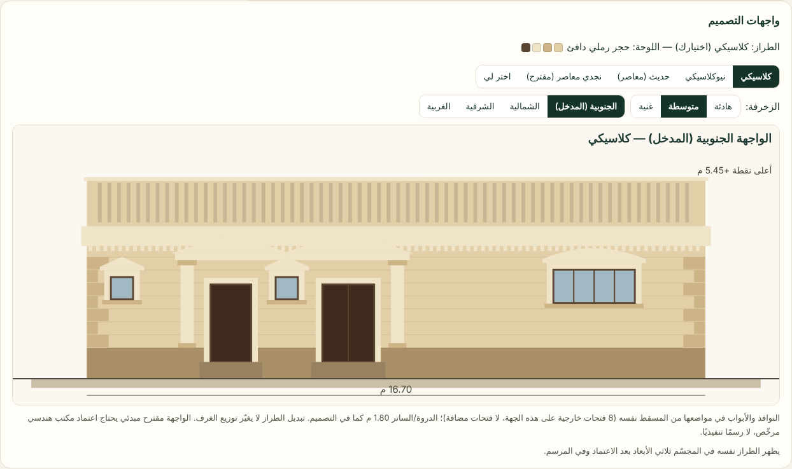 | 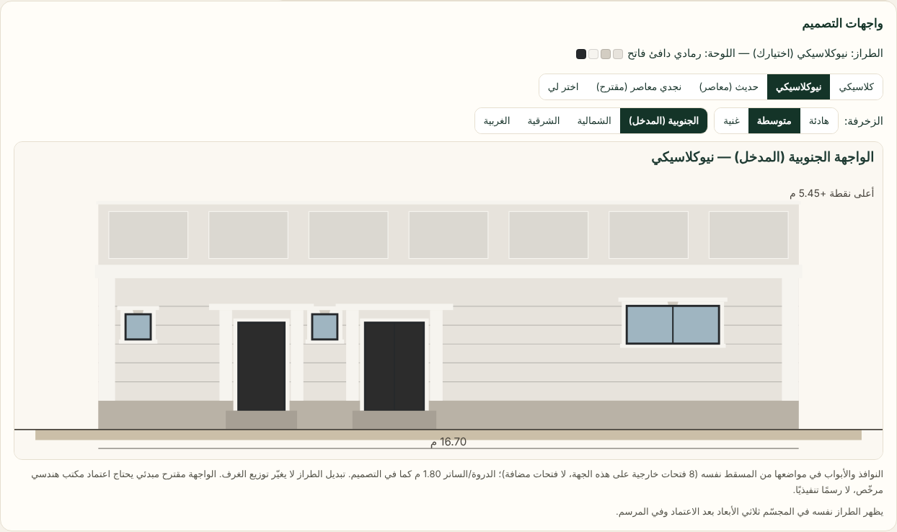 | 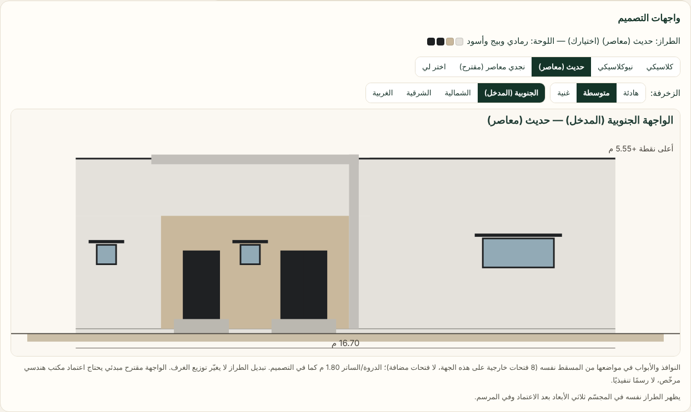 |
| C1 — المجسّم بعد الاعتماد | 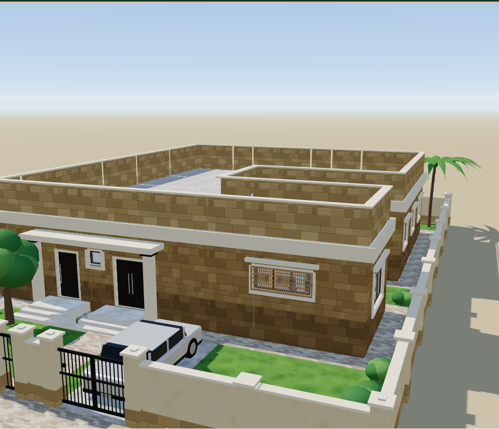 | 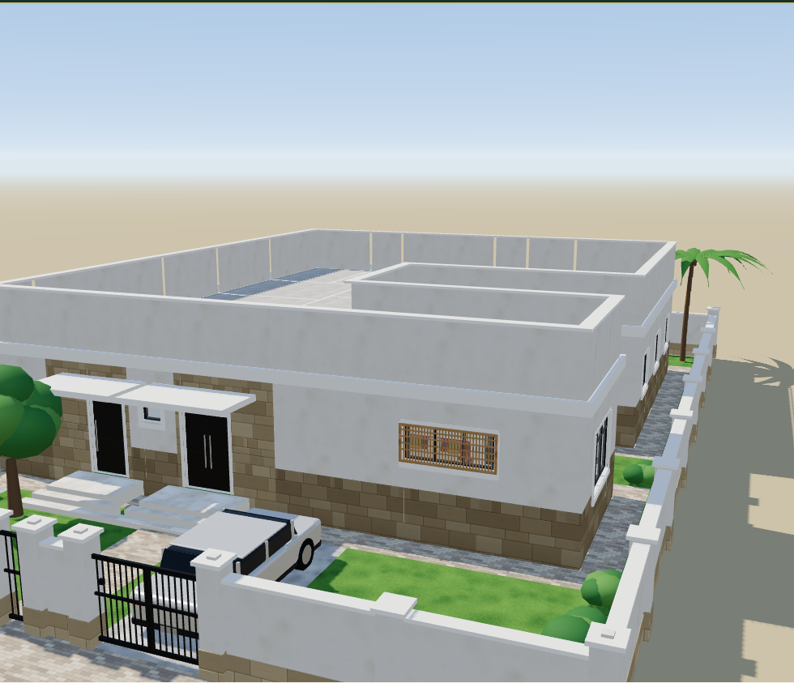 | 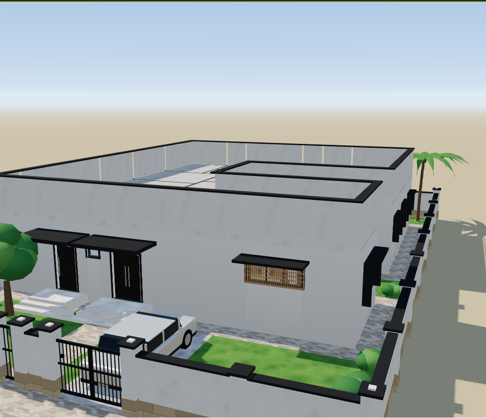 |
| C7 (دوران) — بطاقة الواجهة | 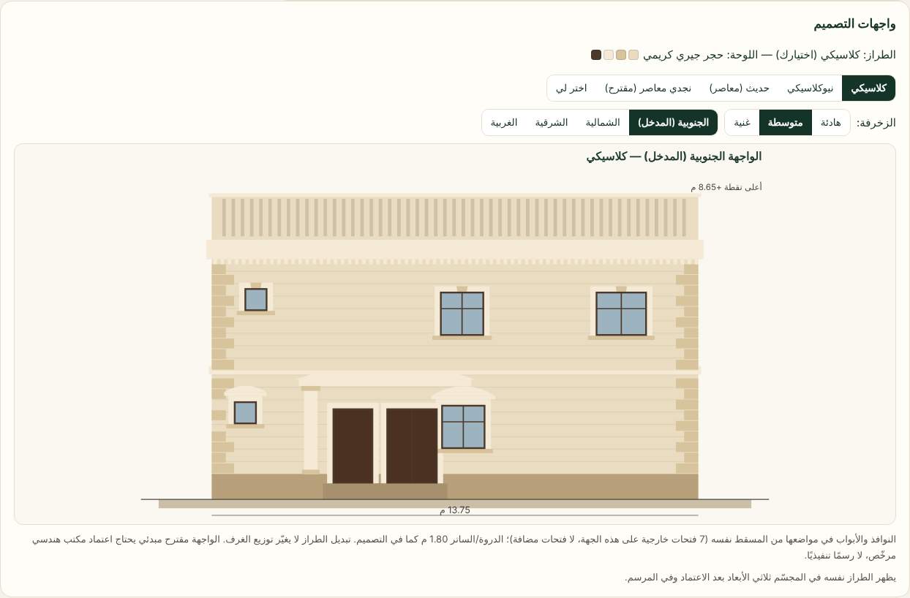 | 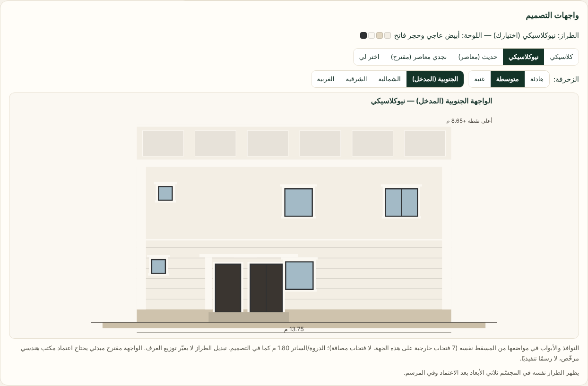 | 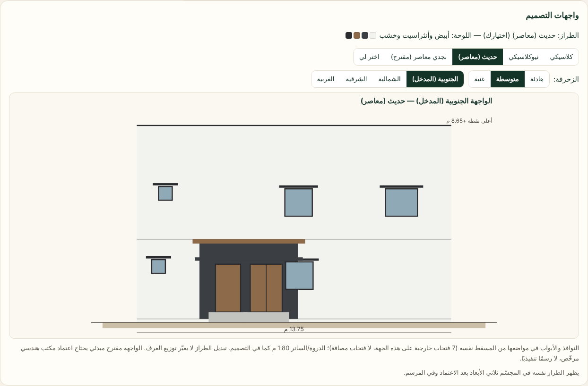 |
| C7 — المجسّم | 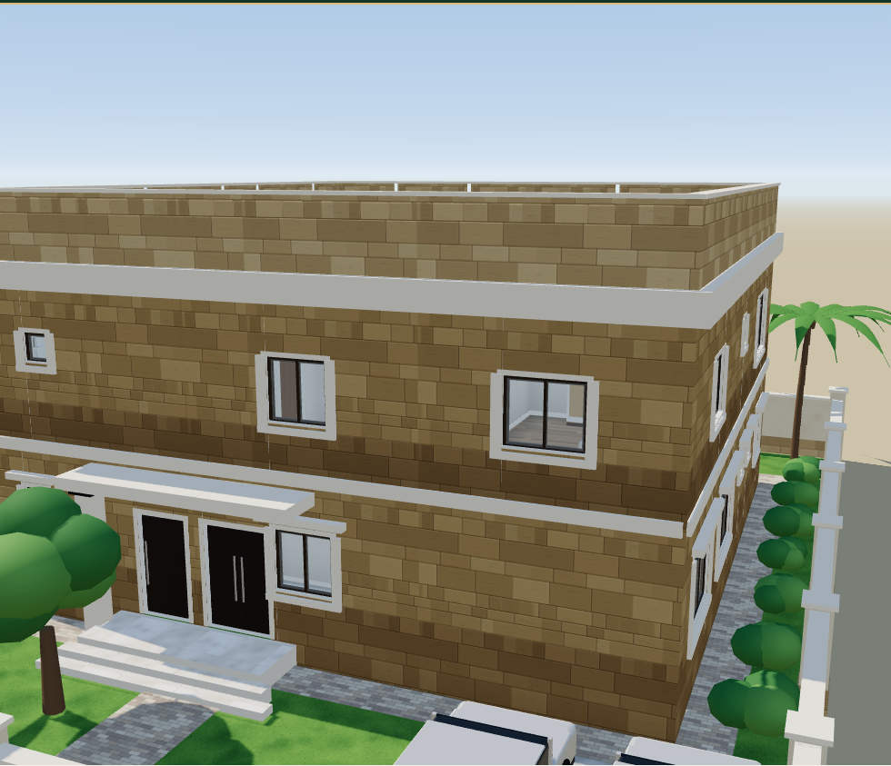 | 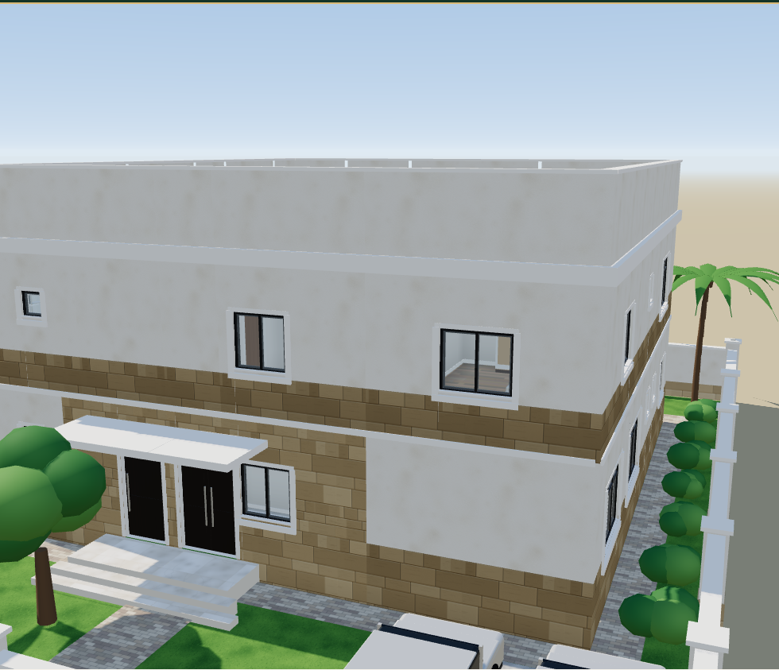 | 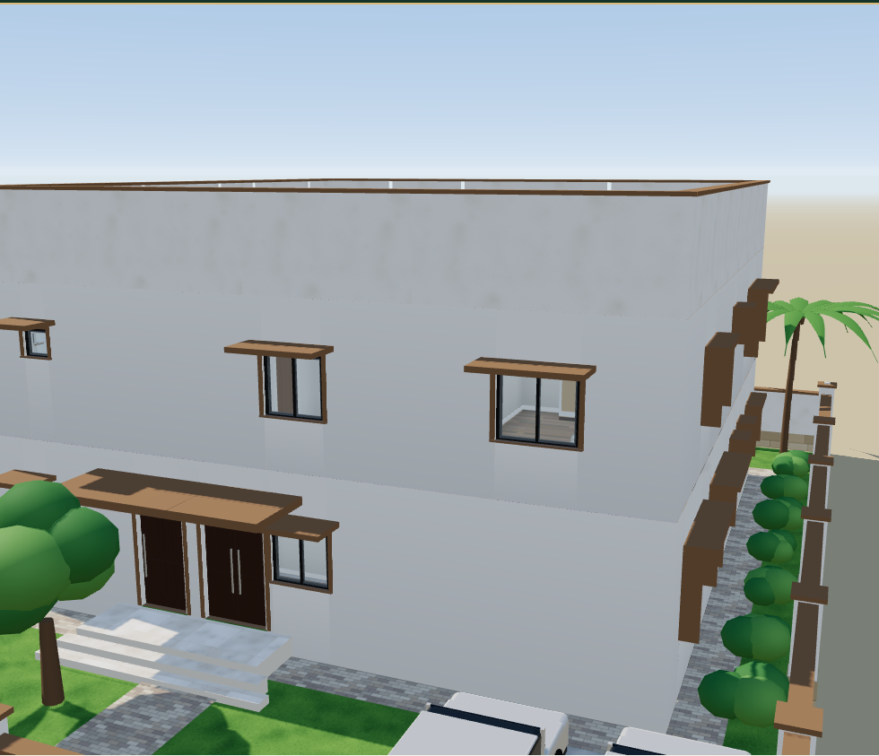 |

الواجهات الأربع لكل طراز (والنجدي المقترح): `shots/elev-C1-{classic,neoclassic,modern,najdi}.png` و`shots/elev-C7-…`.
قبل: 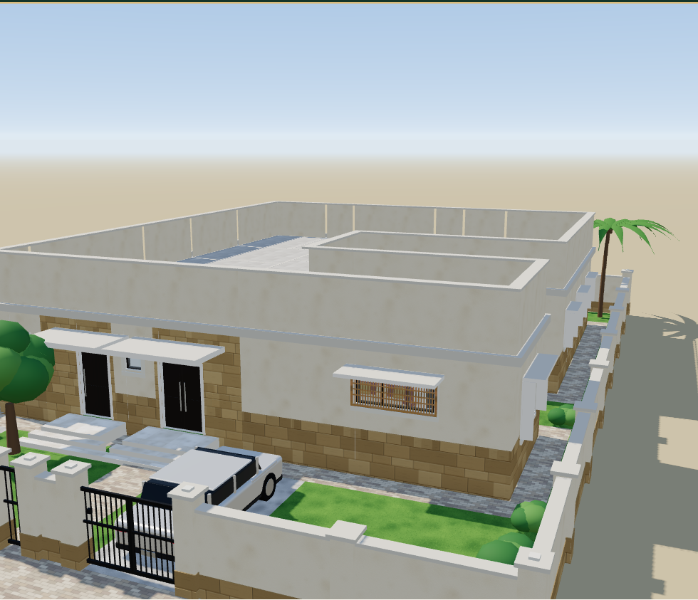 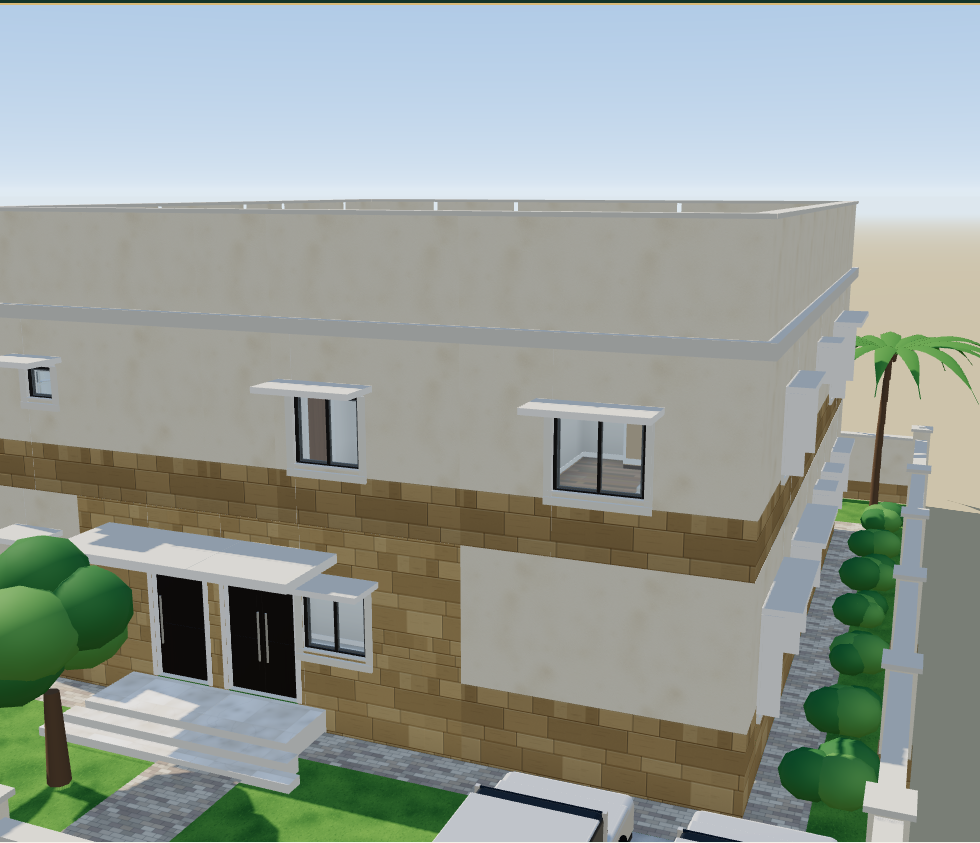
شرعاء في المسار الموجّه (سؤال الطراز ظهر وأُجيب، ثم صفحة التصميم): `shots/sharaa-guided-after-design.png`.

## 5) أن المسقط والمحرك ونتائجه لم تتغير

- لم يُعدَّل أي ملف في رسم استيراد المحرك (villa-layout-v2/v3، villa-layout، home-flow، requirements، rules، plan-review، multi-engine، mizan-score، AZIZ، r19)؛ بصمة ذاكرة المولّد في الاختبارات لم تتغير.
- **مصفوفة C1–C10 وH1–H10 وD1–D10** (`scripts/sharaa-r21-integration-matrix.mjs`: SHA-256 لكامل ناتج `generateInitialDesign` دون حقول الزمن) على `f8e1844` وعلى هذا الفرع: **30/30 متطابقة بايتًا** — `matrix-compare.json` (تشمل الحالات التي يرفضها المحرك: الخطأ نفسه برمزه).
  - ملاحظة تشغيل: عملية المصفوفة على الفرع قُطعت مرتين بقاتل الذاكرة في الحاوية (cgroup OOM، الذاكرة مشتركة مع وكلاء آخرين)؛ أُكملت الحالات الباقية D3–D7 ثم D8–D10 بتشغيلين منفصلين، والمقارنة على الثلاثين كلها.

## 6) الاختبارات (رموز الخروج)

| الاختبار | النتيجة |
|---|---|
| `tests/facade-styles.test.mjs` (جديد، 8): الحتمية وخلو المصدر من Math.random/الزمن؛ احترام الفتحات (كل فتحة مرسومة لها أصل خارجي في المسقط، بعددها في كل جهة، وموضع أفقي/عرض/جلسة من المسقط)؛ الدروة لا تقل و≤ 14 م؛ تمايز الطرز (كثافة الزخرفة كلاسيكي > نيوكلاسيكي > حديث، ومفردات حصرية لكل طراز، ولوحات لا تتداخل، وغنية > متوسطة > هادئة)؛ تمايز تصميمين بالطراز نفسه وعملاء بالتصميم نفسه (≥ 6 متغيرات من 12 عميلًا)؛ withFacade لا يغيّر المسقط و«اختر لي» حتمي؛ المجسّم بلا طراز كما كان وبطراز يختلف دون فتحات جديدة واللون الصريح يتقدم؛ ملف الاحتياجات وسؤال شرعاء دون تغيير requirements أو الجاهزية | 8/8، EXIT=0 |
| `scripts/facade-styles-browser.mjs` (رحلة Chromium): C1 وC7 × كلاسيكي/نيوكلاسيكي/حديث — المعاينة تتبدل فورًا (53–78 مللي ثانية)، المسقط في الجلسة حرفيًا نفسه، المصدر `client_confirmed`، والمستند المسلَّم للمجسّم يحمل الطراز والبذرة؛ صفر أخطاء صفحة | OK 6، EXIT=0؛ ولقطات «قبل» على f8e1844: OK 2 |
| `scripts/e2e-sharaa-v2.mjs` (المسار الموجّه الحقيقي): ظهر سؤال الطراز، أُجيب «كلاسيكي»، واكتمل التوليد إلى صفحة التصميم | EXIT=0 |
| `npm run build` (فحص الاستيرادات والبناء) | EXIT=0 (156 وحدة) |
| **الحزمة الكاملة** (`npm test` بملفات `tests/*.test.mjs` كلها، 182 ملفًا) | **1613 اختبارًا: 1610 ناجحًا و3 راسبة موروثة** |

تفاصيل الحزمة الكاملة: تشغيل `npm test` الواحد قُطع مرتين (حدّ المهام الخلفية ساعتان مع ذاكرة مولّد باردة، وقتل الذاكرة cgroup OOM لعمليات اختبار بـ SIGKILL — موثق في dmesg)، فشُغّلت الملفات نفسها بالمشغّل نفسه `scripts/run-tests.mjs` في ثلاث دفعات أبجدية ثم أعيد الملفان/الملف الذي قُتل بالذاكرة منفردًا:

| الدفعة | الاختبارات | ناجح | راسب | EXIT |
|---|---|---|---|---|
| batch00 (58 ملفًا) | 525 | 525 | 0 | 0 |
| batch01 (56) | 492 | 492 | 0 | 0 |
| batch02 (59) | 502 | 497 | 5 | 1 |
| إعادة `stage2-r21-02b` (قُتل SIGKILL في batch02) | 11 | 11 | 0 | 0 |
| إعادة `stage2-r21-02c-01b` (SIGKILL) | 21 | 21 | 0 | 0 |
| `requirements-v2` (قُتل SIGKILL في التشغيل الكامل) | 64 | 64 | 0 | 0 |

**الراسب الموروث (3، نفسه في سجل `docs/research/sharaa-r21-integration/logs2/06-npm-test.log` على الأساس):** «معايرة حالة العرض…»، «اتساق الحكم في كل الحالات…»، «قياسا الدور العلوي على C7-1 (after-18)…» — بوابة الدش r21shower على وثائق تاريخية بلا دش. **الجديد الراسب: صفر.**
**المعلّقة الأربعة** (`npm run test:pending` / `tests-pending/r21-pending.test.mjs`) ليست في `npm test` ولم تُشغَّل هنا — غير متحقق في هذا الفرع (لم يُمس ما تختبره).
**اختبار عُدِّل لأن السلوك تغيّر عمدًا:** `tests/plan-edit.test.mjs` («الواجهة حجر…»): كان يشترط أن «واجهة نجدي» تبقى «بانتظار العرض»؛ صارت تُرسم، فصار الشرط صفرًا، وأضيف تحقق أن «حجازي» (غير المرسوم) يبقى «بانتظار العرض».
ملخصات السجلات: `logs/*.summary.txt`.

## 7) المصادر

- S1 عرب نيوز — إطلاق خريطة العمارة السعودية: https://www.arabnews.pk/node/2593817/saudi-arabia
- S2 سعودبيديا — قائمة طرز خريطة العمارة: https://saudipedia.com/en/list-of-saudi-architecture-characters-map
- S3 سيدتي — الواجهات الكلاسيكية والحديثة وأنواع الحجر والإطارات: https://www.sayidaty.net/node/1365101
- S4 ويكيبيديا — Najdi architecture: https://en.wikipedia.org/wiki/Najdi_architecture
- S5 ويكيبيديا — Modern architecture: https://en.wikipedia.org/wiki/Modern_architecture
- S6 ويكيبيديا — Neoclassical architecture: https://en.wikipedia.org/wiki/Neoclassical_architecture
- S7 ويكيبيديا — Classical order: https://en.wikipedia.org/wiki/Classical_order
- S8 ويكيبيديا — Cornice: https://en.wikipedia.org/wiki/Cornice
- S9 ويكيبيديا — Pediment: https://en.wikipedia.org/wiki/Pediment
- S10 ويكيبيديا — Quoin: https://en.wikipedia.org/wiki/Quoin
- S11 ويكيبيديا — Baluster: https://en.wikipedia.org/wiki/Baluster
- S12 عرب نيوز — العمارة السلمانية ومبادئ الميثاق الستة: https://www.arabnews.pk/node/2375871
- S13 موقع العمارة السعودية — الصيغ الثلاث ونطاق التطبيق: https://architsaudi.dasc.gov.sa/ar
- S14 سعودبيديا — العمارة السلمانية: https://saudipedia.com/en/salmani-architecture
- S15 عكاظ 2024-07-15 — اشتراطات البناء السكني: https://www.okaz.com.sa/ampArticle/2165939
- S16 ويكيبيديا — Mashrabiya: https://en.wikipedia.org/wiki/Mashrabiya
- S17 BusinessToday (ثانوي، أرقامه غير متحققة ولم تُستعمل): https://businesstoday.me/design/what-specific-design-guidelines-define-the-salmani-architecture-movement/
- بحث المشروع: `docs/research/saudi-residential-regulations-2026-10-21.md`

## 8) غير متحقق / يحتاج قرار المالك

1. قيم الزخارف (الكرنيش، الإطارات، القاعدة، الشرفات) قيمة تصميمية للميزان — غير متحققة بمرجع سعودي رسمي.
2. «النجدي المعاصر» مقترح؛ نص دليل النجدي الأوسط غير متحقق — يُعرض للعملاء الآن بوسم «مقترح». هل يبقى؟
3. سؤال الطراز صنف 4 (لا يظهر في الحديث الحر إلا بـ«أسئلة إضافية»). هل يُرفع ليظهر في كل المسارات؟
4. الافتراضي بلا اختيار: «اختر لي» حتمي من الطرز الثلاثة ومعلن — أم يبقى المجسّم القديم؟
5. الجدران المائلة لا تُرسم في الواجهات الأربع (لم تظهر في الحالات المختبرة).
6. الجملون/الأسنان/الدرابزين/الزوايا في 3D تحتاج توسيع محرك المجسّم.
7. لا مراجعة معمارية بشرية للواجهات بعد.

## 9) الملفات المشتركة المعدلة (لتسهيل الدمج)

| الملف | الموضع | السبب |
|---|---|---|
| `dist/design.mjs` | استيراد واحد؛ عنصر واحد في قائمة `$('main').replaceChildren` بعد `grid`؛ `storeForStudio` و`onStudio` يسلّمان `docWithFacade(doc, session)` | بطاقة الواجهات وتسليم الطراز للمرسم/المجسّم |
| `dist/design-session.mjs` | `createSession` معامل `facade` يُحفظ في `input.facade`؛ `facadeStatus` (بند F-facade في «هل نُفّذ طلبك؟»): الطراز المرسوم لم يعد «بانتظار العرض»؛ استيراد `RENDERED_STYLE_OF` | ملف الاحتياجات في الجلسة؛ صدق القائمة |
| `dist/plan-edit.mjs` | `doFacade`: لا يُعلَّم الطراز المرسوم «pending»؛ استيراد | الصدق نفسه |
| `dist/home.mjs` | استدعاءا `createSession` (التوليد وإعادة المحاولة) يمرّران `facade: eng.facade` | نقل الطراز من شرعاء |
| `dist/sharaa/brief.mjs` | `PREF_VALUES.facadeStyle`؛ سطران في `applyExtraction`؛ استيراد | قراءة الطراز من الكلام بمصدره |
| `dist/sharaa/flow.mjs` | سؤال `facade_style` في `candidates()`؛ فرع في `#applyAnswer`؛ استيراد | السؤال الواحد |
| `dist/sharaa/adapter.mjs` | نهاية `toEngineInput`: حقل `facade` بجانب المخرجات (requirements لا تتغير) | |
| `dist/draw/scene3d.mjs` | `buildBuildingScene`: `FS`/`facBase`، ألوان الطراز، شروط على القاعدة/المظلات/الإطارات/الزعانف/كرنيش السطح/مظلة المدخل، واستدعاء `emitFacadeDetails` | الطراز في المجسّم؛ بلا طراز لا تغيير |
