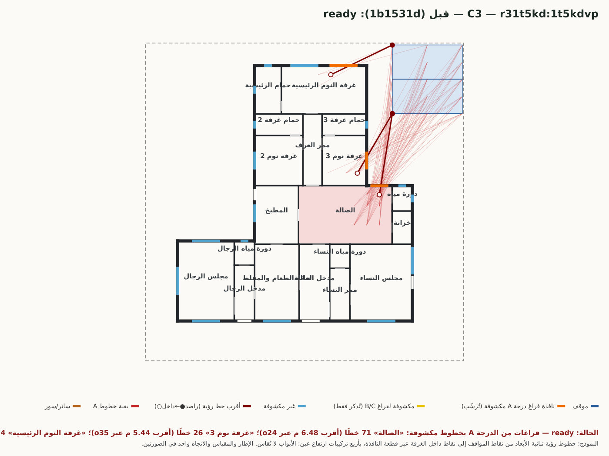
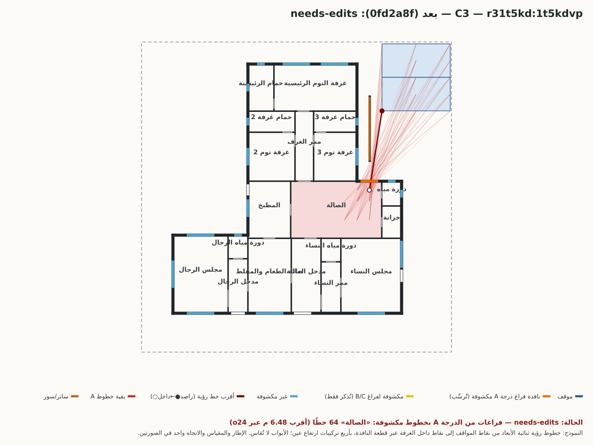
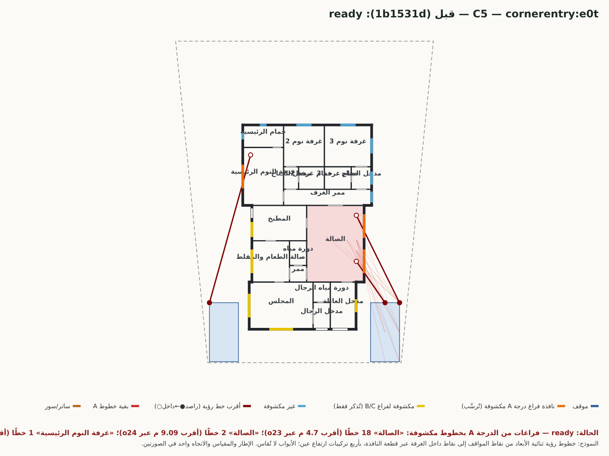
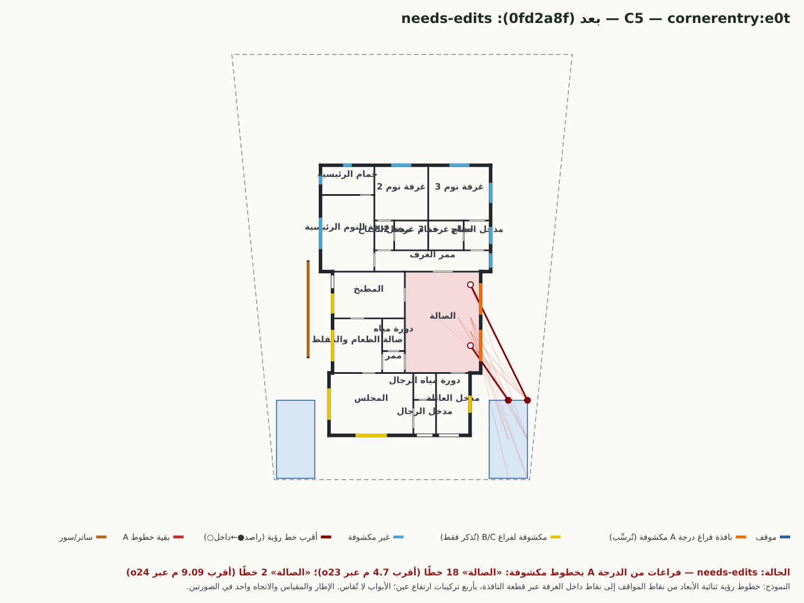
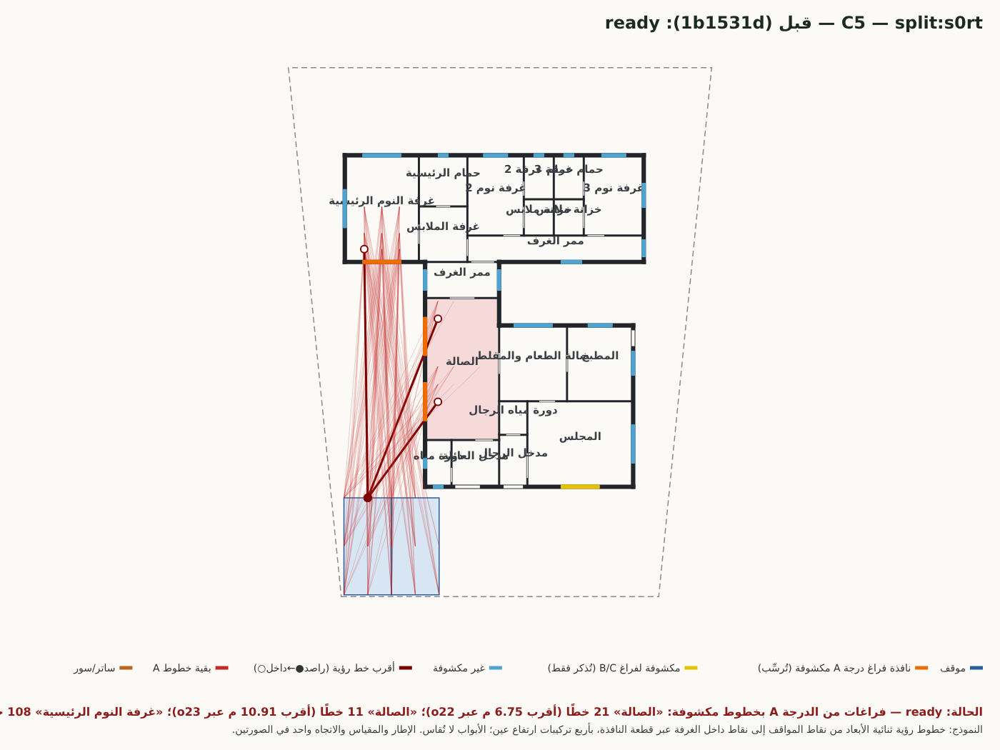
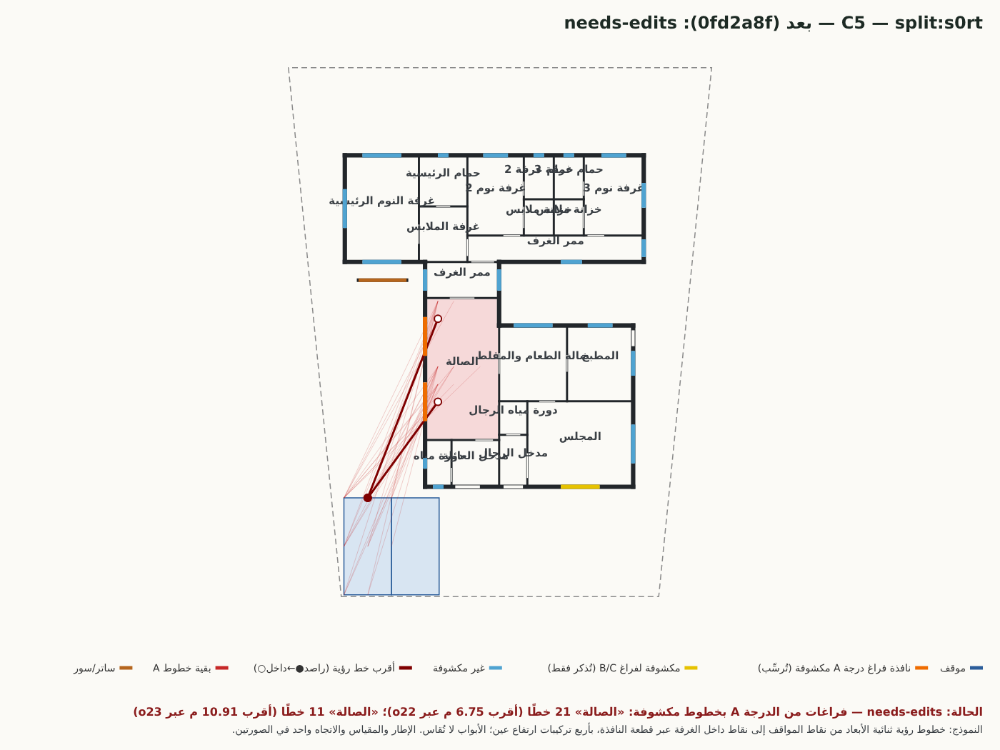
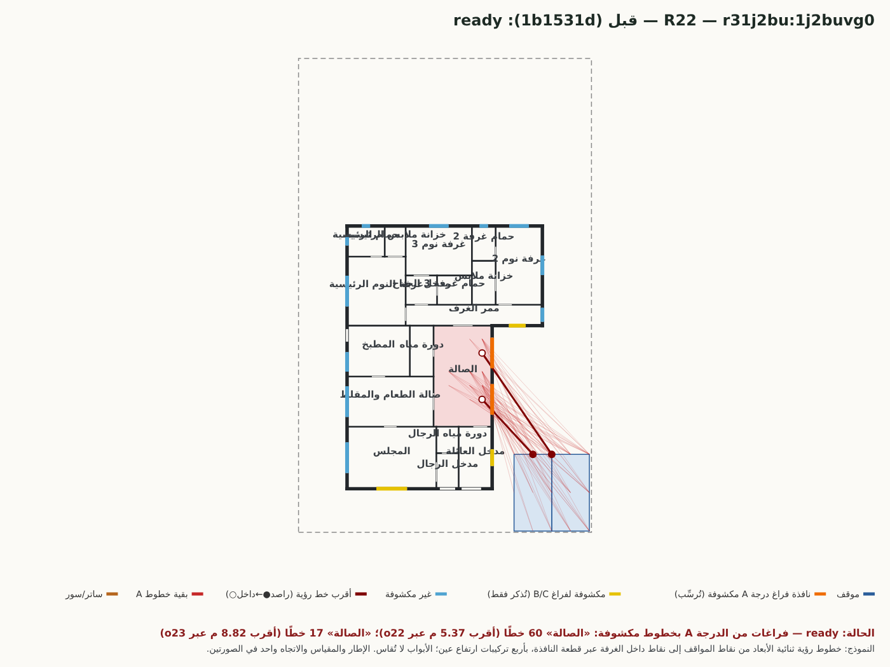
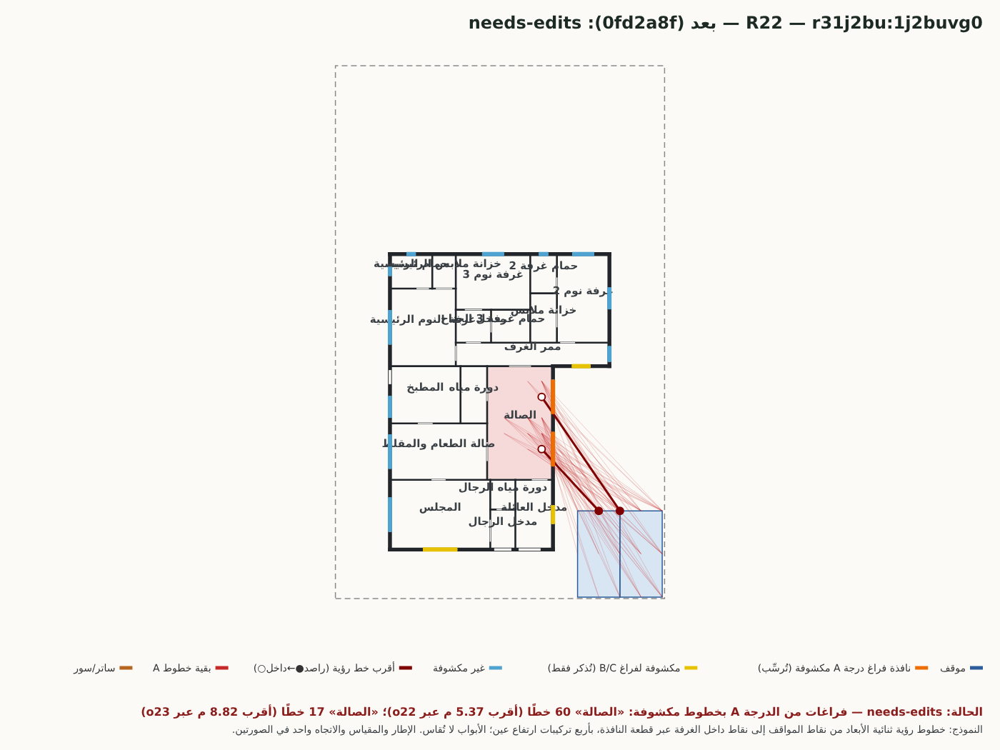
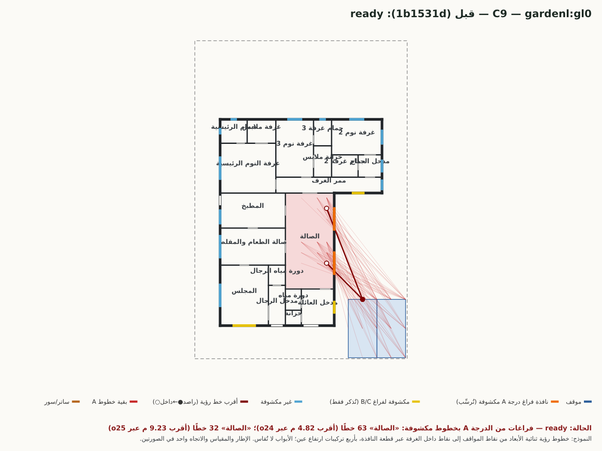
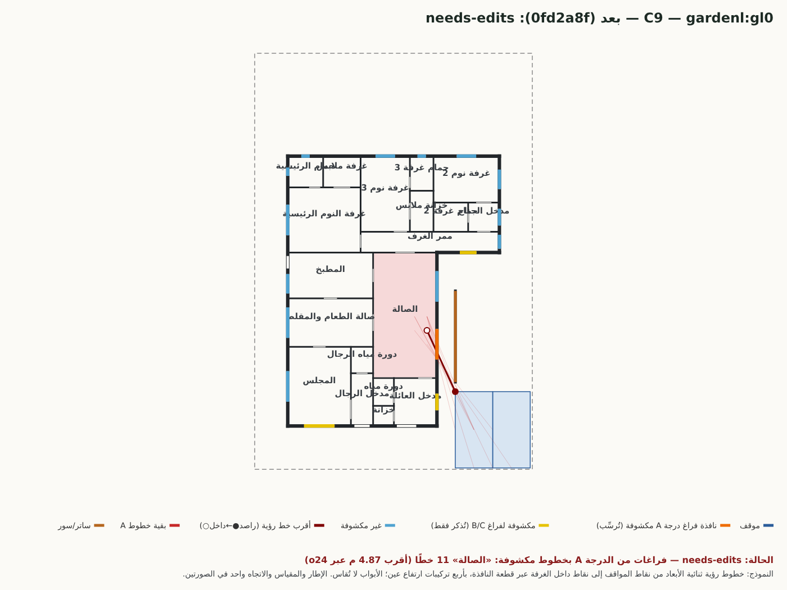

# 09 — تراجعات «جاهز → يحتاج تعديلات» في C3 وC5 وH5 وR22 وC9: قياس على المستند وصور قبل/بعد

> قبل = 1b1531d (المصفوفة k3-all)، بعد = 0fd2a8f (والشيفرة نفسها في e2dd9b4). التوليد: `scripts/r21-flip-gen.mjs`، القياس والرسم: `scripts/r21-flip-report.mjs`؛ البيانات الخام: `flip/<الحالة>/analysis*.json`.
> الصورتان لكل بديل **بإطار ومقياس واتجاه واحد** (شمال أعلى؛ الشارع جنوبًا، وفي C3 شرقيٌّ أيضًا). الخطوط الحمراء = خطوط رؤية من نقاط المواقف إلى نقاط داخل الغرفة عبر النافذة؛ الغامق = الأقرب (● راصد على حدود موقف، ○ نقطة داخل الغرفة). الأبواب لا تُقاس في هذا النموذج (غير متحقق).
> **تعريفان للمسافة:** «أقرب X م» في حكم الاختبار = من الراصد (نقطة الموقف) إلى النافذة؛ «طوله» في الجداول = من الراصد إلى النقطة داخل الغرفة.
> «بدون الساتر» = إعادة القياس على المستند نفسه بعد حذف الأسوار. القياس بدالة المحرك `windowExposure` (بعد) مطبَّقة على مستند «قبل» أيضًا، فالفرق فرق المستند لا فرق الدالة.

## 1. الشرط الذي أخفق ولماذا تلك الدرجة

الشرط: اختبار الخصوصية لكل فراغ (`dist/space-privacy.mjs`، قرار المالك 2026-10-26 ثانيًا): فراغ **درجة A** يرسب إن وُجد **أي** خط رؤية مكشوف من المواقف عبر نافذة جلستها دون 1.6 م. نموذج الخط: نقاط عينة المواقف (الأركان ومنتصفات الأضلاع والمركز) إلى نقاط داخل الغرفة (عمق 0.6/1.5/3 م وانحراف 0/±1/±2 م داخل الأوجه الصافية) بأربع تركيبات ارتفاع عين، ويحجبه سور مرسوم أو جدار.
**درجة A** تشمل غرف النوم والرئيسية ومجلس النساء والصالة العائلية: **قيمة تصميمية افتراضية للميزان، غير نظامية وغير متحققة من كود أو بلدية** (`PRIVACY_DEGREES.source`). الصالة صُنِّفت A لأن المالك سمّاها صراحة في قراره (حكم لكل فراغ بدرجته: «الصالة، غرفة النوم 3، المدخل، الممر»)، ولأنها فراغ الجلوس اليومي للعائلة. **الدرجة المطلوبة نفسها قرار تصميمي بانتظار تثبيت المالك** (الحكم «غير متحقق نظاميًا»).

## 2. الجداول (بيانات مقيسة)

### C3

> طلب الحالة: «3 غرف نوم ومجلس رجال على الشارع ومجلس نساء، والمطبخ بجانب الطعام، ومدخل ثاني من الشارع الشرقي»

| البديل | قبل (1b1531d) | بعد (0fd2a8f) | الهندسة (جدران/فتحات) | ساتر أُضيف | الفراغات من الدرجة A: خطوط مكشوفة قبل ← بعد |
|---|---|---|---|---|---|
| `r31t5kd:1t5kdvp` | ready | needs-edits | الجدران متطابقة؛ تغيّرت فتحات (جلسة نافذة نوم) | 0→1 | الصالة: 71 (أقرب 5.71 م)؛ غرفة نوم 3: 26 (أقرب 4 م)؛ غرفة النوم الرئيسية: 4 (أقرب 3.33 م) ← الصالة: 64 (أقرب 5.71 م) |
| `ell:l0` | ready | **غير موجود بعد** | — | — | — |
| `r31qgzd:1qgzdhCa` | needs-edits | **غير موجود بعد** | — | — | — |
| `r3jvye0:jvye0hCa` | جديد | needs-edits | — | —→5 | — ← الصالة: 8 (أقرب 8.05 م) |

**`r31t5kd:1t5kdvp` — نافذة/نوافذ الفراغات من الدرجة A المكشوفة بعد (إحداثيات المستند بالمتر):**

| النافذة | الفراغ | موضع النافذة | الجلسة | خطوط مكشوفة | أقرب خط: راصد (موقف) ← نقطة على النافذة ← نقطة داخل الغرفة | طوله | مع الساتر الموجود / بدونه |
|---|---|---|---|---|---|---|---|
| o24 | الصالة | (18.38, 13.78) عرض 1.4 | 1 | 64 | (19.4, 19.45) ← (18.5, 13.78) ← (18.38, 13.06) | 6.48 م | 64 / 71 |

حكم الاختبارات بعد: خصوصية «الصالة»: درجة عالية: 64 خط رؤية مكشوف من المواقف (أقرب 5.71 م)

**`r3jvye0:jvye0hCa` — نافذة/نوافذ الفراغات من الدرجة A المكشوفة بعد (إحداثيات المستند بالمتر):**

| النافذة | الفراغ | موضع النافذة | الجلسة | خطوط مكشوفة | أقرب خط: راصد (موقف) ← نقطة على النافذة ← نقطة داخل الغرفة | طوله | مع الساتر الموجود / بدونه |
|---|---|---|---|---|---|---|---|
| o24 | الصالة | (15.58, 16.73) عرض 2.2 | 0.8 | 8 | (19.4, 23.5) ← (15.05, 16.73) ← (14.58, 16.01) | 8.91 م | 8 / 8 |

حكم الاختبارات بعد: خصوصية «الصالة»: درجة عالية: 8 خط رؤية مكشوف من المواقف (أقرب 8.05 م)

### C5

> طلب الحالة: «أرض شكلها شبه منحرف: الواجهة 18 م والخلف 24 م وعمقها 30 م؛ 3 غرف ومجلس وصالة ومطبخ»

| البديل | قبل (1b1531d) | بعد (0fd2a8f) | الهندسة (جدران/فتحات) | ساتر أُضيف | الفراغات من الدرجة A: خطوط مكشوفة قبل ← بعد |
|---|---|---|---|---|---|
| `cornerentry:e0t` | ready | needs-edits | الجدران متطابقة؛ تغيّرت فتحات (جلسة نافذة نوم) | 0→1 | الصالة: 20 (أقرب 3.42 م)؛ غرفة النوم الرئيسية: 1 (أقرب 11.59 م) ← الصالة: 20 (أقرب 3.42 م) |
| `split:s0rt` | ready | needs-edits | الجدران متطابقة؛ تغيّرت فتحات (جلسة نافذة نوم) | 0→1 | الصالة: 32 (أقرب 5.04 م)؛ غرفة النوم الرئيسية: 108 (أقرب 13.38 م) ← الصالة: 32 (أقرب 5.04 م) |
| `hallback:h0` | ready | ready | الجدران متطابقة؛ تغيّرت فتحات (جلسة نافذة نوم) | 0→1 | لا شيء ← لا شيء |

**`cornerentry:e0t` — نافذة/نوافذ الفراغات من الدرجة A المكشوفة بعد (إحداثيات المستند بالمتر):**

| النافذة | الفراغ | موضع النافذة | الجلسة | خطوط مكشوفة | أقرب خط: راصد (موقف) ← نقطة على النافذة ← نقطة داخل الغرفة | طوله | مع الساتر الموجود / بدونه |
|---|---|---|---|---|---|---|---|
| o23 | الصالة | (17.55, 9.46) عرض 2.2 | 0.8 | 18 | (19.5, 5.6) ← (17.55, 8.41) ← (16.83, 9.46) | 4.7 م | 18 / 18 |
| o24 | الصالة | (17.55, 12.75) عرض 2.2 | 0.8 | 2 | (20.85, 5.6) ← (17.55, 12.28) ← (16.83, 13.75) | 9.09 م | 2 / 2 |

حكم الاختبارات بعد: خصوصية «الصالة»: درجة عالية: 20 خط رؤية مكشوف من المواقف (أقرب 3.42 م)

**`split:s0rt` — نافذة/نوافذ الفراغات من الدرجة A المكشوفة بعد (إحداثيات المستند بالمتر):**

| النافذة | الفراغ | موضع النافذة | الجلسة | خطوط مكشوفة | أقرب خط: راصد (موقف) ← نقطة على النافذة ← نقطة داخل الغرفة | طوله | مع الساتر الموجود / بدونه |
|---|---|---|---|---|---|---|---|
| o22 | الصالة | (7.75, 11.05) عرض 2.2 | 0.8 | 21 | (4.5, 5.6) ← (7.75, 10.06) ← (8.48, 11.05) | 6.75 م | 21 / 21 |
| o23 | الصالة | (7.75, 14.76) عرض 2.2 | 0.8 | 11 | (4.5, 5.6) ← (7.75, 13.9) ← (8.48, 15.76) | 10.91 م | 11 / 11 |

حكم الاختبارات بعد: خصوصية «الصالة»: درجة عالية: 32 خط رؤية مكشوف من المواقف (أقرب 5.04 م)

### H5

> طلب الحالة: «دور واحد، 4 غرف نوم، مجلس 5×7، المطبخ 3.5×5، وصالة كبيرة»

| البديل | قبل (1b1531d) | بعد (0fd2a8f) | الهندسة (جدران/فتحات) | ساتر أُضيف | الفراغات من الدرجة A: خطوط مكشوفة قبل ← بعد |
|---|---|---|---|---|---|
| `courtyard:k1` | ready | ready | الجدران متطابقة؛ تغيّرت فتحات (جلسة نافذة نوم) | 0→3 | الصالة: 80 (أقرب 4.08 م)؛ غرفة نوم 4: 2 (أقرب 9.8 م) ← لا شيء |
| `r3od28p:od28phg1` | ready | **غير موجود بعد** | — | — | — |

### R22

> طلب الحالة: «3 غرف نوم منها ماستر، مجلس، صالة كبيرة، مطبخ، طعام»

| البديل | قبل (1b1531d) | بعد (0fd2a8f) | الهندسة (جدران/فتحات) | ساتر أُضيف | الفراغات من الدرجة A: خطوط مكشوفة قبل ← بعد |
|---|---|---|---|---|---|
| `r31j2bu:1j2buvg0` | ready | needs-edits | الجدران متطابقة؛ تغيّرت فتحات (جلسة نافذة نوم) | 0→0 | الصالة: 77 (أقرب 3.31 م) ← الصالة: 77 (أقرب 3.31 م) |
| `r31n5s9:1n5s9vg1` | ready | ready | الجدران متطابقة؛ تغيّرت فتحات (جلسة نافذة نوم) | 0→0 | لا شيء ← لا شيء |
| `r34nk7y:4nk7yhg1` | ready | ready | الجدران متطابقة؛ تغيّرت فتحات (جلسة نافذة نوم) | 0→0 | لا شيء ← لا شيء |

**`r31j2bu:1j2buvg0` — نافذة/نوافذ الفراغات من الدرجة A المكشوفة بعد (إحداثيات المستند بالمتر):**

| النافذة | الفراغ | موضع النافذة | الجلسة | خطوط مكشوفة | أقرب خط: راصد (موقف) ← نقطة على النافذة ← نقطة داخل الغرفة | طوله | مع الساتر الموجود / بدونه |
|---|---|---|---|---|---|---|---|
| o22 | الصالة | (13.88, 9.54) عرض 2.2 | 0.8 | 60 | (16.8, 5.6) ← (13.88, 8.75) ← (13.16, 9.54) | 5.37 م | 60 / 60 |
| o23 | الصالة | (13.88, 12.87) عرض 2.2 | 0.8 | 17 | (18.15, 5.6) ← (13.88, 11.82) ← (13.16, 12.87) | 8.82 م | 17 / 17 |

حكم الاختبارات بعد: خصوصية «الصالة»: درجة عالية: 77 خط رؤية مكشوف من المواقف (أقرب 3.31 م)

### C9 (مسار villa-layout-v2 المباشر كما في اختبار r17)

> طلب الحالة: «3 غرف نوم ومجلس وصالة ومطبخ وطعام»

| البديل | قبل (1b1531d) | بعد (0fd2a8f) | الهندسة (جدران/فتحات) | ساتر أُضيف | الفراغات من الدرجة A: خطوط مكشوفة قبل ← بعد |
|---|---|---|---|---|---|
| `guestblock:gb0` | ready | needs-edits | الجدران متطابقة؛ تغيّرت فتحات (جلسة نافذة نوم) | 0→1 | الصالة: 6 (أقرب 4.73 م)؛ غرفة النوم الرئيسية: 5 (أقرب 9.36 م) ← الصالة: 6 (أقرب 4.73 م) |
| `gardenl:gl0` | ready | needs-edits | الجدران متطابقة؛ تغيّرت فتحات (جلسة نافذة نوم) | 0→1 | الصالة: 95 (أقرب 2.77 م) ← الصالة: 11 (أقرب 2.77 م) |
| `centralhall:ch3` | needs-edits | needs-edits | الجدران متطابقة؛ تغيّرت فتحات (جلسة نافذة نوم) | 0→1 | الصالة: 55 (أقرب 3.47 م)؛ غرفة نوم 2: 1 (أقرب 4.92 م) ← لا شيء |

**`guestblock:gb0` — نافذة/نوافذ الفراغات من الدرجة A المكشوفة بعد (إحداثيات المستند بالمتر):**

| النافذة | الفراغ | موضع النافذة | الجلسة | خطوط مكشوفة | أقرب خط: راصد (موقف) ← نقطة على النافذة ← نقطة داخل الغرفة | طوله | مع الساتر الموجود / بدونه |
|---|---|---|---|---|---|---|---|
| o27 | الصالة | (16.43, 10.35) عرض 2.2 | 0.8 | 6 | (19.85, 5.6) ← (16.43, 9.52) ← (15.71, 10.35) | 6.3 م | 6 / 6 |

حكم الاختبارات بعد: خصوصية «الصالة»: درجة عالية: 6 خط رؤية مكشوف من المواقف (أقرب 4.73 م)

**`gardenl:gl0` — نافذة/نوافذ الفراغات من الدرجة A المكشوفة بعد (إحداثيات المستند بالمتر):**

| النافذة | الفراغ | موضع النافذة | الجلسة | خطوط مكشوفة | أقرب خط: راصد (موقف) ← نقطة على النافذة ← نقطة داخل الغرفة | طوله | مع الساتر الموجود / بدونه |
|---|---|---|---|---|---|---|---|
| o24 | الصالة | (13.13, 9.02) عرض 2.2 | 0.8 | 11 | (14.45, 5.6) ← (13.13, 8.46) ← (12.41, 10.02) | 4.87 م | 11 / 63 |

حكم الاختبارات بعد: خصوصية «الصالة»: درجة عالية: 11 خط رؤية مكشوف من المواقف (أقرب 2.77 م)

## 3. التصنيف الصريح (بعد مراجعة الصور والأرقام)

| الحالة / البديل | التصنيف | الدليل |
|---|---|---|
| **C3** `r31t5kd` | **كشف صادق لعيب سابق** | جدران المستند متطابقة قبل/بعد؛ نافذة الصالة o24 لم تتغير (جلسة 1.0، 1.4 م عرضًا) وتواجه موقف الشارع الشرقي (من الراصد إلى النافذة 5.71 م، وحتى النقطة الداخلية 6.48 م) بزاوية شبه مباشرة (الصورة). في المستند القديم 71 خطًا مكشوفًا وفي الجديد 64 (الساتر المضاف للنوم يحجب جزءًا فقط ويترك فجوة قرب الجدار). كذلك كُشفت في «قبل» غرفتا نوم (26 و4 خطوط) وزالتا في «بعد» برفع الجلسة/الساتر — تحسّن حقيقي. |
| **C5** `cornerentry:e0t` | كشف صادق لعيب سابق | عدد خطوط الصالة 20 قبل وبعد (النافذتان o23 وo24 لم تتغيرا): o23 على الجدار الشرقي تبعد 3.42 م عن راصد ركن الموقف (4.70 م حتى النقطة الداخلية) (الصورة). الرئيسية: خط واحد (11.59 م) زال بالساتر. ملاحظة حدّية: o24 خطان فقط على 9.09 م — لو كانت وحدها لعُدّ الحكم صارمًا؛ لكن o23 وحدها تُرسِّب. |
| **C5** `split:s0rt` | كشف صادق لعيب سابق | الصالة 32 خطًا قبل وبعد؛ o22 على الجدار الغربي تبعد 5.04 م عن راصد موقف الجنوب الغربي (6.75 م حتى النقطة الداخلية)؛ الرئيسية كانت 108 خطًا (13.38 م) وزالت. |
| **C5** `hallback:h0` | بلا تغيير (جاهز → جاهز) | لا انكشاف درجة A في الحالتين. |
| **R22** `r31j2bu` | **كشف صادق لعيب سابق — تغيير معيار محض** | المستند **متطابق** قبل/بعد (الجدران والفتحات والأسوار؛ يزيد فقط جهاز واحد في الحمامات: الدش): 77 خطًا في الصالة، أقرب 3.31 م — نوافذ الصالة الشرقية تواجه الموقفين على بعد 3–5 م (الصورة). الحالة تغيّرت لأن الاختبار جديد لا لأن المخطط تغيّر. |
| **C9** `guestblock:gb0` | كشف صادق لعيب سابق (انظر `10-c9-review.md`) | الصالة 6 خطوط قبل وبعد، أقرب 4.73 م (راصد–نافذة؛ 6.3 م حتى النقطة الداخلية) عبر o27 على الجدار الشرقي أمام الموقف الشرقي؛ الرئيسية 5 خطوط زالت بالساتر الغربي ورفع جلسة نافذتها (الصورة). |
| **C9** `gardenl:gl0` | كشف صادق لعيب سابق، **مع تحسّن** | الصالة 95 خطًا قبل، 11 بعد الساتر؛ المتبقي يمر من زاوية الموقف الشمالية الغربية جنوب نهاية الساتر (أقرب مسافة راصد–نافذة 2.77 م، والخط الأقرب حتى النقطة الداخلية 4.87 م). الساتر لم يتسع لتغطية كامل الخط (غير محسوم هل كان ممكنًا هندسيًا بطول أكبر). |
| **H5** `courtyard:k1` | بلا تغيير (جاهز → جاهز) | لا تراجع حالة. |
| **H5** `r3od28p` | **تراجع غير خصوصي: بديل مفقود** | عاد عند `R14_OFF=r21wallmix` فقط؛ مقاساته القديمة ناجحة بالقياس (08، ملاحظة 5). ليس إفراطًا في فحص الخصوصية بل في متنبّئ المقاس عند التوليد. |
| **C3** `ell:l0` (جاهز قبل) | **تراجع غير محسوم السبب** | البديل في مجمع المرشحين لكنه لا يُعرض؛ يعود (يحتاج تعديلات بسبب اختبار الصالة) عند `R14_OFF=r21spacepriv`، أي أن خطوة الساتر الجديدة تُخرجه من العرض بطريقة لم أعزلها بعد. غير محسوم. |

### هل التغيير كشف عيبًا سابقًا أم أضاف شرطًا جديدًا؟
**الاثنان معًا، ولا يُفصل بينهما.** (أ) العيب الهندسي موجود في مستندات 1b1531d نفسها (جدران ونوافذ الصالة لم تتغير في C3/C5/R22/C9، والخطوط المقيسة على «قبل» بدالة الجديدة تُظهره): إذن **كشف لعيب سابق** *بشرط أن تكون درجة A للصالة مطلوبة*. (ب) المعيار «A للصالة» **شرط جديد** أضافه قرار المالك بتاريخ 2026-10-26 ولم يكن في 1b1531d. فمن يرفض الدرجة A للصالة يصنّف كل ما سبق «تغيير معيار» لا «كشف عيب»؛ ومن يقبلها يصنّفه كشفًا. **ليس في الأدلة ما يُرجّح أحدهما نظاميًا — غير محسوم، قرار المالك.**

### الإفراط في الصرامة؟ (ما يمكن قوله بالأدلة)
- لا يظهر إفراط في الحالات الخمس بصريًا: خطوط الرؤية الأقرب تعبر نافذة جلستها 0.8–1.0 م مباشرة من مسافة 3.3–6.8 م.
- **حساسية النموذج** (تُذكر ولا تُخفى): يكفي خط واحد من عشرات الآلاف من التركيبات ليرسب الفراغ، وتُعدّ زوايا الموقف نقطًا يقف عندها راصد؛ نوافذ `window2` ذات الجلسة 0.8 م تُرى من الواقف خارجًا. لذلك فالحالات الحدّية (خطان على 9 م في C5 o24) تُرسِّب في نموذج قد يُعدّ متشددًا؛ **لم أضع عتبة بديلة** (لا تخفيف).
- الأبواب (مفتوحة/مغلقة) **غير مقاسة**: لا أثر لها في الأرقام أعلاه؛ باب مدخل العائلة المفتوح قد يضيف انكشافًا لا يُحصى. غير متحقق.
- أثر الساتر مقيس (عمود «مع/بدون»): C3 71→64، C9 gl0 95→11 (مجموع الصالة)، وفي بقية الحالات لا أثر على الصالة.
