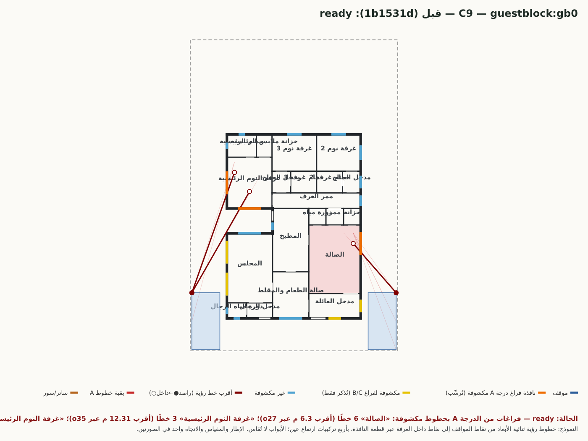
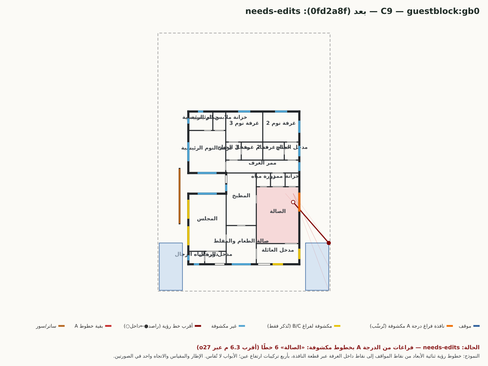

# 10 — مراجعة C9 (جناح الضيافة `guestblock:gb0`): تغيير توقع اختبار r17 — **معلّق بانتظار قرار المالك، غير معتمد**

> التصنيف المطلوب: إصلاح عيب في المولِّد / تصحيح اختبار غير مطابق للمتطلب / تغيير معيار قبول.
> **التصنيف: تغيير معيار قبول.** لا يُعتمد لمجرد نجاح الاختبار؛ `C9_CRITERION_CHANGE=PENDING_OWNER_DECISION`.

## 1. الاختبار
`tests/stage2-r17.test.mjs`، الاختبار الرابع: «المولّد (C1، C9): غرفة الملابس المطلوبة ≥ 4.5 م²، وفي C9 بديل جاهز يلاصق فيه المجلس المقلط والمطبخ خلفه».
المعيار الأصلي بنصه (عنوان الاختبار): «**وفي C9 بديل جاهز** يلاصق فيه المجلس المقلط والمطبخ خلفه»، وسطره الأصلي:
```js
const gb = o9.designs.find(d => d.pat.startsWith('guestblock')); assert.ok(gb, 'جناح الضيافة معروض');
assert.equal(gb.presentation.status, 'ready');
assert.ok(!measureR16(gb.doc).some(g => g.id === 'GUEST_DINING' && g.applicable && !g.pass));
```

| | التوقع القديم (1b1531d) | التوقع الجديد (التزام 5d97aa1، قائم الآن) | الفرق |
|---|---|---|---|
| حالة `guestblock` | `=== 'ready'` | `['ready','needs-edits']` ويقبل `needs-edits` **إن كانت كل ملاحظاته عن خصوصية «الصالة»** وبلا مخالفة إلزامية | يسمح بما كان يُرسِب، أي أن المعيار «جاهز» لم يعد شرطًا |
| باقي الأسطر | وجود البديل؛ `GUEST_DINING` متحقق | بلا تغيير | — |

شغّلتُ **الملف الأصلي كما هو** على الرأس الحالي: يرسب (هذا الاختبار وحده). فالتعديل **لازم لكي ينجح الاختبار**، وهو ما لا يجوز اعتماده بذاته.

## 2. البديل بصيغتيه (مستند حقيقي، 2D، بإطار ومقياس واحد)

| قبل (1b1531d): **جاهز** | بعد (0fd2a8f): **يحتاج تعديلات** |
|---|---|
|  |  |

- **الهندسة:** جدران المستند متطابقة؛ تغيّر في «بعد»: ساتر غربي (سور 1.8 م بطول 6.35 م على بعد 0.9 م) لنافذة الرئيسية، ورفع جلسة نافذتها o36 من 0.8 إلى 1.6 م، وجهازان إضافيان (دش).
- **سبب «يحتاج تعديلات» هو الصالة وحدها:** `edits_ar = ["خصوصية «الصالة»: درجة عالية: 6 خط رؤية مكشوف من المواقف (أقرب 4.73 م)"]`، `mandatory = []`، ولا عيب جوهري آخر (قياس هذه الجولة بالنص نفسه).
- **مسار الانكشاف (إحداثيات المستند):** نافذة الصالة o27 على الجدار الشرقي؛ أقرب خط من راصد على حدود الموقف الشرقي إلى نقطة داخل الصالة المسافة من الراصد إلى النافذة 4.73 م (6.3 م حتى النقطة الداخلية) (الجدول المفصَّل في `09-privacy-flips.md` §2، قسم C9).
- **هل الانكشاف حقيقي بصريًا؟** نعم في الصورة: نافذة الصالة الشرقية تقابل الموقف الشرقي مباشرة من 4.7 م، والساتر المضاف على الجهة الغربية لا يمسّها.
- **الرئيسية:** كانت 5 خطوط مكشوفة في «قبل» (بنموذج الاختبار الجديد) وزالت في «بعد».

## 3. المتطلب الذي يبرر التغيير (وما لا يبرره)
- يبرره **قرار المالك 2026-10-26 (البند 2): حكم خصوصية لكل فراغ بدرجته (الصالة، غرفة النوم 3، المدخل، الممر)**؛ والصالة درجة A في `dist/space-privacy.mjs` (قيمة تصميمية افتراضية، غير نظامية).
- **لا يبرره** أن «جاهز» في C9 كان حكم مراجع مستقل: لا مرجع نظامي، والدرجة A تصميمية. لذلك الاختبار بتوقعه الجديد **يضعف** معيار القبول («جاهز» ⇒ «جاهز أو يحتاج تعديلات»)، وهذا قرار للمالك لا للتنفيذ.

## 4. الخيارات المعروضة على المالك (لا اختيار هنا)
1. **اعتماد التوقع الجديد** (الصالة درجة A تُرسِّب إلى «يحتاج تعديلات»، ويبقى المعروض للعميل). يتطلب تأكيد الدرجة A للصالة.
2. **إعادة التوقع الأصلي «ready»**: يرسب الاختبار (يُعدّ اختبارًا مفتوحًا) إلى أن يُعالَج انكشاف الصالة في المولِّد (ساتر أطول أو نقل النافذة) — **جولة تطوير** لم تُنفَّذ.
3. **تخفيض الصالة إلى B** (تُذكر ولا تُرسِّب): يعيد C9/C3/C5/R22 «جاهزة» لكنه **تخفيف متطلب** لإنجاح حالات، وهو مخالف لقيد «لا تخفيف للخصوصية».
