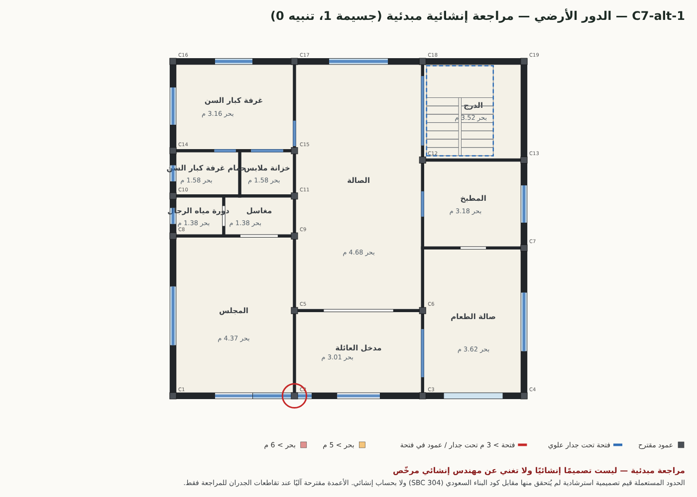
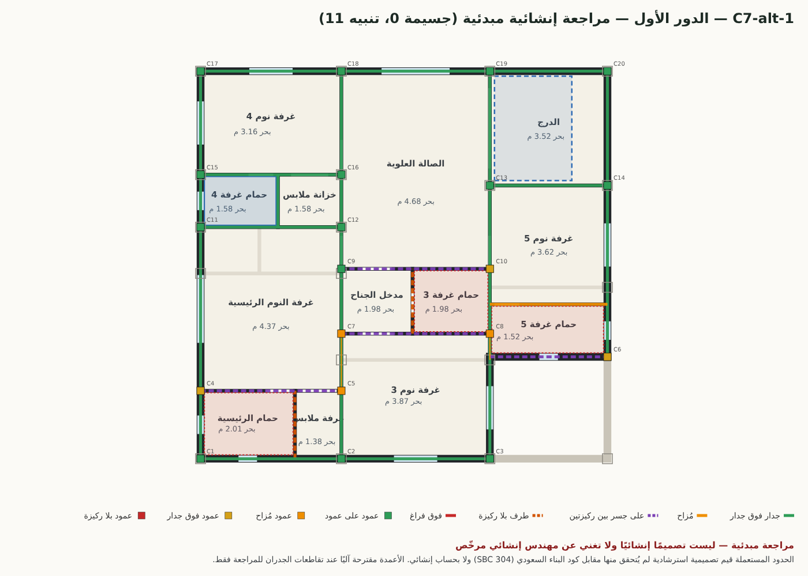
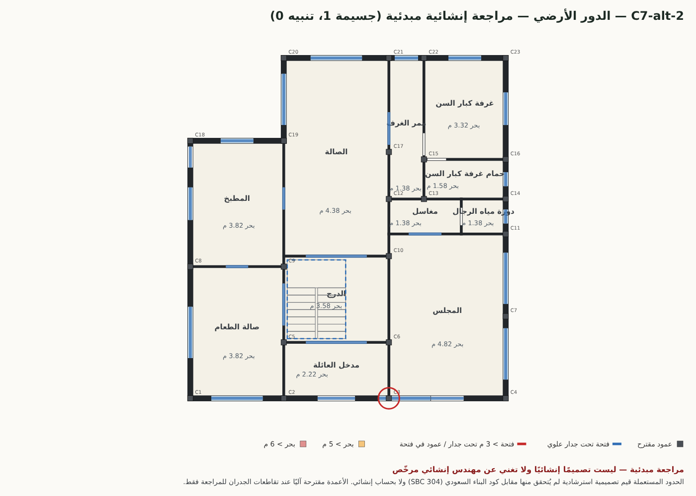
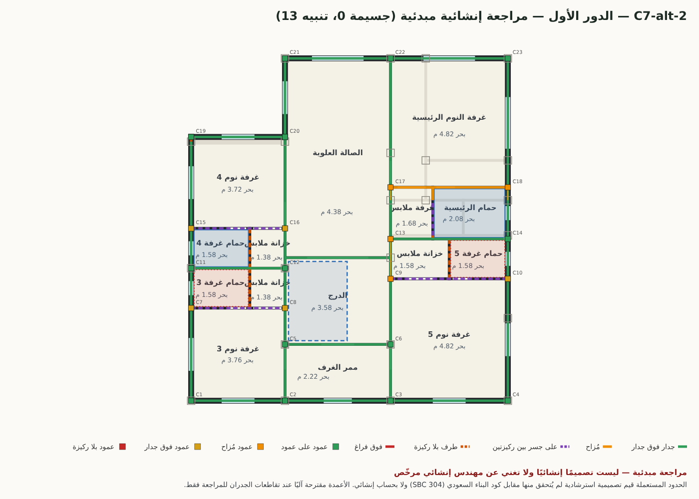
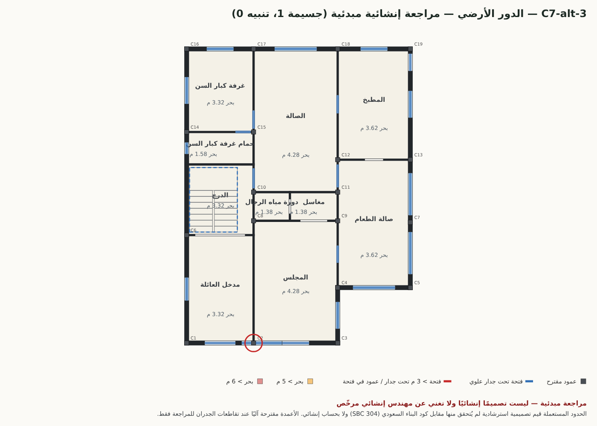
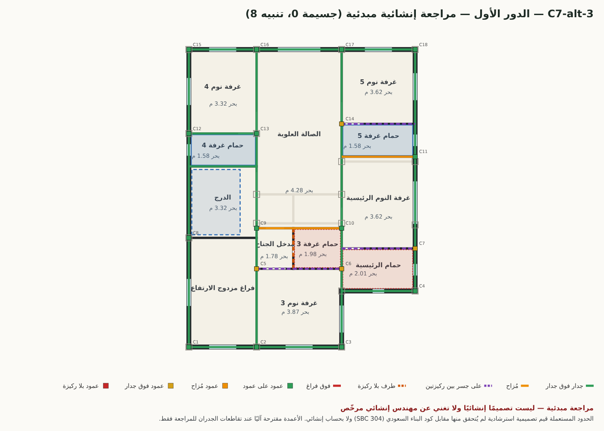
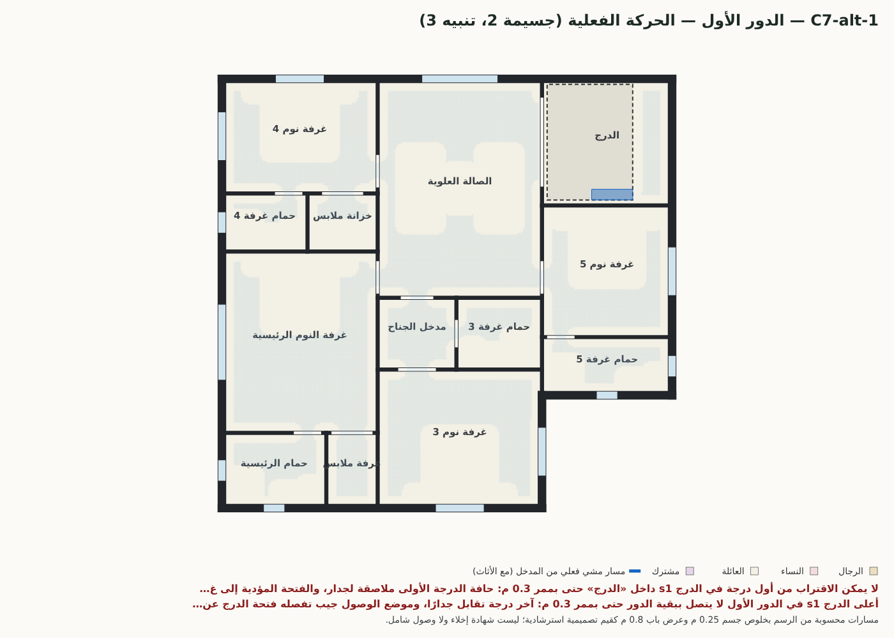
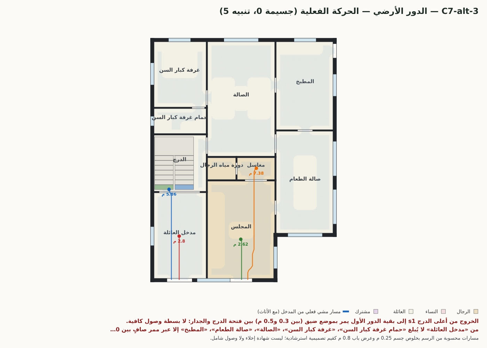

# المراجعة الإنشائية المبدئية، والتطابق 2D/3D، والحركة الفعلية — على أدلة الجولة التاسعة

التاريخ: 2026-10-21 · الفرع: `dev/structural-precheck` من `dev/architect-v2` عند `b462c85` · لم يُدمج في main ولم يُنشر.
المدخلات: `evidence/acceptance/after-9/` (الحالات العشر، 31 بديلًا، منها C7 بدورين: 3 بدائل) ومجموعة المخططات المعيبة `evidence/review-proof/corpus/`.

> **مراجعة مبدئية — ليست تصميمًا إنشائيًا ولا تغني عن مهندس إنشائي مرخّص.**
> لا يصف هذا العمل أي بديل بأنه سليم إنشائيًا أو جاهز للتنفيذ. كل الحدود الرقمية أدناه قيم تصميمية استرشادية
> لم يُتحقق منها مقابل كود البناء السعودي (SBC 301/304) ولا بحساب إنشائي، وهي معلنة في الكود (`PRECHECK_LIMITS`، `CIRC_LIMITS`).

## 1. ما أُضيف (ملفات جديدة فقط)
| الملف | الدور |
|---|---|
| `dist/structural-precheck.mjs` | المراجعة الإنشائية المبدئية: شبكة أعمدة مقترحة، واستمرارية الجدران والأعمدة بين الأدوار، والبحور، والفتحات تحت الجدران، والبروز، وفتحة الدرج، وتراكب الحمامات، وشكل المسقط. نقية (بلا DOM). |
| `scripts/structural-precheck-run.mjs` | يشغّلها على مستندات الأدوار المتعددة ويرسم صور التراكب (PNG عبر Chromium). |
| `scripts/circulation-proof.mjs` | الحركة الفعلية: رسم الأبواب + شبكة مشي 5 سم بخلوص جسم + الأثاث + الدرج كما يبنيه المجسّم. |
| `scripts/consistency-2d3d.mjs` + `scripts/consistency-2d3d-lib.mjs` | التطابق الهندسي: يفتح `view3d.html` الحقيقية في Chromium ويقيس المشهد المعروض (`__mizanViewer.built`) ويقارنه بالمستند؛ و`--node` للمشهد نفسه دون متصفح. |
| `scripts/plan-overlay-svg.mjs` | رسم المسقط وتحويله PNG (مشترك). |
| `tests/structural-precheck.test.mjs` (8)، `tests/circulation-proof.test.mjs` (4)، `tests/consistency-2d3d.test.mjs` (5، منها واحد داخل المتصفح)، `tests/_mini-docs.mjs` | 17 اختبارًا، كل ملف < 20 ث. |

لم يُعدَّل أي ملف قائم. `npm test`: **1338 ناجحًا، 0 فاشلًا**.

## 2. المراجعة الإنشائية المبدئية (`structuralPrecheck(doc)`)
**الافتراض:** هيكل خرساني مسلح (أعمدة وجسور وبلاطات) وجدران بلوك غير حاملة — الشائع في الفلل السعودية.
- **شبكة أعمدة مقترحة لكل دور:** زوايا المحيط دائمًا، وتقاطعات خطين رئيسيين (≥ 4 م)، ثم ما يلزم لتباعد ≤ 6 م على كل خط جدار
  (يُفضَّل التقاطع، وإلا عمود «وسيط» خارج الفتحات، وفي الدور العلوي يُفضَّل موضع عمود الدور الذي تحته). للمراجعة فقط.
- **بين كل دورين:** كل جدار علوي يُقسَّم إلى: فوق جدار (≤ 20 سم)، مُزاح (20–60 سم)، على جسر/بلاطة بين ركيزتين، طرف بلا ركيزة، فوق فراغ.
  > 5 م بلا ركيزة = جسيم؛ جدار ثقيل (≥ 20 سم) على جسر = تنبيه؛ قاطع خفيف = معلومة.
- **الأعمدة:** على عمود (≤ 30 سم) / مُزاح (≤ 1 م، تنبيه) / فوق جدار بلوك (تنبيه: يلزم عمود أو جسر تحويل) / بلا ركيزة أو فوق فراغ (جسيم).
- **البحر الصافي لكل لوح** = ضعف أكبر بُعد لنقطة عن حدود الفراغ (للمستطيل = الضلع الأقصر): > 5 م تنبيه، > 6 م جسيم.
- **فتحات الدور السفلي تحت جدران علوية:** > 3 م تنبيه (عتب/جسر يحمل جدارًا)، وإلا معلومة مجمّعة. **عمود (تقاطع) داخل فتحة** = جسيم.
- **البروز:** عمق الدور العلوي خارج مسقط الذي تحته: > 0.3 م معلومة، > 1.5 م تنبيه، > 2.5 م جسيم.
- **الدرج:** داخل غرفة؟ يعبر جدارًا؟ فتحة البلاطة في غرفة الدرج/فراغ حركة لا في غرفة نوم؟ جدار علوي فوقها؟ تراكب غرفتي الدرج؟ ولا درج بين دورين = جسيم.
- **الحمامات العلوية** فوق فراغ رطب (لمسارات الصرف): فوق فراغ معيشي = تنبيه.
- **الشكل:** نسبة الطول/العرض > 3، والزوايا الداخلة، وإزاحة مركز الدور العلوي.
- **لا يُفحص:** الأحمال وقيمها، المقاسات والتسليح، الأحمال الجانبية، الأساسات والتربة، الانحرافات، نصوص الكود.

### 2.1 نتائج C7 (بعد-9) — البدائل الثلاثة بدورين
| البديل | جسيمة | تنبيه | أعمدة (أرضي/علوي) | استمرارية الأعمدة | أكبر بحر | الحمامات العلوية فوق رطب |
|---|---|---|---|---|---|---|
| 1 | 1 | 11 | 19 / 20 | 14 من 20 على عمود (70%)، 3 مُزاحة، 3 فوق جدار | 4.68 م (الصالة) | 1 من 4 |
| 2 | 1 | 13 | 23 / 23 | 14 من 23 (61%)، 4 مُزاحة، 5 فوق جدار | 4.82 م (المجلس) | 2 من 4 |
| 3 | 1 | 8 | 19 / 18 | 14 من 18 (78%)، 0 مُزاحة، 4 فوق جدار | 4.28 م (المجلس) | 2 من 4 |

لا بروز (المسقط العلوي داخل الأرضي)، ولا جدار علوي فوق فراغ، ولا امتداد جدار علوي > 5 م بلا ركيزة، ولا بحر > 5 م،
وفتحة الدرج في كل بديل داخل غرفة الدرج فوق غرفة الدرج (2.50×3.38 م تقريبًا). **الملاحظة الجسيمة الوحيدة في كل بديل واحدة ونفسها:**
نافذة واجهة أمامية تعبر تقاطع جدار داخلي كامل العمق — `o15` (البديل 1، عند x=6.98)، `o23` (البديل 2، x=10.73)، `o20` (البديل 3، x=6.63) —
أي أن عمود التقاطع (وطرف الجدار الداخلي) يقع داخل فتحة النافذة. هذا خطأ في المولّد (`dist/villa-layout-v2.mjs`، لم أعدّله) ويظهر
أيضًا في التطابق 2D/3D (القسم 3).
التنبيهات المتكررة: جدران علوية مُزاحة 25–55 سم عن الجدار تحتها (مثل `w31` في البديل 1 مُزاح 55 سم عن `w14`)، وتقاطعات علوية فوق جدار بلوك
لا فوق عمود (3–5 لكل بديل)، وحمامات علوية فوق المجلس/الصالة/الطعام (صرف في سقف فراغ معيشي)، وجدار خارجي 25 سم في البديل 1 (`w32`)
محمول على جسر 3.8 م فوق صالة الطعام (السطح المكشوف).

| الأرضي | العلوي |
|---|---|
|  |  |
|  |  |
|  |  |

الألوان في الصورة العلوية: أخضر جدار فوق جدار، برتقالي مُزاح، بنفسجي متقطع على جسر بين ركيزتين، أحمر فوق فراغ؛ والمربعات: أخضر عمود على عمود،
برتقالي مُزاح، أصفر فوق جدار، أحمر بلا ركيزة؛ والمربعات الرمادية المفرغة أعمدة الدور الأرضي. في الأرضية: الأزرق فتحة تحت جدار علوي، والدائرة الحمراء عمود في فتحة.

### 2.2 كل مستندات الأدوار المتعددة في الأدلة (JSON فقط: `evidence/structural-precheck/r9/extra/`)
جسيمة/تنبيه: before 5/15، 5/13 · after-1 0/12، 1/10 · after-2 2/9، 1/15، 1/13 · after-3 14/17، 5/10، 7/10، 6/13 · after-4 6/18 · after-5 7/9، 9/9، 3/12 ·
after-6 1/17، 2/12 · after-7 1/12 · after-req-v2 1/11، 0/13، 0/16، 0/16 · **after-9 1/11، 1/13، 1/8**.
الجولات 3–5 كانت فيها جدران علوية فوق فراغ وبروز وأعمدة مزروعة؛ بوابة التراكب في الجولة التاسعة أزالتها. عيوب الدرج المصنوعة تُكشف:
`stairs-deleted` ← `STAIR_MISSING`، `stairs-moved-out` ← `STAIR_OUTSIDE` + `STAIR_HOLE_OUTSIDE`/`ROOM`/`WALL`.

## 3. التطابق الهندسي بين 2D و3D
القياس من **المشهد المعروض فعلًا** في `view3d.html` (Chromium، WebGL برمجي، المستند في `localStorage` كما يسلّمه الاستوديو):
رؤوس مثلثات كل جدار (وسوم `kind:wall`) مُسقطة على محوره ← امتداده وسماكته وأعلاه؛ وأشعة عمودية على الجدار عند منتصف ارتفاع كل فتحة
مع تنصيف حتى 2 مم ← موضعها وعرضها، وشعاع رأسي ← أعلاها وجلستها؛ ومثلثات أرضية كل غرفة ← مساحتها وحدودها ومنسوبها؛ وكتل الدرج.
التسامح: 2 سم (وإزاحة حتى 5 سم بعرض مطابق = «طفيفة»)، امتداد الجدار 16 سم (التقاء الزوايا)، المساحة 1%. الوضعان (المتصفح وNode) أعطيا النتيجة نفسها لكل البدائل.

**31 بديلًا: 831 جدارًا، 1277 فتحة، 616 غرفة.** كل الجدران (موضعًا وسماكةً وارتفاعًا) وكل الأرضيات والمناسيب والدرج متطابقة.
الفروق كلها في الفتحات: **36 جوهريًا في 17 بديلًا، و14 طفيفًا**؛ 8 بدائل متطابقة تمامًا (C4-1، C4-2، C5-1، C5-3، C6-1، C8-3، C9-1، C9-3) و6 بفروق طفيفة فقط.
- **فتحة في المسقط لا وجود لها في المجسّم (14):** كلها فتحات تعبر تقاطع جدار في المسقط؛ الباني (`dist/draw/wall-geometry.mjs`) يزيحها عن التقاطع،
  فتقع فوق فتحة مجاورة فتُسقط إحداهما. **أخطرها 4 أبواب مدخل مجلس الرجال المستقل** (`door2`، `entry`): C6-2 `o4`، C7-2 `o8`، C7-3 `o6`، C10-2 `o12` —
  المسقط فيه مدخل للرجال، والمجسّم الذي يراه العميل بلا هذا الباب (نافذة مكانه). صورة: `evidence/consistency-2d3d/r9/C7-alt-2-3d.png` (مظلة مدخل واحدة).
  والباقي نوافذ: C1-1 `o32`، C3-2 `o26`، C3-3 `o31`، C5-4 `o24`، C7-1 `o15`، C8-2 `o30`، C8-4 `o27`، C9-2 `o25`، C9-4 `o27`، C10-5 `o30`.
- **فتحة منزاحة 0.4–1.6 م أو اندمجت مع جارتها:** مثل C3-1 `o25`/`o27`، C5-2 `o26` (−1.65 م)، C8-1 `o28` (−1.57 م).
- **طفيف (3–3.5 سم):** باب ملاصق لنهاية جدار يبعده المجسّم 3 سم عن التقاطع (هامش `0.03` في الباني).
- **العلاج المقترح (لم يُنفّذ هنا لأن الملفين خارج نطاقي):** المولّد يمنع فتحة تعبر تقاطعًا (المراجعة الإنشائية تكشفها `COLUMN_IN_OPENING`)،
  والباني يعلن الفتحة المُسقطة بدل حذفها بصمت.

## 4. اتصال الغرف عبر الأبواب والحركة الفعلية
ثلاث طبقات من المستند نفسه: (أ) رسم الأبواب (باب/مزدوج/منزلق/فتحة/مرآب) والأدوار عبر الدرج؛ (ب) شبكة مشي 5 سم داخل الغرف الصافية
وممرات الأبواب، بخلوص جسم 0.25 م (ممر صافٍ ≥ 0.5 م)، والدرج كما يبنيه المجسّم: درجات الدور السفلي كتل مصمتة وفتحة الدرج العلوية بدرابزين،
والوصلة من نقطة الاقتراب أمام الدرجة الأولى إلى نقطة الخروج بعد الأخيرة؛ (ج) الشبكة نفسها مع الأثاث المرسوم عائقًا (عدا السجاد).
ما لا يُبلغ بخلوص 0.5 م يُعاد بخلوص 0.3 م ليُفرَّق «ضيق» (تنبيه) عن «مسدود» (جسيم)، ويُسمّى موضع الاختناق والأثاث المسبب.
تُحسب: مسافة المشي من المدخل المناسب (العائلة/الرجال/النساء) إلى عتبة كل غرفة ووسطها، والغرف التي لا تُبلغ إلا عبر غرفة نوم أو حمام
(الملحق الخاص بغرفته = معلومة)، ومسار الضيوف وهل يعبر العائلة، والممرات المسدودة، وعرض الأبواب (≥ 0.8 م قيمة تصميمية)، وخلوص فتح الأبواب (`swingBlockers`).

### 4.1 لكل حالة (بعد-9) — مسافة المشي بالمتر من المدخل إلى وسط الغرفة مع الأثاث (* = لا تُبلغ مع الأثاث؛ القيمة في المسقط الفارغ، أو بممر 0.3 م إن كان أضيق)
| البديل | جسيمة | تنبيه | المجلس من مدخله | الصالة من مدخل العائلة | أبعد غرفة نوم | الملاحظات (والأثاث القاطع) |
|---|---|---|---|---|---|---|
| C1-1 | 0 | 6 | 1.95 | 14.7 | غرفة نوم 3: 20.43 | أثاث يقطع المسار ×2، باب < 0.8 م ×2، فتح باب يصطدم ×2 — جلسة مجلس؛ مرحاض |
| C1-2 | 0 | 6 | 4.43 | 4.67 | غرفة النوم الرئيسية: 18.98* | أثاث يقطع المسار ×3، باب < 0.8 م ×2، فتح باب يصطدم — كنبة؛ كنبة؛ مرحاض |
| C2-1 | 0 | 1 | 4.59 | 5.5 | غرفة النوم الرئيسية: 16.37 | باب < 0.8 م |
| C3-1 | 0 | 3 | 2.77 | 10.4 | غرفة نوم 2: 16.33 | باب < 0.8 م ×2، فتح باب يصطدم |
| C3-2 | 0 | 3 | 4.85 | 7.31 | غرفة نوم 3: 16.45 | باب < 0.8 م ×2، فتح باب يصطدم |
| C3-3 | 0 | 7 | 2.99 | 7.25 | غرفة نوم 3: 19.78 | أثاث يقطع المسار ×2، ممر بامتداد مسدود ×2، باب < 0.8 م ×2، فتح باب يصطدم — مرحاض ومغسلة؛ جلسة مجلس |
| C4-1 | 0 | 2 | 4.21* | 8.88 | غرفة النوم الرئيسية: 23.19 | أثاث يقطع المسار، باب < 0.8 م — جلسة مجلس |
| C4-2 | 0 | 3 | 4.27* | 9.02 | غرفة النوم الرئيسية: 33.42 | أثاث يقطع المسار، ممر بامتداد مسدود، باب < 0.8 م — جلسة مجلس |
| C5-1 | 0 | 1 | 5.03 | 7.28 | غرفة نوم 3: 20.84 | باب < 0.8 م |
| C5-2 | 0 | 3 | 2.8 | 5.1 | غرفة النوم الرئيسية: 17.93 | أثاث يقطع المسار، باب < 0.8 م، فتح باب يصطدم — مرحاض ومغسلة |
| C5-3 | 0 | 2 | 4.5 | 5.25 | غرفة نوم 2: 16.61 | فتح باب يصطدم، باب < 0.8 م |
| C5-4 | 0 | 3 | 2.56 | 5.45 | غرفة نوم 2: 18.54 | أثاث يقطع المسار، باب < 0.8 م، فتح باب يصطدم — مرحاض |
| C6-1 | 0 | 2 | 4.76 | 12.24 | غرفة نوم 3: 23.88 | فتح باب يصطدم، باب < 0.8 م |
| C6-2 | 0 | 5 | 2.45 | 6.4 | غرفة نوم 2: 22.79* | أثاث يقطع المسار ×3، باب < 0.8 م، فتح باب يصطدم — كنبة وطاولة؛ طاولة؛ مرحاض |
| C6-3 | 0 | 3 | 2.56 | 6.95 | غرفة النوم الرئيسية: 18.76 | أثاث يقطع المسار، باب < 0.8 م، فتح باب يصطدم — مرحاض |
| C7-1 | 2 | 3 | 2.4 | 7 | غرفة كبار السن: 12.97 | بداية الدرج، وصول الدرج، أثاث يقطع المسار، باب < 0.8 م، فتح باب يصطدم — مرحاض ومغسلة |
| C7-2 | 0 | 6 | 4.98 | 9.89 | غرفة النوم الرئيسية: 21.57* | بداية الدرج، وصول الدرج، أثاث يقطع المسار، فتح باب يصطدم ×2، باب < 0.8 م — مرحاض ومغسلة |
| C7-3 | 0 | 5 | 2.62 | 13.02* | غرفة نوم 5: 23.86* | وصول الدرج، ممر 0.3–0.5 م، أثاث يقطع المسار، باب < 0.8 م، فتح باب يصطدم — مرحاض |
| C8-1 | 0 | 4 | 2.65 | 9.75 | غرفة النوم الرئيسية: 17.94 | أثاث يقطع المسار، باب < 0.8 م، فتح باب يصطدم ×2 — مرحاض ومغسلة |
| C8-2 | 0 | 3 | 1.95 | 5.1 | غرفة النوم الرئيسية: 24.37 | أثاث يقطع المسار، باب < 0.8 م، فتح باب يصطدم — جلسة مجلس |
| C8-3 | 0 | 1 | 5 | 5.5 | غرفة النوم الرئيسية: 19.59 | باب < 0.8 م |
| C8-4 | 0 | 3 | 3.36 | 5.25 | غرفة نوم 3: 20.95 | أثاث يقطع المسار، باب < 0.8 م، فتح باب يصطدم — جلسة مجلس |
| C9-1 | 0 | 1 | 5.47 | 7.18 | غرفة نوم 3: 20.47 | باب < 0.8 م |
| C9-2 | 0 | 5 | 4.43 | 4.97 | غرفة نوم 2: 16.67* | أثاث يقطع المسار ×3، باب < 0.8 م، فتح باب يصطدم — كنبة؛ كنبة؛ مرحاض ومغسلة |
| C9-3 | 0 | 2 | 4.96 | 6 | غرفة نوم 2: 16.63 | فتح باب يصطدم، باب < 0.8 م |
| C9-4 | 0 | 4 | 4.33 | 6.9 | غرفة نوم 3: 18.09 | أثاث يقطع المسار، ممر بامتداد مسدود، باب < 0.8 م، فتح باب يصطدم — جلسة مجلس |
| C10-1 | 0 | 6 | 1.8 | 9.67 | غرفة نوم 3: 18.94 | أثاث يقطع المسار ×2، باب < 0.8 م ×2، فتح باب يصطدم ×2 — جلسة مجلس؛ جلسة مجلس |
| C10-2 | 0 | 5 | 5.03 | 5.6 | غرفة النوم الرئيسية: 26.76 | أثاث يقطع المسار ×2، باب < 0.8 م ×2، فتح باب يصطدم — مرحاض؛ جلسة مجلس |
| C10-3 | 0 | 6 | 4.48 | 4.97 | غرفة النوم الرئيسية: 19* | أثاث يقطع المسار ×3، باب < 0.8 م ×2، فتح باب يصطدم — كنبة؛ كنبة؛ مرحاض ومغسلة |
| C10-4 | 0 | 8 | 4.54* | 6.07 | غرفة نوم 3: 26.74* | أثاث يقطع المسار ×5، باب < 0.8 م ×2، فتح باب يصطدم — طاولة وكنبة؛ طاولة؛ كنبة؛ جلسة مجلس؛ مرحاض ومغسلة |
| C10-5 | 0 | 6 | 2.76 | 6.4 | غرفة نوم 2: 24.05 | أثاث يقطع المسار ×2، باب < 0.8 م ×2، فتح باب يصطدم ×2 — جلسة مجلس؛ جلسة مجلس |

لا غرفة غير متصلة، ولا غرفة لا تُبلغ إلا عبر غرفة نوم أو حمام (عدا الملاحق الخاصة)، ولا مسار ضيوف رجال يعبر العائلة في أي بديل من بعد-9.
**متكرر في كل الحالات:** باب دورة مياه الضيوف 0.75 م (< 0.8)، ويصطدم فتحه بالمرحاض، والمرحاض داخل عرض الباب (يبقى أقل من 0.5 م للدخول) —
نمط في المولّد لا في حالة بعينها. والأثاث المولّد يقطع الحركة الفعلية في 22 بديلًا من 31: المرحاض داخل عرض باب دورة المياه، وجلسة المجلس أمام فتحة المغاسل،
وطقم كنب الصالة يعترض عرضها كله (مثال C6-2: الكنبتان والطاولة تتركان ممرات 0.35–0.42 م في صالة عرضها 4 م هي نفسها ممر الحركة إلى الطعام وجناح الغرف).

### 4.2 درج C7 — من الشبكة ومن الصورة
- **البديل 1 (جسيم):** الدرجة الأولى عند (12.53، 12.14) وحافتها على بعد 16 سم من الجدار `w10`، والفتحة الوحيدة لغرفة الدرج (`o3` في `w2`) تقابل جانب القلبة الأولى
  لا بدايتها ← لا يُصعد إلا من جانب الدرج. وفي العلوي آخر درجة تقابل الجدار `w25` (16 سم)، وما يجاورها جيب شرقي تفصله فتحة الدرج عن الفتحة `o23`
  إلى الصالة العلوية ← 12 فراغًا علويًا لا تُبلغ مشيًا حتى بممر 0.3 م. 
- **البديل 2 (تنبيهان):** بداية الدرج لا يُقترب منها إلا من 0.4 م من الفتحة `o2` (والباقي تحجبه القلبة الثانية المصمتة)؛ والخروج من أعلى الدرج إلى الصالة العلوية يمر بموضع ضيق (0.3–0.5 م) بين فتحة الدرج ونهاية الجدار.
- **البديل 3 (تنبيهان):** لا بسطة وصول علوية (آخر درجة على بعد 10 سم من الجدار)؛ والقلبة المصمتة تحجب الفتحة `o2` بين مدخل العائلة وغرفة الدرج
  فلا يبقى إلى الصالة والطعام والمطبخ وغرفة كبار السن إلا 0.4 م (تُبلغ بخلوص كافٍ من المجلس فقط). 
بوابة `STAIRS` الحالية في المراجع لم تلتقط هذا لأنها تفحص الطوبولوجيا (غرفة الدرج متصلة) لا هندسة الاقتراب والوصول.

### 4.3 المخططات المعيبة (التحقق من أن الأداة تكشف)
`unreachable-room` 3/3 ← `UNREACHABLE` · `guest-through-hall` 3/3 ← `GUEST_CROSSES_FAMILY` + `GUEST_NO_OWN_ENTRY` · `no-front-door` 3/3 ← `NO_ENTRANCE` ·
`stairs-room-closed` 2/2 ← `STAIR_ACCESS` + `UNREACHABLE` · `swing-blocked` 3/3 ← `DOOR_SWING` على الباب المقصود · `corridor-075` 1/3 فقط ← `NARROW_PASSAGE`
(ممر 0.75 م يتسع لجسم؛ عرض الممر الأدنى 1.0 م من اختصاص بوابة `MIN_WIDTH` في المراجع لا هذه الأداة).

## 5. الحدود
- **ليست تصميمًا إنشائيًا:** لا أحمال ولا مقاسات ولا تسليح ولا زلازل ولا أساسات؛ الشبكة المقترحة آلية للمراجعة، ونظام البلاطة (مصمتة/هوردي/فلات) غير معروف.
- قراءة «الجدار الحامل» مبنية على افتراض الهيكل الخرساني؛ في نظام جدران حاملة تتغير الأحكام.
- التسامحات (20 سم للجدار فوق جدار، 30 سم للعمود على عمود، 5/6 م للبحر، 3 م للعتب) استرشادية غير متحقق منها.
- الحركة: جسم بعرض 0.5 م ودقة 5 سم (خطأ ±2.5 سم عند الحدود)؛ الأثاث كما ولّده المولّد؛ الدرج يُعامل كتلة مصمتة كما في المجسّم (لا مرور تحته)؛
  ليست شهادة إخلاء أو وصول شامل، ولا تقيس عرض الممر الأدنى النظامي.
- التطابق 2D/3D يقيس الجدران والفتحات والأرضيات والدرج؛ لا يقيس الأثاث والسقف والواجهة والمواد. والمتصفح WebGL برمجي (SwiftShader).
- صور C7 فحصتها بصريًا (أنا) — ليست مراجعة مهندس إنشائي أو معماري بشري.

## 6. التشغيل والأدلة
```
node scripts/structural-precheck-run.mjs --all-multi      # evidence/structural-precheck/r9/ (صور C7 + JSON + extra/)
node scripts/circulation-proof.mjs --corpus --png C7,C1,C9,C10   # evidence/circulation-proof/r9/
node scripts/consistency-2d3d.mjs --shots                 # evidence/consistency-2d3d/r9/browser/ (Chromium، ~10 د)
node scripts/consistency-2d3d.mjs --node                  # evidence/consistency-2d3d/r9/node/ (~20 ث)
node scripts/run-tests.mjs tests/structural-precheck.test.mjs tests/circulation-proof.test.mjs tests/consistency-2d3d.test.mjs
```
