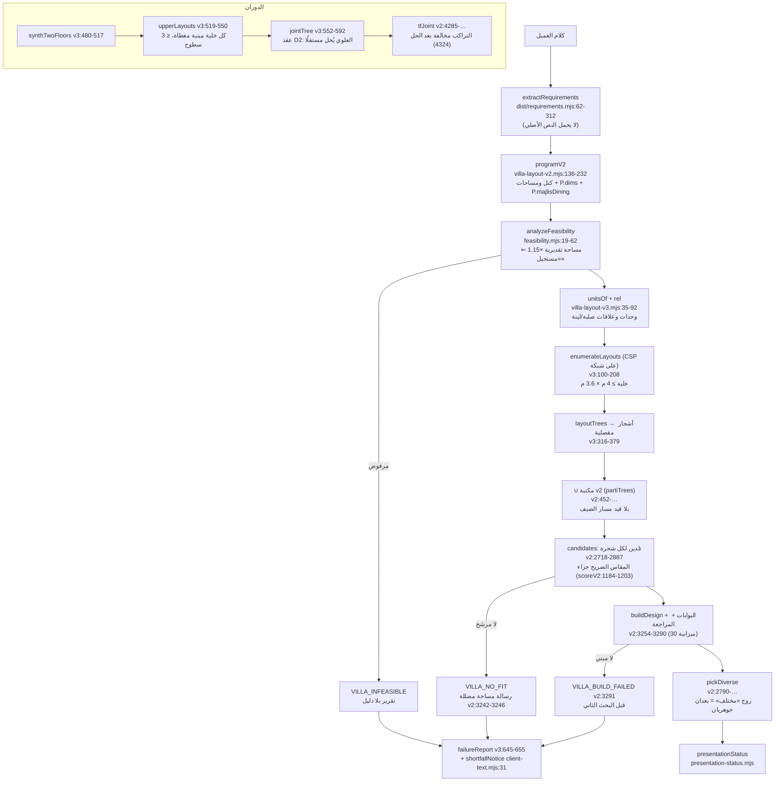
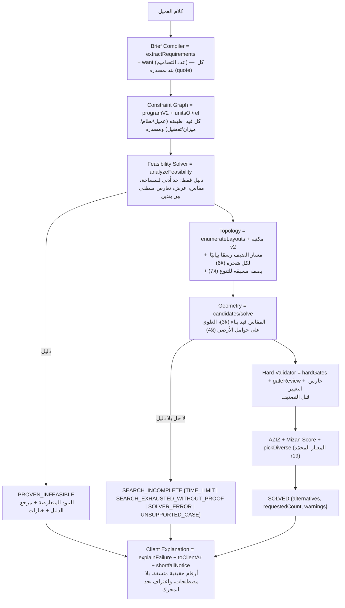

<div dir="rtl">

# تشخيص المحرك الثالث — الجولة 21 (من الشيفرة وسجلات التشغيل)

> **تنبيه:** هذا تشخيص برمجي من سجلات تشغيل حقيقية، لا اعتماد معماري ولا إنشائي. المراجع «المستقل» في الجولات السابقة وكيل ذكاء اصطناعي، لا معماري مرخّص. **H11–H15 مختومة:** لم تُفتح ولم تُشغَّل، وأداة التشخيص ترفضها صراحة.

**الأساس المثبَّت:** المحرك المدمج في `dev/architect-v2` عند `3b212e7` — `evidence/diagnosis-r21/BASELINE.json` (بصمات 25 ملفًا من المحرك والتقييم والمتطلبات والاستحالة والاختلاف والعرض، والإعدادات)، أُودع في إيداع مستقل (`27ea3be`). **كل أرقام الأسباب الجذرية أدناه من هذا الأساس**، وكل أرقام الأسطر من شيفرته (`git show 3b212e7:<الملف>`).

**أدوات التشخيص (غير سلوكية):**
- `scripts/diagnose-r21.mjs <set> <id> [--root <نسخة>]` — سجل مرحلي لحالة: فهم الطلب ← بناء القيود ← بحث التنظيم ← توزيع الغرف وحل الأبعاد ← التحقق الهندسي ← الاختيار ← المهلة. يقرأ خطافات التشخيص الموجودة أصلًا في المحرك (`__v2dbg`، `__v2rej`، `__v2poolDocs`، سجل البحث `engine3.search`)، ولا يضيف شيفرة إلى المحرك.
- `scripts/coverage-r21.mjs` — مقياس التغطية على العينة المجمّدة (`evidence/coverage-r21/SAMPLE.json`).
- **الحياد:** `scripts/instrumentation-neutrality.mjs` يشغّل الحالات بلا سجل وبالسجل في عمليتين ويقارن بصمات المخططات والنتيجة دون الزمن — النتيجة في `evidence/diagnosis-r21/instrumentation-neutrality.json` (القسم 9).
- السجلات الخام لكل حالة: `evidence/diagnosis-r21/baseline-3b212e7/<set>-<id>.json`.

إعادة أي سجل (نسخة الأساس في مجلد منفصل):
```
git worktree add --detach /tmp/base 3b212e7 && ln -s $PWD/node_modules /tmp/base/node_modules
node scripts/diagnose-r21.mjs heldout2 H6 --root /tmp/base --label baseline-3b212e7
```

## 0) إيداعات سلوكية في الفرع قبل قرار «التشخيص أولًا» — للمراجعة

نُفّذت قبل وصول قرار المالك بإيقاف التعديلات حتى المراجعة. **باقية في إيداعات منفصلة، ولكل قاعدة مفتاح إيقاف** (`R14_OFF=<المفتاح>`) يعيد سلوك الأساس، وتُراجع مع هذا التشخيص. **لا أعدّها مقبولة قبل مراجعتكم.**

| الإيداع | ما يغيّره | الملفات والدوال | مفتاح الإيقاف | المشكلة (القسم) |
|---|---|---|---|---|
| `883dbe0` | المراجعة تقرأ «الطعام على المجلس» من بنود العميل كما يقرؤها المولّد؛ والبحث الثاني يُطلق حين لا يُبنى أي بديل؛ ومهلة البناء حتى ضعف الميزانية ما دام لا بديل | `villa-layout-v2.mjs`: `reviewRequest`، حلقة البناء في `generateVillaDesigns0` | `r21mdin`، `r21second`، `r21budget` | H6 (§2) |
| `72f523d` | المقاس الصريح قيد بناء: امتداد ثابت بجداريه الفعليين، وقطع بدقة 1 سم، ومخزن على امتداد المطبخ | `villa-layout-v2.mjs`: `solve`، `dimRun`، `fixExtOf`، `wallPair` | `r21dimfix` | H10 (§3) |
| `8c101b6` | عقد النتائج (SOLVED / PROVEN_INFEASIBLE / SEARCH_INCOMPLETE)، والاستحالة بحد أدنى مثبت أو تعارض منطقي، والمهلة الاختيارية، ومحرك الشرح، ولغة العميل، و«عدد التصاميم» من كلام العميل | `villa-layout-v3.mjs` (`classifyFailure`، `generate`، `fail`، `attach`)، `feasibility.mjs`، `infeasibility-report.mjs` (جديد)، `client-language.mjs` (جديد)، `client-text.mjs`، `presentation-status.mjs`، `requirements.mjs` (`want`)، `home-flow.mjs` (`provisional`) | `r21cf` (البحث المضاد) | الرسائل (§5) |
| `6c6c1a1` | قطوع العلوي تنجذب إلى خطوط جدران الأرضي؛ ونوع جناح النوم العلوي بجدرانه الطويلة على البعد الأقصر؛ والصالة العلوية والسطح فوق المجالس؛ وتسجيل أسباب رسوب تنظيمات الدورين | `villa-layout-v2.mjs` (`solve` فرع `dual`، `supportLines`، `snapToSupport`، `tfJoint`)، `villa-layout-v3.mjs` (`jointTree`، `upperLayouts`، `synthTwoFloors`) | `r21stack` | H4 (§4) |
| `6d3aaf3` | العلوي على «شبكة حوامل» الأرضي، والأرضي بالسلم يُركَّب من العلاقات، ودقة الشبكة 3.2 م، وإصلاح خلط الدرج `ST` بجناح النوم | `villa-layout-v2.mjs` (`upperExtrude`)، `villa-layout-v3.mjs` (`gridShapes`، `isSleepKey`، `source`) | `r21extrude`، `r21gstair`، `r21grid` | H4 (§4) |
| `fb31100` | جلسة التصميم: المرشح القريب من بديل معروض لا يحقق الطلب «تصميم جديد» لا «معروض أصلًا» | `design-session.mjs` (`shownThatAchieves`) | — | تراجع جلسة التصميم |
| `e6d6b7a` | أدوات التشخيص، وكاشف تناقض نصوص العميل، وأسماء الفحوص بالعربية | `scripts/*`، `infeasibility-report.mjs`، `client-language.mjs`، `presentation-status.mjs` | — | §5 |

**أثرها المقيس حتى الآن (الفرع قبل المراجعة، لا يُحتسب تعميمًا لأن الحالات معروفة):** H6 ← بديل «جاهز»؛ H10 ← بديل «جاهز»؛ H5 ← «جاهز» (كان محجوبًا)؛ H4 ← **ما زال بلا مخطط**؛ جلسة التصميم ← ناجح. التغطية على بذرة التطوير (قبل إيداعات الدورين): 15/40 مقابل 14/40 للأساس — **تحسن ضئيل**.

## 1) بنية المحرك الحالية (قبل) ومواضع الخلل



## 2) H6 — لا مخطط لطلب عادي (24×28، شارع غربي)

**الإعادة:** `node scripts/diagnose-r21.mjs heldout2 H6 --root <الأساس>` (27.8 ث).

**مرحلة الفشل: التحقق الهندسي (المراجعة بعد البناء)** — المراحل السابقة سليمة:

| المرحلة | السجل |
|---|---|
| فهم الطلب | البندان مفهومان: `near:dining/majlis «طعام قريب من المجلس»`، `place:kitchen:back «مطبخ في الخلف»` |
| بحث التنظيم | الشبكات 4×3: 46 صالحًا، 3×3: 10، 4×2: 8، 3×4: 28؛ يتسع بأبعاده 25 توزيعًا؛ اختير 20 |
| حل الأبعاد | 102 شجرة، 87 بلا حل (`suite-narrow` 22، `hall-aspect` 9، `family-via-beds` 9…) — بقي 15 مرشحًا |
| التحقق | **رُفض الخمسة عشر كلها**: «تعذّر وصل maid بالحركة» 7، «دورة مياه يومية لم تتسع» 6، **«المجلس يفتح مباشرة على صالة الطعام — طعام عائلي؛ اذكر «مقلط»» 4**، «مجلس النساء أضيق من 4.2 م» 3… |
| الخطأ | `VILLA_BUILD_FAILED` من v2:3291 — **قبل البحث الثاني** المصمم لقلة البدائل |

**السبب الجذري المثبت (تعارض قراءتين للطلب نفسه):**
1. المتطلبات لا تحمل نص العميل — `dist/requirements.mjs:308-312` يعيد `counts, extras, prefs, …, rules` بلا `text`.
2. المولّد يقرأ «الطعام قرب المجلس» من البنود فيفتح باب المجلس على الطعام ولا يسمّيه «المقلط» لأن العميل طلبه:
```
139:   P.majlisDining = majlisDiningAsked({ text: req.text || req.idea || '', rules: P.rules || [] });
1609:     let host = P.majlisDining || P.majlisDiningDefault ? rooms.find(x => x.kind === 'dining' && touch(m, x) >= 1.2) : null;
1614:     if (host && !P.majlisDining) { host.name = host.name.replace(/^صالة الطعام$/, 'صالة الطعام والمقلط'); host.mizanDining = true; }
```
3. المراجعة تقرأ النص وحده — وهو فارغ — فتعدّ الباب «طعامًا عائليًا»:
```
3632: function reviewRequest(requirements, land, counts) {
3633:   return { text: requirements?.text || requirements?.idea || '', counts: …, land: land || {}, prefs: requirements?.prefs || {} };
383:     const asked = majlisDiningAsked(request), bad = [], seen = [];   (plan-review.mjs)
389:   … o.type === 'dining' ? (guestDining(o) || asked) : …
```
4. وحين لا يُبنى شيء يُرمى الخطأ قبل البحث الثاني: `3291: if (!built.length) { const err = Error('تعذّر بناء أي بديل سليم من الأنماط المرشحة.'); … throw err; }`.

**الدليل:** بإصلاح القراءة وحدها (`883dbe0` مع `R14_OFF=r21budget,r21second`) أنتج المحرك لـ H6 بديلًا «جاهزًا» (`r31yrge:1yrgevg1`).

**التعديل المقترح (للمراجعة):**
```diff
 function reviewRequest(requirements, land, counts) {
-  return { text: requirements?.text || requirements?.idea || '', counts: …, land: land || {}, prefs: requirements?.prefs || {} };
+  const text = requirements?.text || requirements?.idea || '';
+  const majlisDining = majlisDiningAsked({ text, rules: requirements?.rules || [] }) || undefined;   // القراءة نفسها التي في programV2:139
+  return { text, counts: …, land: land || {}, prefs: requirements?.prefs || {}, ...(majlisDining ? { majlisDining } : {}) };
 }
```
و(منفصلًا) في `generateVillaDesigns0`: لا يُرمى `VILLA_BUILD_FAILED` قبل البحث الثاني إن لم يُبنَ شيء.
**الاختبار:** «طعام قريب من المجلس» ← بوابة `MAJLIS_PRIVACY` لا ترفض باب المجلس إلى الطعام في أي مرشح مبني؛ وH6 (معروفة) تنتج بديلًا غير محجوب. (لا يُحتسب تعميمًا.)

## 3) H10 — لا مخطط لمقاسات صريحة (25×30، شارع شرقي، «ثلاثة تصاميم»)

**الإعادة:** `node scripts/diagnose-r21.mjs heldout2 H10 --root <الأساس>` (12.3 ث).

**مرحلة الفشل: توزيع الغرف وحل الأبعاد.** بحث التنظيم سليم (4×3: 110 توزيعًا صالحًا، يتسع بأبعاده 43، اختير 28). **95 شجرة من 95 بلا حل**، وأكثر المخالفات: `dims:kitchen` 72، `dims:bedroom` 56، `dims:majlis` 44، `small:suite` 43. فلا مرشح أصلًا ⇐ `VILLA_NO_FIT`.

**السبب الجذري المثبت:** المقاس الصريح **هدف جزاء** للتلدين على أوزان الشجرة، لا قيد بناء — ودقته المطلوبة لا يبلغها التلدين:
```
171:  b.dimGross = { s: s + .2, l: l + .2 };                      // الصافي + 0.2 م جدارًا ثابتًا (programV2)
1190: const half = s => (expLen(q.r, solids, [s]) >= sideLen(q.r, s) - .05 ? EXT / 2 : INT / 2);   // التقييم بالجدار الفعلي 0.25 أو 0.12
1195: const tol = Math.max(0, (Number.isFinite(dm.tol) ? dm.tol : .05) - .08) …   // «4×4» سماحيته 0.05 ⇐ 0 في البحث
1201: pen += 400 * ex; if (ex > .04) bad('dims:' + key, ex);       // خطأ > 4 سم = مخالفة
375:  const sz = dist(L, n.b.map((b, i) => ({ min: suiteRun(b, cross), fix: 0, a: b.area * n.w[i] })));   // الامتداد بنسبة المساحة، لا بالمقاس
```
- القطوع تُقرَّب إلى شبكة 5 سم (`snap`)، والجدار المحسوب في الهدف (0.2) غير الجدار المقيس (0.12–0.25)، والضلعان مقترنان بعرض العمود كله — فبلوغ ضلعي ثلاث غرف معًا بخطأ ≤ 4 سم بالأوزان شبه مستحيل.
- **أُثبت:** سجل أفضل حل لكل شجرة (`__v2dbg.keepSol`) أظهر مطبخًا 4.2×4.2 م محوريًا يرسب (صافيه 3.95–4.08 بحسب جداريه).

**ثم الرسالة المضللة:** `3244: لم أجد توزيعًا مهنيًا … البرنامج بالمقاسات التصميمية المستهدفة يحتاج نحو 265 م²` — والمتاح 541 م²؛ فيُفهم أن المساحة السبب. ولم يُقرأ «ثلاثة تصاميم» (العدد المطلوب 4 افتراضيًا).

**التعديل المقترح (للمراجعة) — المقاس قيد بناء:**
```diff
 // solve(): فرع المنطقة وفرع القطع x/y
-  const sz = dist(L, n.b.map((b, i) => ({ min: suiteRun(b, cross), fix: 0, a: b.area * n.w[i] })));
+  const sz = dist(L, n.b.map((b, i) => ({ min: suiteRun(b, cross),
+               fix: dimRun(b, crossNet, wallPair(extStart, extEnd), dir),   // الصافي المطلوب + جداره الفعلي على الطرفين
+               a: b.area * n.w[i] })));
+  // القطع الثابت بدقة 1 سم لا 5 سم؛ والفائض في الضلع الآخر مخزن للمطبخ (على أي محور) أو دهليز المجلس
```
و`extractRequirements`: يقرأ «ثلاثة تصاميم/5 بدائل» إلى `want`.
**الاختبار:** طلب «مطبخ 4×4، مجلس 5×6، غرف 4×5 تقريبًا» على أرض تتسع ← بديل يحقق المقاسات طولًا وعرضًا في السجل (`verifyRequest`)؛ واختبار السجل نفسه طولًا وعرضًا (`tests/stage2-r21.test.mjs`: 5×7 ✓، 5×9 ✗، 3×7 ✗ — ناجح).

## 4) H4 — الدوران على أرض عريضة (20×25، شارع شرقي)

**الإعادة:** `node scripts/diagnose-r21.mjs heldout H4 --root <الأساس>` (25.8 ث).

**مرحلة الفشل: التحقق الهندسي للتراكب بين الدورين، وأصله في بحث التنظيم العلوي.**

| المسار | السجل |
|---|---|
| (أ) أرضي بالسلم من المكتبة + `upperFor` | 6 أشجار أرضية، 4 بلا حل؛ وما بُني رسب: «جدار في الدور الأول يمتد 6.5 م بلا جدار تحته» و5.55 م |
| (ب) تنظيمات مشتركة (`synthTwoFloors` + `tfTrees`) | 23 تنظيمًا رسب كلها: **`stack` 18، `ov` 5**، `majlis-short` 3 |

**السبب الجذري المثبت (ثلاثة):**
1. **العلوي يُحل مستقلًا عن جدران الأرضي** داخل كل عقدة مزدوجة: `v2:342-345` (`rec(n.g, r)` ثم `rec(n.u, r)` بلا أي معلومة عن جدران الأرضي)، والتراكب مخالفة تُقاس بعد الحل: `4324: if (st.run > 5.0) { viol++; … sol._tfwhy.add('stack'); }`. فالتلدين يبحث عن صدفة تقع فيها جدران العلوي على جدران الأرضي.
2. **توزيع العلوي يُجبر غرف النوم فوق المجالس:** `upperLayouts` يشترط تغطية كل خلية مبنية بوحدة علوية، والسطح المكشوف ≤ 3 خلايا (`v3:540`، `546: if (tUsed < 3)`)، وترتيب التراكب يعدّ المجلس حاملًا جيدًا لغرف النوم (`503: … under(r, ['KS', 'DN', 'S', 'W', 'M'])`). المجلس 5–6 م بلا جدران داخلية، فكل فاصل أو ممر فوقه > 5 م بلا حامل. (رُسمت أفضل الحلول: جدار الرواق العلوي فوق المجلس في كل حالة.)
3. **الأرضي بالسلم لا يُركَّب من العلاقات أصلًا:** `609: if (stair) return null;` — فالأرضي للدورين من مكتبة v2 وحدها (6 أشجار). وإزالة هذا السطر وحده تكشف خطأً كامنًا: `365: const sleepKeys = Object.keys(R).filter(k => k[0] === 'S');` يعدّ الدرج `ST` جناح نوم فيتعطل التحويل (`TypeError … sleepVariants`).

**ما جُرّب في الفرع (إيداعا `6c6c1a1` و`6d3aaf3`) ونتيجته الصادقة:** جذب القطوع إلى جدران الأرضي خفّض `stack` في H4 من 18 إلى 2؛ و«العلوي على شبكة حوامل الأرضي» ينتج توزيعات علوية كل أضلاعها محمولة، **لكن H4 ما زال بلا مخطط**: ما بقي يرسب في الأرضي نفسه (صالة 3.51 م أضيق من 4.2، مجلس 23.79 م² < 24) وفي تفصيل الأجنحة. **غير محلول.**

**التعديل المقترح (للمراجعة):**
```diff
 // v3 source(): الأرضي بالسلم يُركَّب من العلاقات (بعد إصلاح مفتاح جناح النوم)
-      if (stair) return null;
+      // (يُضم إلى المكتبة)
-  const sleepKeys = Object.keys(R).filter(k => k[0] === 'S');
+  const sleepKeys = Object.keys(R).filter(k => /^S\d$/.test(k));
 // v2 generateVillaTwoFloors0: العلوي بعد تفصيل الأرضي على شبكة حوامله
+  const ups = [...upperExtrude(g, G, U, site), ...upperFor(g, U, site, rules2, entry)];
+  // upperExtrude: إحداثيات حواف غرف الأرضي (+ خطوط وسيطة في الفواصل > 5 م)؛ بحث تراجعي بالوحدات: صالة علوية تلامس الدرج،
+  // ممرات 0–2 منها، غرف تلامسها ولها ضلع خارجي، وكل ضلع داخلي محمول بامتداد ≤ 5 م (الحد نفسه في الفحص)؛ وما بقي سطح
```
**الاختبار:** `tests-pending/r21-pending.test.mjs` §3: H4 (معروفة) ⇐ مخطط غير محجوب وكل جدار علوي محمول — **راسب الآن (متوقع)**. والتعميم يُقاس على حالات الدورين في العينة المجمّدة لا على H4.

## 5) صدق رسائل العميل (إشعارا H6 وH10)

**الإعادة:** النصان المحفوظان في `evidence/acceptance/after-20-heldout2/H6|H10/result.json` (`notice`).

**السبب الجذري المثبت:**
```
645: export function failureReport(e, feas, log) {
648:   if (log?.grids?.length) lines.push(`جُرّبت ${log.grids.map(g => `شبكة ${g.nc}×${g.nr} (القيود الصلبة متحققة في …)`)…`);   ← سجل البحث الداخلي نصًا للعميل
651:   lines.push('السبب من المولّد: ' + String(e.message || e));                                                                 ← رسالة الخطأ الداخلية (ومنها «يحتاج 265 م²»)
653:   lines.push('ما يمكن تغييره: ' + (… : 'تقليل عدد الغرف أو مساحاتها، أو دور ثانٍ، أو تخفيف بند موضع صريح.'));             ← خيارات ثابتة لا تتبع السبب المقيس
```
- الخيارات لا تُشتق من سبب الفشل، فيُقترح «تقليل الغرف» و«دور ثانٍ» والمساحة تكفي (H10: 541 مقابل 265).
- `analyzeFeasibility` يعلن «لا يمكن تحقيق الطلب» بمساحة تقديرية (`feasibility.mjs:33: if (gross > availA)`, ومعامل 1.15) — **ليست دليلًا**: حالات العينة R8 وR17 وR34 رُفضت «مستحيلة» بالأساس، وبالحد الأدنى المثبت لا تُرفض.
- لا فرق في الأساس بين «تعارض مثبت» و«لم يجد البحث»: كل الفشل خطأ واحد بتقرير واحد.

**الدليل الآلي:** `textContradictions` (`dist/infeasibility-report.mjs`) على الإشعارين المحفوظين: H10 ⇐ «المتاح 541 م² والمطلوب 265 م² ويقترح تصغير البرنامج»؛ H6 ⇐ «يقترح تصغير البرنامج أو دورًا ثانيًا بلا قياس يثبت ضيق المساحة»؛ و`clientLint` ⇐ «شبكة 4×3»، «القيود الصلبة»، «المولّد» (`tests/stage2-r21.test.mjs` — ناجح، يثبت أن الكاشف يلتقطهما).

**التعديل المقترح (نُفّذ في `8c101b6` — للمراجعة):** عقد النتائج الثلاث؛ «مستحيل» بدليل فقط (`area-lower-bound`: مجموع أصغر المقاسات المعتمدة > المتاح، `dimension-bound`، `width-bound`، `logical-contradiction` بين بندين يُسمَّيان)؛ ومحرك شرح (`explainFailure`) يذكر الأرقام الحقيقية ويحكم «المساحة تكفي/ضيقة/لا تكفي» ويشتق الخيارات من الأسباب المقيسة ومن «البحث المضاد» (إعادة البحث بتخفيف كل بند وحده)، ويعترف «لم يجد المحرك…» حين لا دليل؛ ومحوّل لغة العميل وقائمة مصطلحات ممنوعة.
**الاختبار:** `tests/stage2-r21.test.mjs` (العقد، والمهلة لا تُعدّ استحالة، والتعارض المنطقي، والاتساق، واللغة) — ناجحة على الفرع.

## 6) مسار الضيف (H1، H5، C7، H3)

**الإعادة:** `diagnose-r21.mjs heldout H1|H3|H5`، `main C7` على الأساس.

| الحالة | الحوض المبني | فيه `GUEST_DINING`/`MAJLIS_ISOLATED` | المعروض |
|---|---|---|---|
| H1 | 17 | `centralhall:ch1`، `centralhall:ch2` (مكتبة) | `r31fo67` مركّب: سليم، جاهز |
| H3 | **1** | `centralhall:ch2` (مكتبة) | محجوب بالاثنين |
| H5 | 1 | — | `split:s0r` محجوب (بند المقاس) |
| C7 | 1 | — | `frontstair:fsg3/uspine` (يحتاج تعديلات: `WET_STACK`) |
| C10 | 12 | 6 من 12 (`centralhall`، `courtyard`، `yoo:u0r`، `ell:l0r`) — كلها مكتبة | `sidecourt:sc0` |

**السبب الجذري المثبت:**
1. **وصلة الضيافة قيد في الأشجار المركّبة وحدها.** في بحث التنظيم: `v3:71 { a: 'M', b: 'DN', kind: 'touch', hard: true … }`، وفي الأبعاد `v2:1217 if (ctx.hardLink && …) bad('guest-link', …)` — و`hardLink` لا يُضبط إلا لأشجار v3 (`v3:466 … hardLink: !!(P.guestLink && …)`). **أشجار المكتبة (v2 `partiTrees`) بلا هذا القيد**، فتُبنى وتمر بالبوابات ثم تُحجب بعد البناء (`privacy-defects.mjs:166` `GUEST_DINING`) — نصف حوض C10 هدر.
2. **التلامس على الشبكة ليس بابًا:** القيد يضمن أن خليتي المجلس والطعام متجاورتان، لا أن على الجدار المشترك بعد التفصيل طولًا ≥ باب (الدهليز ودورة مياه الضيوف قد يأخذانه). الباب يُقرَّر في التفصيل (`v2:1609-1616`)، وإن لم يتسع يُكتب «منفصل تمامًا عن العائلة» فيصير `MAJLIS_ISOLATED`.
3. **H3:** بحث التنظيم لا يجد إلا 4 توزيعات صالحة (شبكة 3×4؛ صفر في الثلاث الأخرى)، و82 من 83 شجرة بلا حل (`corr-long` 57): فلا يبقى إلا شجرة المكتبة المعيبة. السبب: خلية واحدة لكل وحدة على شبكة خشنة لبرنامج من 9 وحدات بقيدين صريحين (موثّق في r20).

**التعديل المقترح (للمراجعة) — مسار الضيف رسمًا بيانيًا في مرحلة التنظيم:**
```diff
 // قبل حل الأبعاد، لكل شجرة (مركّبة ومكتبة): رسم الوحدات وتلامسها القابل لباب
+function guestRouteOK(tree, P) {   // العقد: وحدات بمناطقها (guest/family/service/neutral)، والوصلات: حواف مشتركة ≥ عرض باب + الدهليز
+  // BFS من مجلس الرجال إلى الطعام دون دخول عقدة منطقتها family؛ يُرفض المرشح قبل التلدين إن لم يوجد
+}
 // candidates(): ctxT.hardLink لكل شجرة يحقق برنامجها وصلة الضيافة (لا للمركّبة وحدها)
-  const ctxT = tr.foyerYard || tr.hardDress || tr.hardLink || tr.hardHall ? { … hardLink: !!tr.hardLink … } : ctx;
+  const ctxT = { …ctx, hardLink: !!(P.guestLink && P.men && P.dining.length) && !R14_OFF.has('r21link'), … };
 // scoreV2: طول الحافة المشتركة بين المجلس (أو دهليزه) والطعام ≥ DOOR_TOUCH + 0.9 مخالفة لكل الأشجار، ويُفحص الباب الهندسي بعد التفصيل
```
**الاختبار:** `tests-pending` §5: كل مرشح يدخل البناء في H3 (معروفة) بلا `GUEST_DINING`/`MAJLIS_ISOLATED` — **راسب الآن (متوقع)**؛ و`tests/stage2-r21.test.mjs`: H3-1 المحفوظ يُكشف ويُحجب، وC1 السليم لا يُنذَر — ناجح.

## 7) التنوع المعماري (C10 بديل من 5، والتكرار الحرفي والمعكوس)

**الإعادة:** `diagnose-r21.mjs main C10 --root <الأساس>` + تحليل الحوض (`__v2poolDocs`) بالمعيار المجمّد r19 (`dist/arch-criterion.mjs` `sameOrDifferent`).

| المرحلة | السجل |
|---|---|
| بحث التنظيم | 4 شبكات (3×4: 44 صالحًا…)، **يتسع بأبعاده 5**، اختير 5 ⇐ 8 أشجار مركّبة فقط مقابل 72 من المكتبة |
| حل الأبعاد | 88 شجرة، 67 بلا حل |
| التحقق | 22 مبنيًا بأنماط مختلفة، اجتاز 12 |
| الحوض (12) | 6 بمسار ضيف معيب، 3 بموقف ضحل، **5 سليمة**: `sidecourt:sc0`، `yoo:u0`، `split:s0r`، `r3zphx2:zphx2vg0`، `ell:l0` |
| الاختلاف بين السليمة الخمسة | **لا زوج «مختلف معماريًا»**: 6 أزواج «نسخة معدّلة» و4 «اختلاف جزئي» (بعد واحد جوهري: `zoning`) |

**السبب الجذري المثبت:**
1. **التنظيمات المختلفة فعلًا في الحوض هي ذات مسار الضيف المعيب** (الصالة المركزية، الحوش، U المعكوس) — فتُستبعد بحق؛ وما يبقى يتشارك الحركة والخصوصية نفسيهما (مدخل ← صالة ← نوم، المجلس أمامي على الطعام) ويختلف في توزيع المناطق وحده.
2. **بحث التنظيم المركّب يتقارب على قليل:** من 23 توزيعًا مختلفًا (بلا انعكاس) اتسع بأبعاده 5 (`dimFit`)، لأن أدنى أبعاد الوحدات (`unitMins`) على شبكة 4 م يرفض معظمها؛ والاختيار بجاكار ≥ 0.15 على بصمة التجاور (`v3:461`) لا يضمن اختلاف الحركة والخصوصية التي يقيسها المعيار.
3. **الاختيار صحيح ولا يحشو:** `pickDiverse` (`v2:2790-…`) يرفض أي زوج غير «مختلف» — فالنقص من المولّد لا من الاختيار.
4. **التكرار بين الحالات** (r20: C6-1≈C8-1، C8-3≈C9-3): المكتبة ما زالت نصف فضاء البحث وأكثر ما يُعرض منها.

**التعديل المقترح (للمراجعة):** (أ) قيد مسار الضيف لكل الأشجار (§6) فيتحول هدر الحوض إلى تنظيمات صالحة مختلفة؛ (ب) **تنويع البحث على أبعاد المعيار نفسه قبل الهندسة**: لكل توزيع مرشح بصمة مسبقة (موضع الضيافة، مسار الخدمة، نطاق العائلة، علاقة الفراغ المفتوح بالكتلة) ويُنتقى جشعًا أعلى جودة بشرط مسافة ≥ عتبة المعيار المجمّد بين البصمات المسبقة، ثم الهندسة لكل منها؛ (ج) دقة الشبكة (خلية 3.2 م) ليتسع بأبعاده عدد أكبر من التوزيعات. **لا عتبة جديدة**: المعيار المجمّد r19 كما هو.
**الاختبار:** `tests-pending` §6: C10 ⇐ ≥ 3 بدائل «مختلفة معماريًا» غير محجوبة — **راسب الآن (متوقع)**؛ و`tests/stage2-r21.test.mjs`: النسخة المعكوسة ليست «مختلفة» — ناجح.

## 8) أسئلة المالك السبعة (المرحلة الأولى من الموجز)

| السؤال | الجواب من الشيفرة |
|---|---|
| أين تتحول المتطلبات إلى قيود؟ | `extractRequirements` (`requirements.mjs:62-312`) ← `programV2` (`v2:136-232`: كتل، `P.dims`، `P.rules`، `P.majlisDining`، الافتراضيات السعودية `saudiDefaults`) ← `unitsOf` (`v3:35-92`): وحدات وعلاقات `hard`/`soft`، وبنود الموضع الصريحة قيود صلبة (`v3:86-90`) |
| كيف تُنشأ العلاقات؟ | قائمة `rel` ثابتة في `unitsOf` (`v3:62-84`)؛ بنود العميل تُضاف إليها بالخريطة `MAP` (`v3:86`) |
| كيف تنتقل إلى إحداثيات؟ | `enumerateLayouts` (CSP على شبكة، `v3:124-208`) ← `layoutTrees` (شجرة مقصلية، `v3:316-379`) ← `candidates` (تلدين الأوزان، `v2:2718-2887` و`solve` `v2:338-…`) ← `realizeV2` (تفصيل الأبواب والأشرطة، `v2:1500-…`) |
| لماذا تفشل H4/H6/H10؟ | §4، §2، §3 |
| كيف يميز بين التعارض وفشل البحث؟ | **لا يميز في الأساس**: `analyzeFeasibility` تقديري، وكل فشل بعده خطأ بتقرير واحد (`failureReport`). العقد المقترح في §5 |
| أين الجودة والتنوع؟ | الجودة: `scoreV2` (`v2:965-…`) في البحث، و`gateReview`/`plan-review` بعد البناء، و`presentationStatus` للعرض، وMizan Score/AZIZ في المراجعة الكاملة (`finalReview`). التنوع: `pickLayouts`/`synthTrees` (`v3:251`، `455-468`) و`pickDiverse` (`v2:2790-…`) بالمقياس v2 |
| كيف تُنشأ رسائل العميل؟ | `shortfallReason` (`v2:3589-…`) و`failureReport` (`v3:645-655`) و`shortfallNotice` (`client-text.mjs:31-…`) |

## 9) أداة القياس: التغطية على العينة المجمّدة (الأساس)

العينة: `evidence/coverage-r21/SAMPLE.json` (بذرتا `dev` و`eval`، 40 لكل منهما، بصمات العينة والمولّد). الأساس `3b212e7`، بلا مهلة زمنية (ميزانيات حتمية)، عمليتان على نواتين.

المصدر: `evidence/coverage-r21/baseline-3b212e7-{dev,eval}.json` والملخص `baseline-3b212e7-report.json` (`node scripts/coverage-report-r21.mjs baseline-3b212e7`).

| المؤشر | بذرة التطوير (dev) | بذرة القياس (eval) |
|---|---|---|
| الحالات | 40 (30 دور، 10 دوران) | 40 (29 دور، 11 دوران) |
| **مخطط صالح** (بديل معروض غير محجوب) | **14 (35٪)** — دور 14/30، دوران **0/10** | **9 (22.5٪)** — دور 8/29، دوران 1/11 |
| كل المعروض محجوب بمخالفة إلزامية | 7 | 6 |
| «مستحيل» أعلنه الأساس | 3 | 7 |
| منها له دليل بالحد الأدنى المثبت | **0** | **0** |
| فشل البحث بلا دليل | 16 | 18 |
| البدائل المختلفة معماريًا والصحيحة (المعيار r19) | 29 من 149 مطلوبة (متوسط 0.73 لكل حالة) | 15 من 146 (0.38) |
| توزيع الحالات بعدد البدائل المختلفة (0/1/2/3/4) | 26/4/7/1/2 | 31/5/2/2/0 |
| الزمن لكل حالة (متوسط / أقصى) | 38 ث / 154 ث | 34 ث / 129 ث |
| أقصى ذاكرة للعملية | 1.39 ج.ب | 1.39 ج.ب |
| إشعارات العميل فيها مصطلح ممنوع | 29 من 38 | 27 من 39 |
| إشعارات فيها تناقض رقمي أو اقتراح بلا قياس | 13 من 38 | 16 من 39 |

**مرحلة الفشل (الحالات غير الصالحة):** dev — التحقق الهندسي 13، الاختيار (كل المعروض محجوب) 7، الاستحالة 3، توزيع الغرف 3؛ eval — التحقق 15، الاستحالة 7، الاختيار 6، التوزيع 3.

**أكثر أسباب الفشل تكرارًا (عددًا عبر الحالات):** «لا دور علوي يتسع» (dev 190، eval 149) والتراكب `stack` (116، 72)؛ مقاس صريح لم يُبلغ في حل الأبعاد `dims:bedroom` (181، 164) و`dims:kitchen` (123، 96) و`dims:majlis` (65، 109)؛ صالة ممرية `hall-aspect` (110، 156)؛ ممر نوم > 12.5 م `corr-long` (70، 122)؛ طعام شريطي `dining-strip` (91، 98)؛ بحر سقف > 6 م `slab-span` (83، 74).

**القراءة:** الفشل الأكبر في **الدوران** (1 من 21 حالة بمخطط صالح)، ثم **المقاسات الصريحة**، ثم **التنظيمات المعروضة كلها محجوبة** (مسار الضيف أو الموقف)؛ و**كل** «مستحيل» أعلنه الأساس (10 حالات) بلا دليل بالحد الأدنى — تقدير المساحة ×1.15 وحده.

**حياد أدوات التشخيص على العينة:** تشغيل `before21` (بلا سجل التشخيص) وتشغيل `baseline-3b212e7` (به) على النسخة نفسها أعطيا **النتيجة نفسها في 80 من 80** (الأنماط المعروضة وحالاتها أو رمز الخطأ). والمقارنة الحرفية لبصمات المخططات في القسم 12.

## 10) تغيير الطبقات بقرار المالك (للتطبيق بعد المراجعة)

قرار الاعتماد r21: موقع الماستر، وتطابق الحمامات بين الأدوار، وكبر الصالة **ليست شروطًا مطلقة** إلا بطلب العميل أو متطلب موثق، وكل قيد يُتتبع إلى مصدره.

| القياس | الموضع | الطبقة الآن | المقترح |
|---|---|---|---|
| `HALL_LT_MAJLIS` (الصالة أصغر من المجلس) | `r20-checks.mjs`، و`v2:1216` (`hardHall` مخالفة في أشجار v3) | عيب معماري يمنع «جاهز»، وقيد صلب في البحث | تفضيل لين يُذكر، إلا إن قال العميل «صالة أكبر من المجلس» (بند العميل يُقاس بالسجل) |
| `WET_STACK` (حمام علوي فوق فراغ جاف) | `privacy-defects.mjs` | عيب معماري (C7، H8 «يحتاج تعديلات») | ملاحظة «تحتاج مراجعة مختص» (صحي/إنشائي)، لا عيب يمنع «جاهز»، إلا بطلب صريح |
| الماستر على الواجهة بجوار مدخل العائلة | (غير مقيس؛ r20: C9-2) | — | تفضيل خصوصية لين في البحث، وإلزامي فقط بطلب العميل |

## 11) البنية المقترحة (بعد) — امتداد للوحدات الحالية لا منظومة موازية



## 12) حياد أدوات التشخيص (قرار المالك، الضابط الثاني)

- **الأداة:** `scripts/instrumentation-neutrality.mjs run off|on` في عمليتين منفصلتين على الأساس `3b212e7` (C1–C10، H1–H10، والعينة المجمّدة 80)، ثم `compare` لبصمات المخططات (sha256 للمستند المسلسل) والنتيجة دون الزمن.
- **النتيجة:** `evidence/diagnosis-r21/instrumentation-neutrality.json` — **متطابق حرفيًا في 100 من 100 حالة** (C1–C10، H1–H10، والعينة المجمّدة 80): بصمة كل مخطط معروض وملاحظاته، والأنماط، وحالات العرض، وسبب النقص، وعدد المحجوب والمرفوض، ورمز الخطأ ونصه. الملفان الخامان `neutrality-off.json` و`neutrality-on.json`.
- **اختبار دائم:** `tests/stage2-r21.test.mjs` «حياد التشخيص»: السجل مطفأ افتراضيًا، ولا يشغّله المحرك بنفسه، والنتيجة بالسجل وبدونه متطابقة حرفيًا (حالة معروفة صغيرة).

## ملحق أ) الملفات والدوال المعنية (الأساس 3b212e7)

| الملف | الدالة (الأسطر) | الدور |
|---|---|---|
| `dist/requirements.mjs` | `extractRequirements` (62–312)، `detectConflicts` (413–486) | فهم الطلب؛ لا يحمل النص (308–312)؛ كشف التعارض للحوار |
| `dist/feasibility.mjs` | `analyzeFeasibility` (19–62) | الاستحالة بالتقدير ×1.15 (26–37) |
| `dist/villa-layout-v3.mjs` | `unitsOf` (35–92)، `gridShapes` (100–106)، `enumerateLayouts` (124–208)، `pickLayouts` (251–258)، `sleepVariants` (262–314)، `layoutTrees` (316–379)، `synthTrees` (433–472)، `synthTwoFloors` (480–517)، `upperLayouts` (519–550)، `jointTree` (552–592)، `source` (596–621)، `generateVillaDesigns` (628–636)، `failureReport` (645–655) | العلاقات والقيود والتنظيم والدوران وتقرير الفشل |
| `dist/villa-layout-v2.mjs` | `programV2` (136–232)، `solve` (338–…)، `scoreV2` (965–…)، `realizeV2` (1500–…)، `candidates` (2718–2887)، `pickDiverse` (2790–…)، `generateVillaDesigns0` (3206–…)، `refineGuest` (3464–…)، `shortfallReason` (3589–…)، `reviewRequest` (3632–3634)، `pickReviewed` (3666–…)، `generateVillaTwoFloors0` (3828–…)، `upperFor` (3934–…)، `rectStack` (4139–…)، `tfTrees` (4171–…)، `tfJoint` (4285–…) | البرنامج والهندسة والتقييم والتفصيل والاختيار والدوران |
| `dist/plan-review.mjs` | `majlisDiningAsked` (242–247)، بوابة `MAJLIS_PRIVACY` (379–396) | المراجعة بعد البناء |
| `dist/privacy-defects.mjs` | `measureR16` (85–…)، `GUEST_DINING` (166)، `MANDATORY_R16` (37) | المخالفات الإلزامية |
| `dist/r20-checks.mjs` | `MAJLIS_ISOLATED`، `R20_MANDATORY` (21) | المجلس المعزول |
| `dist/presentation-status.mjs` | `presentationStatus` | حالة العرض بالطبقات |
| `dist/arch-criterion.mjs` | `sameOrDifferent` (23–27) | المعيار المجمّد r19 (لا يُغيَّر) |
| `dist/client-text.mjs` | `shortfallNotice` (31–…)، `INTERNAL_PATTERNS` (7–15) | إشعار العميل |
| `dist/structural-precheck.mjs` | `PRECHECK_LIMITS.bridgeMax = 5.0` (35) | حد الجدار بلا حامل (لم يُغيَّر) |

المقتطفات الحرفية بأرقام أسطرها في الأقسام 2–7 أعلاه.

## 13) ما لا يُدّعى

- لا تحسن في التعميم مثبت بعد: الحالات المعروفة (H1–H10) استُعملت في التشخيص، والمقياس الوحيد للتعميم بذرة `eval` في العينة المجمّدة بعد الإصلاحات المعتمدة.
- H4 غير محلول. والتنوع في C10 غير محلول.
- كل الحدود (5 م للجدار بلا حامل، 4.2 م للمجلس…) قيم الميزان التصميمية كما هي، لم يُخفَّف أي منها.

</div>
